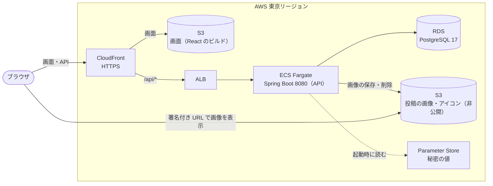

# タイムライン型 SNS アプリ（Raise timeline）

X（Twitter）のようなタイムライン形式のテキスト SNS です。ユーザー登録した人どうしでフォローし合い、文章と画像を投稿し、いいね・コメントで反応できます。**インプレッション数を出さないこと、リツイートがないこと**が特徴で、数字や拡散を気にせず投稿できるようにします。

学習用に、要件定義から設計・実装・テスト・AWS への公開・受け入れまでを一通り行いました。画面は React、API は Spring Boot、データは PostgreSQL、画像は AWS S3 に保存し、AWS（CloudFront・ALB・ECS Fargate・RDS・S3）で公開しました。

> **開発の状況**：[開発計画書](docs/development-plan.md)のすべて（全機能 FN-01〜FN-09、テスト、AWS への公開、受け入れ）を 2026-11-01 に終えました。受け入れでは、自動テスト（API 551 件・画面 331 件）と、7 つの環境での E2E テスト（85 件）がすべて合格し、公開先（AWS）で測った性能の目標（N-1〜N-5）もすべて満たしました（[検収書](docs/test/acceptance-report.md)、[性能テスト報告書](docs/test/performance-test-report.md)）。費用をかけないよう、受け入れの後に AWS の環境は消してあります。[基本設計書 2.2.1](docs/design/basic-design.md#221-公開環境の手順)の「初めて作るとき」の手順で作り直せます（公開の URL は作るたびに変わります）。

## 目次

- [主な機能](#主な機能)
- [画面](#画面)
- [構成](#構成)
- [工夫した点](#工夫した点)
- [開発の進め方](#開発の進め方)
- 開発者向け
  - [機能の一覧](#機能の一覧)
  - [技術スタック](#技術スタック)
  - [フォルダ構成](#フォルダ構成)
  - [起動方法](#起動方法)
  - [テストとコードチェック](#テストとコードチェック)
  - [API](#api)
  - [データベース](#データベース)
  - [公開環境](#公開環境)
  - [困ったとき](#困ったとき)
  - [開発ルール](#開発ルール)

## 主な機能

詳しくは[要件定義書の 8 章（機能一覧）](docs/requirements/requirements.md#8-機能一覧)と、機能ごとの機能定義書を見てください。

- **ユーザー登録・ログイン（JWT 認証）**：ユーザー ID とパスワードで登録・ログインする。ログインの状態は JWT で持ち、HttpOnly の Cookie に入れる。5 回続けて失敗したら 15 分間ログインできない。ログインしていないと何も使えない
- **タイムライン**：「フォロー中」（自分とフォローした人）と「すべて」（全員）のタブで、投稿を新しい順に 20 件ずつ出す
- **投稿と画像（AWS S3）**：280 文字までの文章に、画像を 4 枚まで（1 枚 5MB まで）添えて投稿する。画像は S3 に保存し、拡大して見られる
- **投稿の編集・削除**：自分の投稿の本文を直せる（画像は変えられない）。編集した投稿には「（編集済み）」と出す。削除すると画像・コメント・いいねも消える
- **いいね・コメント**：件数と中身（いいねした人・コメント）は誰でも見られる
- **フォロー**：承認なしでフォロー・解除する。フォロー中・フォロワーの一覧と件数は誰でも見られる
- **ユーザー検索**：ヘッダーの検索欄から、ユーザー ID・表示名の部分一致で探す
- **プロフィール**：プロフィールとその人の投稿の一覧（第 1 版）、アイコン画像・表示名・自己紹介の編集（第 2 版）。アイコンを設定していない人は表示名の頭文字を丸の中に出す

## 画面

画面は 11 個です（ログイン前 2・ログイン後 7・ダイアログ 2）。一覧と画面遷移は[画面一覧](docs/requirements/screens.md)、画面ごとのレイアウトは[画面設計書](docs/design/screen-design.md)にあります。

タイムライン画面（G-3）のイメージ：

```
┌──────────────────────────────────────────────────────────────┐
│ Raise timeline     [🔍 ユーザーを検索      ]  プロフィール  ログアウト │
├──────────────────────────────────────────────────────────────┤
│ ┌──────────────────────────────────────────────────────────┐ │
│ │ いまどうしてる？                                         │ │
│ │ [画像1 ×] [画像2 ×]                                      │ │
│ │ [画像を選ぶ]                             残り 248 [投稿する] │ │
│ └──────────────────────────────────────────────────────────┘ │
│   [ フォロー中 ]   すべて                                     │
├──────────────────────────────────────────────────────────────┤
│ (た) たろう  @taro_y · 3 分前（編集済み）                  … │
│      今日は晴れ。川沿いを散歩してきた                         │
│      ♡ 12   💬 3                                            │
└──────────────────────────────────────────────────────────────┘
```

| 画面 ID | 画面 | URL |
| --- | --- | --- |
| G-1 | ログイン | /login |
| G-2 | ユーザー登録 | /signup |
| G-3 | タイムライン | / |
| G-4 | 投稿の詳細（コメント） | /posts/{投稿 ID} |
| G-5 | いいねした人の一覧 | /posts/{投稿 ID}/likes |
| G-6 | プロフィール | /users/{ユーザー ID} |
| G-7 | プロフィールの編集（アイコン・表示名・自己紹介。第 2 版） | /settings/profile |
| G-8 | フォロー中・フォロワーの一覧 | /users/{ユーザー ID}/following、/followers |
| G-9 | ユーザー検索の結果 | /search?q={検索した文字} |
| G-10 | 画像の拡大（ダイアログ） | — |
| G-11 | 削除の確認（ダイアログ） | — |

### 画面のモック（Mock）

実装の前に画面と動きを確かめるため、HTML・CSS・JavaScript だけで作ったモックを [mock/](mock/) に置いています。**`mock/index.html` をブラウザで開くだけ**で、サーバーもデータベースも使わずに G-1〜G-11 の全画面を操作できます。

- ログイン：ユーザー ID `taro_y`、パスワード `password1`（ほかのサンプルユーザーも同じパスワード）
- データはブラウザのメモリ上のサンプルで、再読み込みすると元に戻ります（ログインの状態だけはブラウザに残ります）
- 左下の「モック操作」で、読み込み・送信の失敗（M-9・M-14・M-18）、通信切れ（M-20）、ログインの期限切れ（M-19）、削除された投稿（M-11）を再現できます
- 画像の URL の期限切れ（I-8）は、S3 を使わないため再現していません

## 構成

公開環境の構成です。詳しくは[インフラ設計書](docs/design/infra-design.md)にあります。



| 部分 | 使うもの |
| --- | --- |
| 画面 | React 19・TypeScript・Vite、画面の切り替えは React Router |
| API サーバー | Java 21・Spring Boot 4（Web MVC・Data JPA・Validation・Security・Actuator）、テーブルは Flyway で作成 |
| データベース | PostgreSQL 17（開発は Docker、公開環境は RDS）。ユーザー検索は pg_trgm の索引で速くする |
| 画像 | S3（自動テストは MinIO）、AWS SDK for Java 2.x |
| 公開環境 | AWS（CloudFront・ALB・ECS Fargate・ECR・RDS・S3・Parameter Store・CloudWatch）を Terraform で作成 |
| CI | GitHub Actions（PR ごとに画面・API・Terraform のチェックとテスト） |

画面（S3）と API（ALB）を同じ CloudFront の URL から配る（/api/* だけを ALB に送る）ので、JWT を入れる Cookie と CSRF 対策が簡単になり、CORS の設定も要りません。

## 工夫した点

設計で決め、そのとおりに作ったことです。

- **JWT を JavaScript から読めなくする**：JWT（15 分）とリフレッシュトークン（14 日）を HttpOnly の Cookie に入れ、XSS で盗まれないようにします。リフレッシュトークンはデータベースにハッシュだけを持ち、使うたびに新しくして、古いものが使われたら盗まれたとみなしてその人のログインを全部切ります（[機能定義書 3.2](docs/functions/function-definition.md#32-ログインjwt-認証と-csrf-対策)、[データ設計書 7 章](docs/design/data-design.md#7-データのルール) BR-9）
- **画像を API を通さずに配る**：S3 のバケットは非公開にし、API が発行した署名付き URL（15 分）で、ブラウザが S3 から直接読みます。API の負荷と通信量を抑えられます（[インフラ設計書 5.1](docs/design/infra-design.md#51-画像つきの投稿と表示)）
- **投稿と画像の保存を食い違わせない**：S3 への保存に失敗したら投稿を作らず、データベースへの保存に失敗したら S3 に置いた画像を消します。削除は データベース → S3 の順にし、S3 で消せなかったものは記録してあとで消します（[データ設計書 7 章](docs/design/data-design.md#7-データのルール) BR-4・BR-5）
- **部分一致の検索を索引で速くする**：ユーザー ID・表示名に pg_trgm の GIN 索引を張り、`LIKE '%…%'` でも全件を調べずに済むようにします。並びは「ID の完全一致 → 前方一致 → 表示名の前方一致 → それ以外」、同じならフォロワーの多い順です（[データ設計書 8 章](docs/design/data-design.md#8-ユーザー検索の実装)）
- **接続先だけを切り替える**：開発中はデータベースを Docker で動かし、画像は S3 の開発用のバケットに置きます。自動テストは Testcontainers で PostgreSQL と MinIO（S3 の代わり）を起動するので、AWS の鍵は要りません。接続先は環境変数で切り替え、開発環境と AWS でコードを変えません（[インフラ設計書 6 章](docs/design/infra-design.md#6-開発環境との対応)）
- **費用を抑える**：Fargate のタスクはパブリックサブネットに置き、ALB からの通信しか受け付けないようにして、NAT ゲートウェイ（月 7,000 円ほど）を使わずに済ませます。ALB は止められず置いておくだけで月 3,500 円ほどかかるので、使わない間は ECS のサービスと ALB を Terraform で消し、RDS を止めます。CloudFront は残すので URL は変わりません
- **文書を GitHub で読めるようにする**：文書はすべて Markdown で、図は Mermaid で書いています。差分を PR で確かめられます

## 開発の進め方

- **Issue → ブランチ → Pull Request → squash マージ**：文書 1 行の修正でも同じ流れにしています。main への直接のコミットは git フック（[.githooks/](.githooks/)）で止めます（[CONTRIBUTING.md](CONTRIBUTING.md)）
- **文書から作る**：要件定義書 → 機能定義書 → 基本設計書 → 技術スタック定義書の順に書き、実装はそれに合わせて進めました。実装の前に、画面の動きを[モック](#画面のモックmock)で確かめました。仕様が変わったら、実装と同じ PR で文書も直しました
- **機能ごとに API と画面を作る**：1 つの機能の API とそれを使う画面を作り終えてから、次の機能に進みました（[開発計画書](docs/development-plan.md)）
- **タスク管理アプリ（[kadai](https://github.com/y0408e0301-star/kadai)）と同じ技術・同じバージョン**：kadai で覚えたことをそのまま使い、新しく学ぶことを S3・JWT 認証・フォロー・検索に絞りました（[技術スタック定義書 4 章](docs/tech-stack.md#4-kadai-との違い)）
- **AI（Claude Code）を使った開発**：文書とコードの多くは AI のコーディングエージェント Claude Code と一緒に書いています（コミットの `Co-Authored-By` はそのためです）。開発ルールの中で動かし、方針の決定と、PR を確認してマージするかどうかの判断は自分で行いました。Claude Code 用のスキル（サーバーの起動・品質チェック）は [.claude/skills/](.claude/skills/) にあります

## 機能の一覧

機能の番号（FN-01 など）は[要件定義書の 8 章](docs/requirements/requirements.md#8-機能一覧)に対応しています。すべて API と画面を作り終えています（✅）。作った順番は[開発計画書](docs/development-plan.md)にあります。

| 機能 | 版 | 機能定義書 | API | 画面 |
| --- | --- | --- | --- | --- |
| FN-01 ユーザー登録・ログイン | 第 1 版 | [fn01-auth.md](docs/functions/fn01-auth.md) | ✅ | ✅ |
| FN-02 タイムライン | 第 1 版 | [fn02-timeline.md](docs/functions/fn02-timeline.md) | ✅ | ✅ |
| FN-03 投稿 | 第 1 版 | [fn03-post.md](docs/functions/fn03-post.md) | ✅ | ✅ |
| FN-04 画像 | 第 1 版 | [fn04-image.md](docs/functions/fn04-image.md) | ✅ | ✅ |
| FN-05 コメント | 第 1 版 | [fn05-comment.md](docs/functions/fn05-comment.md) | ✅ | ✅ |
| FN-06 いいね | 第 1 版 | [fn06-like.md](docs/functions/fn06-like.md) | ✅ | ✅ |
| FN-07 フォロー | 第 1 版 | [fn07-follow.md](docs/functions/fn07-follow.md) | ✅ | ✅ |
| FN-08 ユーザー検索 | 第 1 版 | [fn08-user-search.md](docs/functions/fn08-user-search.md) | ✅ | ✅ |
| FN-09 プロフィール（表示） | 第 1 版 | [fn09-profile.md](docs/functions/fn09-profile.md) | ✅ | ✅ |
| FN-09 プロフィール（編集） | 第 2 版 | 同上 | ✅ | ✅ |

## 技術スタック

バージョンと選んだ理由は[技術スタック定義書](docs/tech-stack.md)にあります。

| 部分 | 使うもの |
| --- | --- |
| 画面 | Node.js 24、React 19 + TypeScript 6 + Vite 8、React Router 7、CSS Modules、コードチェックは oxlint、テストは Vitest・Testing Library、E2E テストは Playwright |
| API サーバー | Java 21 + Spring Boot 4.1（Web MVC・Data JPA・Validation・Security・OAuth2 Resource Server（JWT）・Actuator）、AWS SDK for Java 2.x（S3）、ビルドは Maven（`mvnw` 同梱）、コードチェックは spring-javaformat・SpotBugs、テストは JUnit 5・Testcontainers |
| データベース・画像 | PostgreSQL 17（開発は Docker Compose）、テーブルは Flyway で作成。画像は S3（開発用のバケット） |
| 公開環境 | AWS（CloudFront・ALB・ECS Fargate（ARM・0.5 vCPU）・ECR・RDS db.t4g.micro・S3・Parameter Store・CloudWatch・Budgets）、環境は Terraform 1.16 で作成 |
| CI | GitHub Actions |

## フォルダ構成

```
raise-timeline/
├── backend/                    API サーバー（Spring Boot）。Dockerfile は公開先（ECS Fargate）のイメージ
├── frontend/                   画面（React + Vite）
├── docs/                       文書（最初に docs/README.md を読む）
│   ├── README.md               文書一覧・読む順番・ID の一覧
│   ├── requirements/           要件定義書（本体・画面一覧・データ要件）
│   ├── functions/              機能定義書（本体・FN-01〜FN-09）
│   ├── design/                 基本設計書（本体・画面・データ・インフラ）
│   ├── api/openapi.yaml        API の仕様書（コードから自動で作る）
│   ├── test/                   テスト仕様書・要件 ID とテストの対応表・性能テスト報告書
│   ├── manual/                 操作マニュアル（アプリを使う人向け）
│   ├── tech-stack.md           技術スタック定義書
│   └── development-plan.md     開発計画書（作る順番と進み具合）
├── perf/                       性能テストのデータ（seed.sql）と API のシナリオ（k6/）。画面の測定は frontend/perf/
├── deploy/terraform/           AWS の環境（Terraform）。止めている間のページは deploy/maintenance/
├── mock/                       画面のモック（HTML・CSS・JavaScript だけ。index.html を開く）
├── .claude/skills/             Claude Code のスキル（サーバーの起動・品質チェック）
├── .githooks/                  main へのコミットなどを止める git フック
├── .github/                    Issue・Pull Request のテンプレート、GitHub Actions（workflows/）
├── compose.yaml                開発用の PostgreSQL
├── CONTRIBUTING.md             開発ルール
└── CLAUDE.md                   Claude Code への指示
```

## 起動方法

データベース・API サーバー・画面・画像（S3 の開発用のバケット）は、この手順で動くことを確かめています。

### 必要なもの

- JDK 21
- Node.js 24
- Docker Desktop
- AWS CLI と、S3 の開発用のバケット（`rt-images-dev-{アカウント ID}`）を読み書きできる鍵（`aws configure` で `~/.aws/credentials` に入れる）。画像を扱わないなら無くても起動できます

### 初回だけ

```
git clone https://github.com/y0408e0301-star/raise-timeline.git
cd raise-timeline
git config core.hooksPath .githooks
```

`git config core.hooksPath .githooks` は開発ルールを守らせる git フックを有効にする設定です（[CONTRIBUTING.md](CONTRIBUTING.md)）。

### 起動する

ターミナルを 3 つ使い、それぞれリポジトリのフォルダから次を実行します。

| 順番 | 起動するもの | コマンド | ポート |
| --- | --- | --- | --- |
| 1 | データベース | `docker compose up -d` | 5432（PostgreSQL） |
| 2 | API サーバー | `cd backend` → `.\mvnw.cmd spring-boot:run` | 8080 |
| 3 | 画面 | `cd frontend` → `npm install`（初回のみ）→ `npm run dev` | 5173 |

- API サーバーは http://localhost:8080/actuator/health で `{"status":"UP"}` が返れば起動済みです
- API の仕様書は http://localhost:8080/swagger-ui.html （Swagger UI）で見られます（下の「API」）
- ブラウザで http://localhost:5173 を開き、「アカウントを作る」から登録します。画面から `/api` へのリクエストは、Vite の proxy で API サーバー（8080）へ転送します
- 画像は S3 の開発用のバケットに置き、ブラウザが署名付き URL（15 分）で S3 から直接読みます。バケットは `application.properties` の既定値（`S3_BUCKET` で変えられる）、鍵は `~/.aws/credentials` を使います
- ポートは上の表のものだけを使います（[CLAUDE.md](CLAUDE.md) の「サーバーのポート」）。使われていたら、そのポートを使っているプロセスを止めてから起動し直します（別のポートでは起動しません）
- 開発では、データベースの接続先と JWT の秘密の値は `backend/src/main/resources/application.properties` の既定値（開発用）を使うので、設定は要りません。公開環境では環境変数（`DB_URL`・`DB_USERNAME`・`DB_PASSWORD`・`JWT_SECRET`・`COOKIE_SECURE=true`）で渡します
- 接続先（データベースの URL、S3 のバケット名）は環境変数で渡します。パスワードなどは `.env` に書き、リポジトリには入れません

### 止める

- 画面・API サーバー：それぞれのターミナルで `Ctrl + C`
- データベース：`docker compose down`（データは残ります）

### 公開用の jar を作る

公開環境では、画面も API と同じ Spring Boot から配ります（[インフラ設計書 5.3](docs/design/infra-design.md#53-jar-から配る画面)）。

1. `frontend` で `npm run build`
2. `backend` で `.\mvnw.cmd clean package -Pwith-frontend`（画面をビルドしていなければ止まります）
3. `java -jar target\backend-0.0.1-SNAPSHOT.jar` で起動すると、http://localhost:8080/ で画面も使えます（API サーバーと同じ 8080 なので、開発用の API サーバーは止めておきます）

## テストとコードチェック

ツールとバージョンは[技術スタック定義書 3.5](docs/tech-stack.md#35-開発ツール)、テストの観点は各機能定義書の 10 章にあります。

| 対象 | コマンド（それぞれのフォルダで実行） | 内容 |
| --- | --- | --- |
| API サーバー | `.\mvnw.cmd verify` | テスト（下の「API サーバーのテストの種類」。DB は Testcontainers がテスト用の PostgreSQL を Docker で起動する）、書式チェック（spring-javaformat）、静的解析（SpotBugs）。API の仕様書（docs/api/openapi.yaml）がコードと違えば、書き直して失敗する |
| 画面 | `npm run gen:api` | API の仕様書から画面の型（src/api-schema.d.ts）を作り直す |
| 画面 | `npm run lint` | oxlint でコードをチェック。警告が 1 つでもあれば失敗する |
| 画面 | `npm test` | Vitest・Testing Library のテスト。サーバーは要らない |
| 画面 | `npm run build` | 型チェックと本番用のビルド |
| 画面 | `npm run test:e2e` | Playwright で、主な流れ・各機能のシナリオ・権限・ログインの続き・全画面のアクセシビリティと横幅を画面から確かめる（下の「画面を通したテスト」） |
| 画面 | `npm run perf -- <コマンド>` | 性能テスト。k6 と Playwright で、要件定義書 11.1 の目標の時間に収まるかを測る（下の「性能テスト」） |
| テスト仕様書 | `node scripts/requirement-coverage.mjs`（リポジトリのフォルダで） | テストに書いた要件 ID から、要件 ID とテストの対応表（docs/test/requirement-coverage.md）を作り直す。`--check` を付けると、テストのない要件 ID があるか、対応表が古ければ失敗する（[テスト仕様書](docs/test/test-specification.md) 2 章） |
| 公開環境 | `deploy/terraform` で `terraform fmt -check -recursive`・`terraform validate`・`tflint` | Terraform の書式・構文・書き方。AWS には接続しない |

Pull Request を作ったときは、GitHub Actions（[.github/workflows/ci.yml](.github/workflows/ci.yml)）が自動で実行します。いまは API サーバーの `mvnw verify` と、画面の `npm run gen:api`（作り直した型がコミットしたものと同じか）・`npm run lint`・`npm test`・`npm run build`、API の仕様書の HTML（成果物 `api-spec`）の作成、E2E テスト（ランナーの中で DB・MinIO・公開用の jar を起動して実行）、公開先のイメージのビルド（`docker build`。push はしない）、Terraform の `fmt -check`・`validate`・`tflint`、要件 ID とテストの対応の `--check` です（性能テストは自動では実行しません）。

### API サーバーのテストの種類

`mvnw verify` で、次の 5 種類をまとめて実行します。Controller・Service・Repository を 1 つずつ確かめるテストと、それらをつないで API を通して確かめるテストです。落ちたテストの種類で、どの層に原因があるかが分かります。

| 種類 | クラス名 | 確かめること | 本物を使うもの | 偽物にするもの |
| --- | --- | --- | --- | --- |
| 小さなクラスのテスト | `BodyTextTests`・`TimeCursorTests`・`ImageFormatTests` など | 入力の条件と境界値（280 文字と 281 文字など） | そのクラスだけ | なし |
| Service のテスト | `*ServiceTests` | 処理の順番、エラー、S3 やデータベースに失敗したときの後始末 | Service | Repository・S3・時計（Mockito） |
| Repository のテスト | `*RepositoryTests`（`@RepositoryTest`） | SQL の結果・並び順・件数、テーブルの制約 | PostgreSQL（Flyway でテーブルを作る） | なし（Controller・Service は動かさない） |
| Controller のテスト | `*ControllerTests`（`@ControllerTest`） | URL・ステータス・JSON の形、ログインと CSRF トークンが要るか、エラーの形 | Controller・ログインの確かめ方（SecurityConfig） | Service（`@MockitoBean`） |
| API のテスト | `*ApiTests` | 機能定義書 10 章の観点を、API を通して（Controller から DB・S3 まで） | すべて（S3 は MinIO） | なし |

- **開発用の DB（compose.yaml）と S3 の開発用のバケットは使いません。** DB を使うテストは、Testcontainers が使い捨ての PostgreSQL 17（と S3 の代わりの MinIO）を Docker で起動し、終わったら消します。Docker は動かしておいてください（開発用の DB は止めていても構いません）
- H2 などのメモリーの DB は使いません。ユーザー検索の pg_trgm や照合順序（`COLLATE "C"`）など、PostgreSQL にしかない機能を本番と同じ形で確かめるためです
- Repository のテストは、テストごとにトランザクションを巻き戻すので、データは残りません。API のテストは、テストの始めに表を空にします
- Controller のテストで、ログインした状態は `ControllerTestSupport.loggedIn(ユーザーの ID)` で作ります。spring-security-test の `jwt()` は CSRF の確認を飛ばすため使いません（本アプリは Cookie で JWT を送るので CSRF を確かめています）

### 画面のテストの種類

`npm test` で、次の 3 種類をまとめて実行します。どれもサーバーは要りません。API は `fetch` の偽物（[src/test/fetchMock.ts](frontend/src/test/fetchMock.ts)）が返します。

| 種類 | ファイル | 確かめること |
| --- | --- | --- |
| 関数のテスト | `api.test.ts`・`validation.test.ts`・`time.test.ts` | API の URL・メソッド・送る中身、JWT の取り直し、入力の条件と境界値、日時の表示 |
| 部品のテスト | `components/*.test.tsx`・`auth/*.test.tsx` | 部品を 1 つだけ描画して、表示・操作、素早く何度も押したとき、失敗したときに元に戻すこと |
| 画面のテスト | `pages/*.test.tsx`・`App.test.tsx` | アプリ全体を描画して、画面の移動と、機能定義書 10 章の観点 |

- 部品のテストは、[src/test/render.tsx](frontend/src/test/render.tsx) の `renderComponent` で描画します。ルーター・ログインしている自分・トーストを用意し、今の URL を「今の URL」という名前で画面に出します（移動したかを確かめるため）
- API の応答を待っている間の表示（押してすぐ「♥」にする、など）を確かめるときは、応答を止めておく偽物を使います。すぐ返す偽物だと、確かめる前に応答の値に戻ってしまいます

### 画面を通したテスト（E2E テスト）

[frontend/e2e](frontend/e2e) のテストは、Playwright でブラウザ（パソコンに入っている Microsoft Edge）を動かし、本物の API と DB につないで、利用者の操作の流れ（シナリオ）を確かめます。何人かのユーザーを別々のブラウザで操作し、操作の後に API で読んだ DB の中身と、相手の画面・読み直した画面も確かめます。

| ファイル | 確かめること |
| --- | --- |
| `main-flow.spec.ts` | 主な流れ（登録 → 投稿 → 検索 → フォロー → いいね・コメント）、ログアウトとログインし直し |
| `posts.spec.ts` | 投稿の編集・削除と確認ダイアログ（G-11）、280 文字の上限、画像 4 枚の投稿と拡大（G-10）・削除で画像も消える、コメントの削除 |
| `timeline.spec.ts` | 「フォロー中」「すべて」のタブ、一番下まで見たときの続きの読み込み、フォロー解除 |
| `profile.spec.ts` | プロフィールの編集（表示名・自己紹介・アイコン）、フォロー中・フォロワーの一覧 |
| `security.spec.ts` | ログインしていないと使えない（N-10）、他人のものを画面からも API からも変えられない（N-11）、本文の HTML が文字のまま出る（N-15）、5 回の失敗でロック（N-13） |
| `session.spec.ts` | JWT が切れてもリフレッシュトークンで使い続けられる、ログアウト後・使い回したリフレッシュトークンは使えない（A-8・N-25） |
| `screens.spec.ts` | すべての画面（G-1〜G-11）に、アクセシビリティの違反（axe-core。WCAG 2.1 の A・AA、N-18 のコントラスト比を含む）と横のスクロール（N-20）がない |

画面の幅は 2 通りで動かします（[playwright.config.ts](frontend/playwright.config.ts) の projects）。`pc`（1280px）ではすべてを、`mobile`（375px）では `main-flow.spec.ts` と `screens.spec.ts` を動かします。

使い方：

- 3 つのサーバー（DB・API・画面）を「起動方法」のとおりに起動してから、`frontend` で `npm run test:e2e` を実行します（1 分ほど）。1 つのファイルだけなら `npm run test:e2e -- posts`、片方の幅だけなら `-- --project=pc`
- 行き先は既定で画面の Vite（5173）です。環境変数 `E2E_BASE_URL` で変えられます（CI は jar の 8080）
- 環境変数 `E2E_BROWSERS=all` を付けると、Edge に加えて Chrome・Firefox・WebKit（Safari の代わり）・iPhone と Android のエミュレーションでも流します（[テスト仕様書](docs/test/test-specification.md) 3 章。Firefox と WebKit は先に `npx playwright install firefox webkit`）
- テストは開発用の DB にユーザーを作ります。ユーザー ID は `e2e_` で始まり、テストを始める前と終わった後に `docker compose exec` で DB から消します（投稿・いいね・フォローも一緒に消えます）
- 画像を使うテストは S3 の開発用のバケットに画像を置き、テストの中で投稿を消す・アイコンを外して消します。テストが途中で失敗すると、画像が残ることがあります
- 落ちたテストは `frontend/test-results/` にトレースが残ります。`npx playwright show-trace <trace.zip のパス>` で、操作ごとの画面を見られます

### 性能テスト

要件定義書 11.1 の性能（N-1〜N-5）を、要件の量のデータ（ユーザー 1,000 人・投稿 1 万件など）を入れて測ります。方針は[基本設計書 2.4](docs/design/basic-design.md#24-性能テスト)にあります。P95（小さい順に並べて 95% の位置の値）が目標以内なら合格です。時間がかかるので、Pull Request では動かしません。

| コマンド（`frontend` で実行） | 内容 | かかる時間 |
| --- | --- | --- |
| `npm run perf -- seed` | 性能テスト用の DB `raise_timeline_perf` にデータを入れ、タイムラインの画像 100 枚を S3 に置く。何回流しても同じデータになる | 約 1 分 |
| `npm run perf -- api` | k6 で、1 人で各 API を 50 回ずつ呼ぶ（N-2・N-3・N-5） | 約 30 秒 |
| `npm run perf -- load` | k6 で、30 人が同時に使う | 約 6 分半 |
| `npm run perf -- ui` | Playwright（Edge）で、パソコンとスマートフォンの幅で N-1・N-2・N-3・N-5 を 20 回ずつ測る。回線は下り 10Mbps・上り 30Mbps | 約 4 分 |
| `npm run perf -- mixed` | k6 で 30 人の負荷をかけながら、画面で N-1・N-2・N-3・N-5 を測る | 約 3 分 |
| `npm run perf -- all` | 上の 4 つを順にすべて動かし、結果を `perf/results/summary.md` にまとめる | 約 15 分 |
| `npm run perf -- clean` | データと S3 の画像を消す | 数秒 |

手元で動かす手順：

1. Docker Desktop を起動し、リポジトリのフォルダで `docker compose up -d`
2. 「公開用の jar を作る」の 1・2 で jar を作る
3. 8080 の API サーバー（`mvnw spring-boot:run`）が動いていれば止め、リポジトリのフォルダで `java -Xmx384m -jar backend\target\backend-0.0.1-SNAPSHOT.jar --spring.profiles.active=perf` を実行する（perf プロファイルは、開発用の DB ではなく `raise_timeline_perf` につなぐ。ポートは 8080 のまま）
4. `frontend` で `npm run perf -- seed`（初回は DB を作って止まるので、3 の API を起動し直してから、もう一度実行する。表は API の起動のときに Flyway が作る）
5. `npm run perf -- all`（または `api`・`ui` など 1 つずつ）

- k6 は Docker のイメージ（`grafana/k6:2.2.0`）で動くので、入れる必要はありません。Playwright はパソコンの Edge を使います
- 画像 4 枚（20MB）の投稿（N-4）は、`PERF_UPLOAD=1` を付けたときだけ測ります。手元では API から S3 への送信が家の回線を通るので、公開先とは条件が違うためです
- 測る回数は `PERF_RUNS`（既定 20）、測る先は `PERF_BASE_URL`（既定 `http://localhost:8080`）で変えられます
- 手元とランナーの数値は参考です。合否は公開先（AWS）で測った値で決めます（2026-11-01 に測り、すべて合格。[性能テスト報告書](docs/test/performance-test-report.md)）
- 公開先で測るとき：公開して（「公開環境」）、`frontend` で `PERF_DB=aws npm run perf -- seed`（PowerShell では `$env:PERF_DB='aws'; npm run perf -- seed`）で公開先の DB にデータを入れ、Actions の「性能テスト」を測る先に公開先の URL を入れて動かします。終わったら `PERF_DB=aws npm run perf -- clean` で消します

GitHub Actions で動かす：Actions の画面で「性能テスト」を選び、「Run workflow」を押します（[.github/workflows/perf.yml](.github/workflows/perf.yml)）。測る先を空にすると、ランナーの中で DB・MinIO（S3 の代わり）・jar を起動してデータを入れ、N-4 を含めてすべて測ります。公開先の URL を入れると、そこを測ります（先に公開先の DB に `perf/seed.sql` のデータを入れておき、終わったら `perf_` で始まるユーザーを消します）。結果は実行結果の画面の Summary と、成果物 `perf-results` で見られます。

## API

下の API はすべて作りました。API は機能定義書の「6. API（案）」で決めています。項目ごとの型・必須・条件は、コードから自動で作る API の仕様書（[docs/api/openapi.yaml](docs/api/openapi.yaml)、OpenAPI 3.1）にあります。共通の決まり（ログイン・CSRF・エラーの形・ページング）は[機能定義書 3 章](docs/functions/function-definition.md#3-共通の決まりapi)にあります。

| メソッド | パス | 内容 | 機能 |
| --- | --- | --- | --- |
| GET | `/api/auth/username-availability?username=` | ユーザー ID が使えるか | FN-01 |
| POST | `/api/auth/signup` | ユーザー登録 | FN-01 |
| POST | `/api/auth/login` | ログイン | FN-01 |
| POST | `/api/auth/refresh` | JWT の取り直し（リフレッシュトークンを使う） | FN-01 |
| POST | `/api/auth/logout` | ログアウト | FN-01 |
| GET | `/api/auth/me` | ログインしている自分 | FN-01 |
| GET | `/api/timeline?tab=&cursor=` | タイムライン（`following`・`all`） | FN-02 |
| POST | `/api/posts` | 投稿（multipart：本文と画像 0〜4 個） | FN-03・FN-04 |
| GET | `/api/posts/{id}` | 投稿の詳細 | FN-03 |
| PATCH | `/api/posts/{id}` | 投稿の本文の編集（自分のものだけ） | FN-03 |
| DELETE | `/api/posts/{id}` | 投稿の削除（自分のものだけ） | FN-03 |
| POST | `/api/images/urls` | 画像の署名付き URL を発行し直す | FN-04 |
| GET | `/api/posts/{id}/comments?cursor=` | コメントの一覧 | FN-05 |
| POST | `/api/posts/{id}/comments` | コメントする | FN-05 |
| DELETE | `/api/comments/{commentId}` | コメントの削除（自分のものだけ） | FN-05 |
| PUT / DELETE | `/api/posts/{id}/like` | いいね・取り消し | FN-06 |
| GET | `/api/posts/{id}/likes?cursor=` | いいねした人の一覧 | FN-06 |
| PUT / DELETE | `/api/users/{username}/follow` | フォロー・解除 | FN-07 |
| GET | `/api/users/{username}/following?cursor=` | フォロー中の一覧 | FN-07 |
| GET | `/api/users/{username}/followers?cursor=` | フォロワーの一覧 | FN-07 |
| GET | `/api/search/users?q=&offset=` | ユーザー検索 | FN-08 |
| GET | `/api/users/{username}` | プロフィール | FN-09 |
| GET | `/api/users/{username}/posts?cursor=` | その人の投稿の一覧 | FN-09 |
| PATCH | `/api/me/profile` | プロフィールの編集（第 2 版） | FN-09 |
| PUT / DELETE | `/api/me/icon` | アイコン画像の設定・外す（第 2 版） | FN-09 |

- ログインがいらないのは、ユーザー登録・ログイン・JWT の取り直し・ユーザー ID の確認の 4 つだけです。それ以外は JWT（Cookie の `access_token`）がなければ 401 を返します
- JWT の期限（15 分）が切れると 401 `TOKEN_EXPIRED` を返し、画面は `/api/auth/refresh` で取り直してから元の操作をやり直します
- GET 以外は CSRF トークン（Cookie の `XSRF-TOKEN` を `X-XSRF-TOKEN` ヘッダーで送り返す）を確かめます
- 一覧は 20 件ずつ（コメントは 50 件）で、続きは前回の `nextCursor` を `cursor` に渡して読みます
- エラーは HTTP ステータスと次の JSON で返します。画面は `message` をそのまま出します

```json
{"code": "USERNAME_TAKEN", "message": "このユーザー ID は使われています。", "field": "username"}
```

### API の仕様書（OpenAPI）

仕様書は API のコード（Controller と record）から springdoc-openapi で作ります。手で直しません（[基本設計書 2.1.1](docs/design/basic-design.md#211-api-の仕様書openapi)）。

| 見たいもの | 方法 |
| --- | --- |
| 開発中に見る・試す | API サーバーを起動して http://localhost:8080/swagger-ui.html を開く。「Try it out」でログイン（`POST /api/auth/login`）すると、そのあとの API も Cookie と CSRF のヘッダー付きで試せる |
| ファイルで読む | [docs/api/openapi.yaml](docs/api/openapi.yaml) |
| HTML で読む | GitHub Actions の実行結果の画面から、成果物 `api-spec` を取り出して `api-spec.html` を開く |

API を変えたときは、次の順に作り直してコミットします。

1. `backend` で `.\mvnw.cmd verify` を実行する。仕様書が変われば、`docs/api/openapi.yaml` を書き直してテストが失敗するので、もう一度実行して通ることを確かめる
2. `frontend` で `npm run gen:api` を実行し、画面の型（`src/api-schema.d.ts`）を作り直す。画面が使っている項目を変えたなら、`npm run build` の型チェックで直すところが分かる

- 仕様書と Swagger UI は、公開環境では出しません（`mvnw spring-boot:run` で起動したときの dev プロファイルだけで出します）
- record の項目は、`@Nullable` がなければ必須、あれば null になることがある、として仕様書に書きます。リクエストの項目の条件は `@Schema` で書きます

### ログ

API サーバーのログは、公開用の jar（`java -jar`）では 1 行 1 つの JSON（ECS 形式）で、開発中（`mvnw spring-boot:run`）は読みやすいテキストで出ます（[基本設計書 2.3](docs/design/basic-design.md#23-ログ)）。

- `/api/` のリクエストごとに `GET /api/auth/me 200 42ms` のような 1 行を出し、JSON ではリクエスト ID・ステータス・処理時間・ログインした人の ID を項目として持ちます
- リクエスト ID は応答のヘッダー `X-Request-Id` でも返します。不具合を調べるときは、ブラウザの開発者ツールでこの値を見て、ログを探します
- 5xx は ERROR、1 秒以上かかったリクエストは WARN で出します（閾値は `application.properties` の `app.logging.slow-request-threshold`）
- パスワード・JWT・Cookie・リクエストの本文・クエリ文字列は出しません

## データベース

テーブル定義・索引・データのルールは[データ設計書](docs/design/data-design.md)にあります。テーブルは Flyway で作ります（[backend/src/main/resources/db/migration/](backend/src/main/resources/db/migration/) の `V1__....sql` から順に。既存の SQL は書き換えず、新しいファイルを足します）。

| テーブル | 内容 | 主な列 |
| --- | --- | --- |
| `users` | ユーザー | `id`、`username`（一意）、`display_name`、`password_hash`（BCrypt）、`bio`、`icon_key`（アイコンの S3 のキー）、`failed_login_count`、`locked_until` |
| `posts` | 投稿 | `id`、`user_id`、`body`（280 文字まで）、`created_at`、`edited_at`（編集日時） |
| `post_images` | 投稿の画像 | `id`、`post_id`、`storage_key`（S3 のキー）、`content_type`、`byte_size`、`sort_order`（0〜3） |
| `comments` | コメント | `id`、`post_id`、`user_id`、`body`（280 文字まで）、`created_at` |
| `likes` | いいね | `user_id` と `post_id`（2 つで主キー）、`created_at` |
| `follows` | フォロー | `follower_id` と `followee_id`（2 つで主キー）、`created_at` |
| `refresh_tokens` | リフレッシュトークン | `id`、`user_id`、`token_hash`（SHA-256。一意）、`expires_at`、`revoked_at` |

## 公開環境

構成・セキュリティグループ・費用は[インフラ設計書](docs/design/infra-design.md)、手順は[基本設計書 2.2.1](docs/design/basic-design.md#221-公開環境の手順)にあります。

| コマンド（Git Bash） | すること |
| --- | --- |
| `bash deploy/deploy.sh` | 今のコミットの API（ECR）と画面（S3）を反映する。止めていれば起動もする |
| `bash deploy/start.sh` | RDS を起動し、ECS のサービスと ALB を作り直す |
| `bash deploy/stop.sh` | 「止めています」のページにして、ECS のサービスと ALB を消し、RDS を止める |

- AWS のリソースは Terraform（`deploy/terraform/`）で作ります。消して作り直すことが多いため、手作業では作りません
- 公開の URL は CloudFront を作ったときに決まり、stop.sh・start.sh で止めたり起動したりしても変わりません（`terraform destroy` で消すと変わります）。今は環境を消してあります
- 常に動かすと月 11,000 円ほどかかり予算（月 10,000 円）を超えるため、使う時間だけ動かします。AWS は無料プランのクレジットで動かしています
- API は `backend/Dockerfile` のイメージ（ARM）を ECR に置いて動かし、画面はビルドしたファイルを S3 に置きます
- 公開の URL は CloudFront のもの（https://〜.cloudfront.net）で、独自ドメインは取りません。公開は検収のときだけ行い、終わったら環境を消します（要件定義書 17 章 U-2）

## 困ったとき

| 症状 | 原因と対処 |
| --- | --- |
| API サーバーが DB につながらずに止まる | データベースが起動していない。`docker compose up -d` を実行する（Docker Desktop が起動しているかも確認） |
| 「ポートが使われている」（`Port 8080 was already in use`、`EADDRINUSE` など） | 前に起動したサーバーが残っている。そのポートを使っているプロセスを止めてから起動し直す（PowerShell なら `Get-NetTCPConnection -LocalPort 8080` で PID を調べて `Stop-Process -Id <PID>`）。別のポートでは起動しない |
| 新しく追加した API が 404 になる | 古い API サーバーが動き続けている。止めてから起動し直す |
| 画像だけ表示されない・画像つきの投稿が M-14 になる | AWS の鍵がない・期限切れか、バケットの名前が違う。`aws sts get-caller-identity` と `aws s3 ls s3://rt-images-dev-{アカウント ID}` で確かめる。署名付き URL の期限（15 分）が切れたときは画面が自動で取り直す |
| `mvnw verify` が「Could not find a valid Docker environment」で失敗する | Docker Desktop が起動していない。起動してからもう一度実行する（テスト用の DB と MinIO を Docker で起動するため） |
| PowerShell で日本語が文字化けする | `[Console]::OutputEncoding = [Text.Encoding]::UTF8` を実行し、`Invoke-RestMethod` ではなく `curl.exe` を使う |
| コミットが「main への直接コミットは禁止」で止まる | 正常な動き。Issue を立ててブランチを切る（下の開発ルール） |

## 開発ルール

すべての変更は **Issue → ブランチ → Pull Request → squash マージ** の順で取り込みます。文書 1 行の修正でも同じです。作業前に [CONTRIBUTING.md](CONTRIBUTING.md) を必ず読んでください。

```
git switch main
git pull
git switch -c <種類>/<Issue 番号>-<短い説明>   # 例：feat/12-post-api
# 変更してコミット
git push -u origin <ブランチ名>
gh pr create                                   # 本文に Closes #<Issue 番号>
```

- main への直接コミット・push、force push、`--no-verify` は禁止です（git フックで止まります）
- 文書の書き方（版数・改訂履歴・ID）は [docs/README.md](docs/README.md) に従います
- Claude Code で作業するときの指示は [CLAUDE.md](CLAUDE.md) にあります
