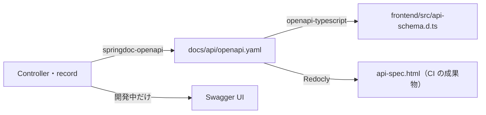

# 基本設計書：タイムライン型 SNS アプリ（Raise timeline）

| 項目 | 内容 |
| --- | --- |
| 文書番号 | RT-BD |
| 版数 | 0.13 |
| 作成日 | 2026-10-16 |
| 最終更新日 | 2026-10-28 |
| 作成者 | （氏名） |
| 元にした文書 | [要件定義書](../requirements/requirements.md)（RT-REQ）版数 0.10、[機能定義書](../functions/function-definition.md)（RT-FD）版数 0.3 |
| 状態 | 承認待ち |

## 改訂履歴

| 版数 | 日付 | 内容 | 作成者 |
| --- | --- | --- | --- |
| 0.1 | 2026-10-16 | 初版。要件定義書 版数 0.2 の 7 章（画面設計）・8 章（ER 図とテーブル定義）を画面設計書・データ設計書に移し、インフラ設計書を追加 | （氏名） |
| 0.2 | 2026-10-16 | API の一覧・エラーの形・ページング・画像のアップロード（旧 2.1 API 設計）は機能定義書で決めたため、2.1 を「API の詳細設計」に変更 | （氏名） |
| 0.3 | 2026-10-16 | インフラ設計書を 0.2 にした（EC2 を t4g.micro に変更、Terraform に決定）。2.2 の「環境の作り方」を Terraform で作る前提に変更 | （氏名） |
| 0.4 | 2026-10-17 | JWT 認証・投稿の編集・アイコン画像に合わせ、画面設計書を 0.2、データ設計書を 0.2、インフラ設計書を 0.3 にした。2.2 に「JWT の秘密の値の変え方」と「期限切れのリフレッシュトークンの削除」を追加 | （氏名） |
| 0.5 | 2026-10-17 | ログインの失敗の数え方（BR-8）とパスワードの条件（A-3）に合わせ、データ設計書を 0.3、画面設計書を 0.3 にした | （氏名） |
| 0.6 | 2026-10-19 | 開発中の画像の保存先を S3 の開発用のバケットにしたことと、S3 から消せなかったファイルの表に合わせ、データ設計書を 0.4、インフラ設計書を 0.4 にした | （氏名） |
| 0.7 | 2026-10-23 | 公開の構成から ALB をなくし、CloudFront → EC2 にしたことに合わせ、インフラ設計書を 0.5 にした | （氏名） |
| 0.8 | 2026-10-23 | ユーザー検索の実装に合わせ、データ設計書を 0.5 にした | （氏名） |
| 0.9 | 2026-10-23 | 画面を jar に入れて配る方法に合わせ、インフラ設計書を 0.6 にした | （氏名） |
| 0.10 | 2026-10-24 | 2.1 の「入力・出力の項目の一覧」を、OpenAPI の形式でコードから自動で作ることに決めた（2.1.1） | （氏名） |
| 0.11 | 2026-10-24 | ログの形式（JSON。ECS 形式）・リクエストのログの項目・出さないもの・閾値を決めた（2.3）。インフラ設計書を 0.7 にした | （氏名） |
| 0.12 | 2026-10-27 | 性能テストの方針（道具・データ・測り方・判定・環境）を決めた（2.4） | （氏名） |
| 0.13 | 2026-10-28 | 画面の性能テストに N-2（タブの切り替え・続きの読み込み）と N-5（検索）を足した（2.4）。API だけでなく、利用者が押してから画面に出るまでも確かめるため | （氏名） |

## 承認

| 役割 | 氏名 | 承認日 | 署名 |
| --- | --- | --- | --- |
| 承認者 | | | |
| 作成者 | | | |

承認は、本書と 1.2 の詳細文書をまとめて行う。詳細文書を変えた場合は、その文書の版数を上げて改訂履歴に記録し、あわせて本書の版数を上げて改訂履歴に記録する。

---

## 1. 概要

### 1.1 本書の目的

要件定義書で決めた「何ができるか」をもとに、「画面がどう見えて、どう動くか」「どんなデータを、どんな形で持つか」「どこで、どんな構成で動かすか」を決める。

### 1.2 基本設計書の構成

基本設計書は、本書と次の詳細文書でできている。

| 文書 | 文書番号 | 内容 | 技術との関係 |
| --- | --- | --- | --- |
| 基本設計書（本書） | RT-BD | 全体の概要、表記のルール、これから行う設計、要件定義書に反映した事項 | |
| [画面設計書](screen-design.md) | RT-BD-SCR | 画面一覧、画面遷移図、共通仕様（色・文字・ボタン・メッセージなど）、画面ごとのレイアウト・表示項目・操作 | 技術に依存しない |
| [データ設計書](data-design.md) | RT-BD-DATA | 方針、エンティティ一覧、ER 図、テーブル定義、データのルール、CRUD 表、データ量の見積もり | PostgreSQL の型で書く（要件定義書 P-1） |
| [インフラ設計書](infra-design.md) | RT-BD-INFRA | AWS の構成図、ネットワーク、通信の許可、開発環境との対応、費用の目安 | AWS（CloudFront・EC2・RDS・S3）を前提とする（要件定義書 P-2・P-3） |

機能ごとの処理・API（案）・エラーは[機能定義書](../functions/function-definition.md)で定める。使う言語・フレームワーク・サービスは[技術スタック定義書](../tech-stack.md)で定める。文書の一覧は [docs/README.md](../README.md) にある。

### 1.3 表記のルール

本書と詳細文書に共通のルールである。

- 「A-1」「T-3」などの ID は機能定義書の要件 ID を、「FN-01」などは要件定義書 8 章の機能 ID を表す（どの文書で定めているかは [docs/README.md](../README.md) の ID 一覧を参照）
- 「（第 2 版）」と書いたものは第 2 版で作る。書いていないものは第 1 版で作る
- 図は Mermaid 記法かテキストで書く。VS Code で Mermaid を図として見るには、拡張機能「Markdown Preview Mermaid Support」を入れてプレビューを開く。GitHub ではそのまま図として表示される

---

## 2. これから行う設計

次の内容は、開発を始めるときに基本設計書の詳細文書として追加する。

### 2.1 API の詳細設計

API の一覧（URL・メソッド・入力・出力・主なエラー）、エラーの形、ページング、画像のアップロードの方法は、機能定義書（共通の決まりは 3 章、機能ごとは各文書の 6 章）で決めた。開発を始めるときに、次の内容を足す。

| 項目 | 内容 |
| --- | --- |
| 入力・出力の項目の一覧 | 機能定義書 6 章の「案」をもとに、項目ごとの型・必須・上限を表にする。OpenAPI の形式で、コードから自動で作ることにした（2.1.1） |
| 処理の分け方 | Controller・Service・Repository の分け方と、1 つのトランザクションにまとめる範囲（データ設計書 BR-4・BR-5） |
| 画面の部品の分け方 | 画面（G）ごとの React の部品と、共通の部品（投稿カード・ユーザーの行・ヘッダー） |

#### 2.1.1 API の仕様書（OpenAPI）

入力・出力の項目の一覧は、手で表を書かず、API のコード（Controller と record）から OpenAPI 3.1 の形式で自動で作る。手で書くと、API を変えたときに直し忘れて実装とずれるためである。

| 項目 | 決めたこと |
| --- | --- |
| 正本 | API のコード。仕様書は [docs/api/openapi.yaml](../api/openapi.yaml) に書き出してコミットし、Pull Request の差分で API の変更が分かるようにする |
| 作り方 | springdoc-openapi が Controller・record から作る。機能 ID のタグ（例：FN-03 投稿）・説明・リクエストの項目の条件は注釈で足す。record の項目は、`@Nullable` がなければ必須、あれば null になることがある、として書く |
| ずれの防ぎ方 | テスト（OpenApiExportTests）が仕様書を作り、コミットしたものと違えば書き直したうえで失敗する。画面の型（frontend/src/api-schema.d.ts）も仕様書から作り（openapi-typescript）、CI で作り直して違えば失敗する。API を変えて画面を直し忘れると、画面の型チェックで止まる |
| エラー | 全部の API に 4XX・5XX として ErrorResponse（機能定義書 3.3）を付ける。code の一覧は ErrorCode から作り、仕様書の説明に表で入れる。API ごとに返す code は各機能定義書 9 章のとおり |
| 見方 | 開発中は Swagger UI（http://localhost:8080/swagger-ui.html）で見て、そのまま API を試せる（ログインの Cookie と CSRF のヘッダーも送る）。CI は 1 ファイルの HTML（Redocly）を作り、成果物 api-spec にする |
| 公開先 | 仕様書（/v3/api-docs）と Swagger UI は出さない。API の一覧を外に見せないため。開発中だけ dev プロファイル（`mvnw spring-boot:run`）で出す |



### 2.2 運用設計

| 項目 | 内容 |
| --- | --- |
| 環境の作り方 | 開発環境（Docker Compose）と AWS の構築手順。AWS は Terraform で作る（インフラ設計書 8 章） |
| 表の変更の管理 | Flyway のマイグレーションの書き方と履歴の残し方 |
| 公開の手順 | ビルドから EC2 への配置、止め方・起動し直し方（要件定義書 P-4） |
| データベースのバックアップと復旧 | RDS の自動バックアップからの戻し方（N-7） |
| 不適切な投稿の削除 | データベースと S3 から消す手順（R-2）。不適切なアイコン画像も同じ |
| JWT の秘密の値の変え方 | 秘密の値が漏れた・漏れた疑いがあるときに、Parameter Store の値を変え、refresh_tokens を全部無効にして全員をログアウトさせる手順（R-7） |
| 定期の処理 | 期限切れのリフレッシュトークンの削除（BR-9）と、S3 から消せなかったファイルの削除（BR-5・BR-10）を 1 日 1 回動かす方法 |
| 費用の確認 | 月 1 回の確認手順と AWS Budgets の設定（R-1） |
| 障害時の対応 | 障害に気づく方法（CloudWatch）、利用者への連絡、復旧後の確認 |

### 2.3 ログ

API のログは、公開先では 1 行 1 つの JSON（構造化ログ）で標準出力に出す。CloudWatch Logs（インフラ設計書 3.3）で、文の中を探すのではなく、項目（ステータス・ユーザー・リクエスト ID など）で絞り込めるようにするためである。

| 項目 | 決めたこと |
| --- | --- |
| 形式 | ECS（Elastic Common Schema）。Spring Boot の標準の機能（`logging.structured.format.console=ecs`）で出し、ライブラリは足さない。項目の名前が決まっているので、ほかのツールでもそのまま読める |
| 出し方の切り替え | 既定（公開先の `java -jar`）は JSON。開発中（`mvnw spring-boot:run`。dev プロファイル）は、読みやすいテキストで出す |
| リクエストのログ | `/api/` のリクエストごとに 1 行出す（RequestLogFilter）。画面のファイルと `/actuator/health`（死活の確認で何度も呼ばれる）は出さない。401・403 も記録するため、Spring Security より前で動かす |
| リクエスト ID | リクエストごとに UUID を作り、そのリクエストの間に出るログすべてに `http.request.id` として付ける。応答のヘッダー `X-Request-Id` でも返し、利用者からの問い合わせのときにログを探せるようにする |
| 出さないもの | パスワード・JWT・Cookie・リクエストの本文・クエリ文字列（検索語など）。要件定義書 N-12 |

リクエストのログの項目（ECS の項目名）：

| 項目 | 内容 | 例 |
| --- | --- | --- |
| `message` | 人が読むための 1 行 | `GET /api/auth/me 200 42ms` |
| `log.level` | ログのレベル（下の閾値） | `INFO` |
| `http.request.id` | リクエスト ID | `5af00ed4-6c7d-42a8-a476-ea9bda3369ea` |
| `http.request.method` | メソッド | `GET` |
| `url.path` | パス（クエリ文字列を除く） | `/api/auth/me` |
| `http.response.status_code` | ステータス | `200` |
| `event.duration` | 処理にかかった時間（ECS の決まりでナノ秒） | `42880100` |
| `user.id` | ログインした人の ID（users.id）。ログインしていないとき、JWT を確かめる前に止めたとき（CSRF の 403）は付けない | `66` |

このほか、すべての行に `@timestamp`・`log.logger`・`service.name`（raise-timeline）・`service.version`・`process.thread.name`・`ecs.version` が付く。例外は `error.type`・`error.message`・`error.stack_trace` に入る。定期の処理のログは、件数を `deleted.count`、S3 のファイルを `storage.key` として出す。

閾値（一般的な値から始め、運用しながら見直す。値は application.properties）：

| 閾値 | 値 | 理由 |
| --- | --- | --- |
| ログのレベル（公開先） | ライブラリも本アプリも INFO 以上 | DEBUG は量が多く、CloudWatch Logs の費用が増えるため |
| ログのレベル（開発中） | 本アプリは DEBUG 以上、ライブラリは INFO 以上 | 開発中は細かく見たいため |
| リクエストのログのレベル | 5xx は ERROR、遅いリクエストは WARN、それ以外（4xx を含む）は INFO | 4xx は入力の誤り・ログインの切れなど利用者側の理由で起き、障害ではないため |
| 遅いリクエスト | 1 秒以上（`app.logging.slow-request-threshold`） | 利用者が待たされていると感じ始める目安。画像の送信は 1 秒を超えることがあるので、WARN が多ければ見直す |

CloudWatch Logs Insights での探し方の例：

```
fields @timestamp, message, user.id
| filter http.response.status_code >= 500 or log.level = "WARN"
| sort @timestamp desc
```

### 2.4 性能テスト

要件定義書 11.1 の性能（N-1〜N-5）を満たしているかを、決まった手順で何度でも測れるようにする。時間がかかり、毎回測る必要はないので、Pull Request ごとの CI では動かさず、必要なときに手元のコマンドか GitHub Actions のボタンで動かす。動かし方は README「性能テスト」に書く。

| 項目 | 決めたこと |
| --- | --- |
| 動かすとき | 手元：`frontend` で `npm run perf -- <コマンド>`（[frontend/perf/cli.ts](../../frontend/perf/cli.ts)）。GitHub Actions：「性能テスト」のワークフロー（[.github/workflows/perf.yml](../../.github/workflows/perf.yml)）をボタン（workflow_dispatch）で動かす。測る先の URL を空にするとランナーの中で API を起動して測り、公開先の URL を入れるとそこを測る |
| 判定 | P95 が目標値以内なら合格（要件定義書 11.1）。P50・P99・最大も記録する。P99 は回数の多い API の測定だけで意味を持つ |
| 結果 | `perf/results/summary.md` に 1 つの表でまとめる（GitHub Actions では実行結果の画面と成果物 `perf-results`）。リクエストごとの時間は、API のログ（2.3）の `event.duration` と、1 秒以上の WARN でも確かめられる |

道具（技術スタック定義書 3.5）：

| 層 | 道具 | 測るもの | 理由 |
| --- | --- | --- | --- |
| API | k6（Docker のイメージ grafana/k6） | N-2・N-3・N-5 の API の応答時間。30 人の同時アクセス | シナリオを JavaScript で書け、目標（`p(95)<1000` など）を外すと失敗で終わる。Docker で動くので、package.json にも pom.xml にも入れなくてよい |
| 画面 | Playwright（Edge） | N-1〜N-5 の、押してから画面に出るまで。LCP・CLS、最初に読む JS・CSS の大きさ | 要件の「表示されるまで」は、JavaScript の実行・描画・S3 からの画像を含むため、ブラウザで測る。Edge（Chromium）なら回線・CPU を遅くできる（CDP） |

データ（[perf/seed.sql](../../perf/seed.sql)）：

| 項目 | 決めたこと |
| --- | --- |
| 量 | 要件定義書 11.1 の条件：ユーザー 1,000 人・投稿 1 万件・コメント 3 万件・いいね 5 万件。測るユーザー（`perf_0001`〜`perf_0050`）は自分以外の 999 人をフォロー。新しい 1,000 件の投稿のうち 100 件に画像を 1 枚ずつ付ける |
| ユーザー | ユーザー ID は `perf_` で始め、パスワードはすべて同じ。k6 は 1〜30 番、画面の測定は 41〜44 番を使い、いいね・フォローを付けたり外したりしても互いに邪魔しない。測った後は元の状態に戻す |
| 置き場所（手元） | 開発用の DB を埋めないよう、同じ PostgreSQL（5432）の中の別の DB `raise_timeline_perf` に入れる。API は perf プロファイル（`application-perf.properties`）で、公開用の jar を 8080 で起動する（ヒープは EC2 と同じ 384MB）。画面は Vite ではなく jar に入れたビルド済みのものを測る |
| 置き場所（公開先） | 公開先の DB に入れて測り、終わったら消す（`perf_` で始まるユーザーを消すと、投稿などもまとめて消える） |
| 入れ直し | 乱数の種を決めているので、何回入れ直しても同じデータになる |

測り方：

| 種類 | 内容 | 合格の条件 |
| --- | --- | --- |
| API の基準の測定（`api`） | 1 人で、タイムライン（フォロー中・すべて・2 ページ目）・検索・いいね・フォローを順に 50 回ずつ呼ぶ | 各 API の P95 が目標以内（N-2・N-5 は 1 秒、N-3 は 0.5 秒） |
| 同時アクセス（`load`） | 30 人まで 1 分で増やし、5 分続ける。1 人ずつ、タイムラインを開く・続きを読む・検索・いいね・フォローを、2〜5 秒の間を置きながら繰り返す（要件定義書の想定は合わせて数十人） | 上と同じ。失敗した応答が 1% 未満 |
| 画面（`ui`） | パソコン（1280px）とスマートフォン（375px・CPU 4 倍遅く）で、N-1〜N-5 を 20 回ずつ測る。N-2 は「すべて」「フォロー中」のタブを押してから 20 件と、一番下まで見てから続きの 20 件、N-5 は検索欄で Enter を押してから結果の一覧まで（API の応答が届いた後に一覧がそろうまで）。回線は下り 10Mbps・上り 30Mbps・遅延 20ms | P95 が目標以内（N-1 は 3 秒、N-2・N-5 は 1 秒、N-3 は表示と確定の両方が 0.5 秒、N-4 は 10 秒）。N-2 の要件は API の応答だが、画面に出るまでも同じ 1 秒で見る。LCP・CLS・JS の大きさは参考 |
| 負荷の中の画面（`mixed`） | k6 で 30 人の負荷をかけながら、画面で N-1・N-2・N-3・N-5 を測る。混んでいるときに利用者が感じる時間を見る | 画面と同じ |

長い時間の耐久の試験や、急に人が増えたときの試験は行わない。想定する利用者が数十人のためである。

測る環境：

| 環境 | 使い方 |
| --- | --- |
| 手元 | シナリオを作るときと、遅くなっていないかの確認。数値は参考。N-4 は、API から S3 への送信が家の回線を通り公開先と条件が違うので、`PERF_UPLOAD=1` を付けたときだけ測る |
| GitHub Actions のランナー | 測る先を空にすると、ランナーの中で PostgreSQL・MinIO（S3 の代わり）・jar を起動して測る。N-4 も測る。ランナーは EC2（t4g.micro）より速いので、数値は参考 |
| 公開先（AWS） | 要件の合否を決める（3-3 の受け入れの材料）。公開した後（3-2c）に、データを入れてから測る |

---

## 3. 要件定義書に反映した事項

設計中に見つかった要件の不足と、その対応である。すべて要件定義書 版数 0.3 に反映済み。

| No | 対象 | 問題 | 対応 |
| --- | --- | --- | --- |
| Q-1 | 用語「文字数」 | 「見た目の 1 文字を 1 と数える」としていたが、PostgreSQL の文字列の長さはコードポイント単位で数えるため、画面と DB で数え方がずれる | コードポイント単位に変更（要件定義書 5 章） |
| Q-2 | ログイン | 誰でも登録できるのに、パスワードの総当たりへの対策がない | ログイン失敗の回数制限を追加（A-7、N-13、M-7） |
| Q-3 | 画像 | 署名付き URL は 15 分で切れるため、画面を開いたままだと画像が出なくなる | 自動で取り直す動きを追加（I-8） |
| Q-4 | タイムライン | 読み込みの途中にほかの人が投稿すると、「何件目から」の指定では同じ投稿が 2 回出る | 「この投稿より古いもの」で読み込むことを要件に追加（T-7） |
| Q-5 | ユーザー検索 | 部分一致だけでは、ユーザー ID を正確に入れた人が下に埋もれる | 並び順を追加（S-6） |
