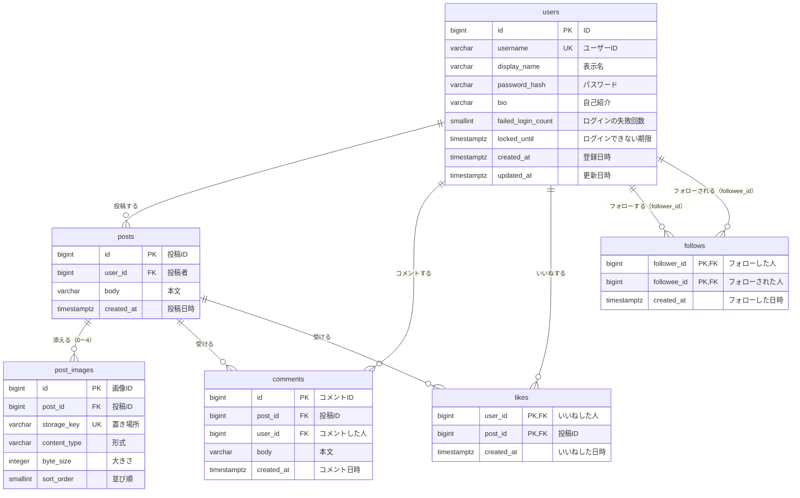

# データ設計書：タイムライン型 SNS アプリ（Raise timeline）

| 項目 | 内容 |
| --- | --- |
| 文書番号 | RT-BD-DATA |
| 版数 | 0.1 |
| 作成日 | 2026-10-16 |
| 最終更新日 | 2026-10-16 |
| 作成者 | （氏名） |
| 上位文書 | [基本設計書](basic-design.md)（RT-BD） |
| 元にした文書 | [データ要件定義書](../requirements/data-requirements.md)、[機能要件定義書](../requirements/functional-requirements.md)（要件定義書 版数 0.3） |
| 状態 | 承認待ち |

## 改訂履歴

| 版数 | 日付 | 内容 | 作成者 |
| --- | --- | --- | --- |
| 0.1 | 2026-10-16 | 初版。要件定義書 版数 0.2 の 8 章（ER 図とテーブル定義）をもとに作成。ログイン失敗の回数（A-7）の項目、ユーザー検索の索引（8 章）、CRUD 表、データ量の見積もりを追加 | （氏名） |

本書は基本設計書の一部である。承認は[基本設計書](basic-design.md)で一括して行う。表記のルールは基本設計書 1.3 のとおり。

データベースは PostgreSQL（要件定義書 P-1）とし、型は PostgreSQL の型で書く。バージョンは[技術スタック定義書](../tech-stack.md)のとおり。テーブルは Flyway のマイグレーションで作る。

---

## 1. 方針

| No | 方針 | 理由 |
| --- | --- | --- |
| 1 | 第 3 正規形を基本とする。いいね数・コメント数・フォロー数・フォロワー数・投稿数は列に持たず、その都度数える | 同じデータを 2 か所に持たないことで、食い違いを防ぐ。件数は 6 章の索引で速く数えられる |
| 2 | 各データの ID は、データベースが自動で付ける連番（bigint）とする | 投稿の ID の大きさで新しい順に並べ、「この ID より古いもの」で読み込む（T-2・T-7）。データはログインした全員に公開するため（要件定義書 3.1）、ID を推測されても困らない。他人のデータを変えられないことは BR-7 で守る |
| 3 | 削除は、データを実際に消す方式（物理削除）とする | 「元に戻す」機能がないため（N-19） |
| 4 | 日時はタイムゾーン付き（timestamptz）で保存し、画面では日本時間で表示する | 海外のサーバーを使っても時刻がずれないようにするため |
| 5 | 画像のファイルは S3 に置き、データベースには置き場所（キー）だけを持つ | 要件定義書 P-2。データベースを小さく保つ |
| 6 | いいね・フォローの表は、2 つの ID の組み合わせを主キーにする | 「1 人 1 投稿に 1 つ」（L-3）「同じ人を 2 回フォローしない」（F-4）をデータベースで守る |

## 2. エンティティ一覧

| 論理名 | 物理名 | 内容 | 件数の目安 | 版 |
| --- | --- | --- | --- | --- |
| ユーザー | users | 登録した人 | 1,000 件 | 第 1 版 |
| 投稿 | posts | ユーザーの投稿 | 1 万件 | 第 1 版 |
| 投稿の画像 | post_images | 投稿に添えた画像の置き場所 | 1 投稿に 0〜4 件。合計 6,000 件 | 第 1 版 |
| コメント | comments | 投稿へのコメント | 3 万件 | 第 1 版 |
| いいね | likes | 誰がどの投稿にいいねしたか | 5 万件 | 第 1 版 |
| フォロー | follows | 誰が誰をフォローしているか | 5 万件 | 第 1 版 |

件数の目安は、要件定義書 11.1 の性能を測る条件と同じにした。

## 3. ER 図



線の記号の意味：`||` はちょうど 1、`o{` は 0 以上。follows は users と 2 本の線でつながる（フォローする側とされる側）。

## 4. テーブル定義

### 4.1 ユーザー（users）

| No | 論理名 | 物理名 | 型 | 必須 | キー | 初期値 | 説明 |
| --- | --- | --- | --- | --- | --- | --- | --- |
| 1 | ID | id | bigint | ○ | 主キー | 自動の連番 | 画面には出さない |
| 2 | ユーザー ID | username | varchar(15) | ○ | 一意（lower(username)） | | 登録したときの大文字・小文字のまま保存し、重複は小文字にして確かめる（A-2） |
| 3 | 表示名 | display_name | varchar(30) | ○ | | | |
| 4 | パスワード | password_hash | varchar(100) | ○ | | | BCrypt のハッシュ（N-12） |
| 5 | 自己紹介 | bio | varchar(160) | ○ | | 空文字 | 自己紹介がない状態は空文字 1 種類で表す |
| 6 | ログインの失敗回数 | failed_login_count | smallint | ○ | | 0 | A-7 |
| 7 | ログインできない期限 | locked_until | timestamptz | | | なし | 5 回続けて失敗した時刻の 15 分後（A-7） |
| 8 | 登録日時 | created_at | timestamptz | ○ | | 登録した時刻 | |
| 9 | 更新日時 | updated_at | timestamptz | ○ | | 更新した時刻 | |

### 4.2 投稿（posts）

| No | 論理名 | 物理名 | 型 | 必須 | キー | 初期値 | 説明 |
| --- | --- | --- | --- | --- | --- | --- | --- |
| 1 | 投稿 ID | id | bigint | ○ | 主キー | 自動の連番 | 新しい投稿ほど大きい。並び順と読み込みの位置に使う |
| 2 | 投稿者 | user_id | bigint | ○ | 外部キー（users） | | |
| 3 | 本文 | body | varchar(280) | ○ | | 空文字 | 画像がないときに空にしないことは API で確かめる（BR-2） |
| 4 | 投稿日時 | created_at | timestamptz | ○ | | 投稿した時刻 | |

投稿は編集できないため、更新日時は持たない。

### 4.3 投稿の画像（post_images）

| No | 論理名 | 物理名 | 型 | 必須 | キー | 初期値 | 説明 |
| --- | --- | --- | --- | --- | --- | --- | --- |
| 1 | 画像 ID | id | bigint | ○ | 主キー | 自動の連番 | |
| 2 | 投稿 ID | post_id | bigint | ○ | 外部キー（posts） | | |
| 3 | 置き場所 | storage_key | varchar(100) | ○ | 一意 | | S3 のキー。「posts/{UUID}.{拡張子}」。元のファイル名は使わない |
| 4 | 形式 | content_type | varchar(20) | ○ | | | image/jpeg・image/png・image/gif・image/webp のどれか |
| 5 | 大きさ | byte_size | integer | ○ | | | 1〜5,242,880 |
| 6 | 並び順 | sort_order | smallint | ○ | 一意（post_id と組み合わせ） | | 0〜3 |

### 4.4 コメント（comments）

| No | 論理名 | 物理名 | 型 | 必須 | キー | 初期値 | 説明 |
| --- | --- | --- | --- | --- | --- | --- | --- |
| 1 | コメント ID | id | bigint | ○ | 主キー | 自動の連番 | 古い順に並べるのに使う |
| 2 | 投稿 ID | post_id | bigint | ○ | 外部キー（posts） | | |
| 3 | コメントした人 | user_id | bigint | ○ | 外部キー（users） | | |
| 4 | 本文 | body | varchar(280) | ○ | | | トリム後 1 文字以上 |
| 5 | コメント日時 | created_at | timestamptz | ○ | | コメントした時刻 | |

### 4.5 いいね（likes）

| No | 論理名 | 物理名 | 型 | 必須 | キー | 初期値 | 説明 |
| --- | --- | --- | --- | --- | --- | --- | --- |
| 1 | いいねした人 | user_id | bigint | ○ | 主キー（第 1 列）・外部キー（users） | | |
| 2 | 投稿 ID | post_id | bigint | ○ | 主キー（第 2 列）・外部キー（posts） | | |
| 3 | いいねした日時 | created_at | timestamptz | ○ | | いいねした時刻 | G-5 の並び順 |

### 4.6 フォロー（follows）

| No | 論理名 | 物理名 | 型 | 必須 | キー | 初期値 | 説明 |
| --- | --- | --- | --- | --- | --- | --- | --- |
| 1 | フォローした人 | follower_id | bigint | ○ | 主キー（第 1 列）・外部キー（users） | | |
| 2 | フォローされた人 | followee_id | bigint | ○ | 主キー（第 2 列）・外部キー（users） | | follower_id と同じ値は入れられない（CHECK 制約。F-3） |
| 3 | フォローした日時 | created_at | timestamptz | ○ | | フォローした時刻 | G-8 の並び順 |

## 5. リレーションシップ定義

| 親 | 子 | 多重度 | 親を削除したときの子 | 説明 |
| --- | --- | --- | --- | --- |
| ユーザー | 投稿 | 1 対 0 以上 | 一緒に削除 | 退会の機能はない（U-3）。運用で削除する場合に備えて決めておく |
| ユーザー | コメント・いいね・フォロー | 1 対 0 以上 | 一緒に削除 | 同上 |
| 投稿 | 投稿の画像 | 1 対 0〜4 | 一緒に削除 | W-7。S3 のファイルは API が消す（BR-5） |
| 投稿 | コメント | 1 対 0 以上 | 一緒に削除 | W-7 |
| 投稿 | いいね | 1 対 0 以上 | 一緒に削除 | W-7 |

「一緒に削除」は、外部キーの ON DELETE CASCADE で行う。

## 6. 索引

主キーと一意の制約には自動で索引ができる。それ以外に次の索引を作る。

| テーブル | 列 | 使う場面 |
| --- | --- | --- |
| posts | (user_id, id DESC) | プロフィールの投稿一覧（PF-2）、「フォロー中」タブ（T-1） |
| comments | (post_id, id) | コメントの一覧と件数（C-3・C-6） |
| likes | (post_id, created_at DESC) | いいねした人の一覧と件数（L-5・L-6） |
| follows | (followee_id, created_at DESC) | フォロワーの一覧と件数（F-6） |
| users | lower(username) に pg_trgm の GIN 索引 | ユーザー検索の部分一致（S-4） |
| users | lower(display_name) に pg_trgm の GIN 索引 | 同上 |

「すべて」タブ（T-1）は posts の主キー（id）の索引を、「フォロー中」の follows は主キー（follower_id, followee_id）の索引を使う。

## 7. データのルール

| ID | ルール | 関連要件 |
| --- | --- | --- |
| BR-1 | 文字列は前後の空白を取り除いてから保存する。パスワードは取り除かない | A-2、A-4、W-2、C-2 |
| BR-2 | 投稿は、本文が 1 文字以上か、画像が 1 枚以上のどちらかを満たす。これは API で確かめる | W-3 |
| BR-3 | 1 つの投稿の画像は 4 枚まで。API で確かめ、sort_order（0〜3）の一意の制約でも守る | I-2 |
| BR-4 | 投稿と画像の保存は、全部成功するか全部やめるかのどちらかにする。S3 への保存に失敗したら投稿の行を作らず、行の保存に失敗したら S3 に置いたファイルを消す | I-5 |
| BR-5 | 投稿を削除するときは、先にデータベースから削除し、その後で S3 のファイルを消す。S3 から消すのに失敗したファイルは記録しておき、あとでまとめて消す | W-7、N-8 |
| BR-6 | いいね・フォローを重ねて登録しようとしたときは、エラーにせず「すでにある」として扱う（続けて押しても 1 つ。L-3・F-4）。取り消しも、ないものを消そうとしたときはエラーにしない | L-3、F-4 |
| BR-7 | 投稿・コメントの削除、いいね・フォローの取り消し、プロフィールの変更は、ログインしている本人のものだけを対象にする。これをサーバー側で確かめ、本人のものでなければ 403 を返す | N-11 |
| BR-8 | ログインに失敗したら failed_login_count を 1 増やし、5 になったら locked_until を 15 分後にする。locked_until より前はパスワードを確かめずに M-7 を返す。成功したら 0 に戻す | A-7 |

## 8. ユーザー検索の実装

S-3〜S-6 を次のように実現する。

```sql
-- :q は、トリムして先頭の @ を取り、小文字にした検索語
SELECT u.*
FROM users u
WHERE lower(u.username) LIKE '%' || :q || '%'
   OR lower(u.display_name) LIKE '%' || :q || '%'
ORDER BY
  CASE
    WHEN lower(u.username) = :q            THEN 1  -- ユーザー ID が完全に一致
    WHEN lower(u.username) LIKE :q || '%'  THEN 2  -- ユーザー ID が前方一致
    WHEN lower(u.display_name) LIKE :q || '%' THEN 3  -- 表示名が前方一致
    ELSE 4                                          -- それ以外の部分一致
  END,
  (SELECT count(*) FROM follows f WHERE f.followee_id = u.id) DESC,
  lower(u.username)
LIMIT 20 OFFSET :offset;
```

- 検索語に含まれる「%」「_」「\」は、LIKE の特別な記号として扱わないようにエスケープする
- pg_trgm の索引は 3 文字以上の検索語で効く。1〜2 文字のときは全件を調べるが、ユーザー 1,000 人なら N-5（1 秒以内）に収まる
- 検索結果は並び順が検索語ごとに変わるため、読み込みの位置はカーソルではなく件数（OFFSET）で指定する。検索中にユーザーが増えて 1 件ずれることは許す

## 9. CRUD 表

C ＝ 作成、R ＝ 読み取り、U ＝ 更新、D ＝ 削除

| 機能 | 要件 | users | posts | post_images | comments | likes | follows | S3 |
| --- | --- | --- | --- | --- | --- | --- | --- | --- |
| ユーザー登録 | A-1 | C R | | | | | | |
| ログイン | A-5〜A-7 | R U | | | | | | |
| タイムライン表示 | T-1〜T-8 | R | R | R | R | R | R | |
| 投稿 | W-1、I-5 | | C | C | | | | C |
| 投稿の削除 | W-7 | | D | D | D | D | | D |
| 投稿の詳細 | W-6 | R | R | R | R | R | | |
| 画像の表示 | I-6〜I-8 | | | R | | | | R |
| コメント | C-1 | | R | | C | | | |
| コメントの削除 | C-5 | | | | R D | | | |
| いいね・取り消し | L-1・L-2 | | R | | | C D | | |
| いいねした人の一覧 | L-5 | R | | | | R | R | |
| フォロー・解除 | F-1・F-2 | R | | | | | C D | |
| フォロー中・フォロワーの一覧 | F-6 | R | | | | | R | |
| ユーザー検索 | S-1〜S-9 | R | | | | | R | |
| プロフィール | PF-1〜PF-4 | R | R | R | R | R | R | |
| プロフィールの編集 | PF-5 | R U | | | | | | |

S3 の R は、署名付き URL を発行することを表す（ファイルを読むのはブラウザ）。

## 10. データ量の見積もり

日本語 1 文字を 3 バイトとして、2 章の件数で計算する。

| 対象 | 計算 | 量 |
| --- | --- | --- |
| 投稿 | 1 万件 ×（本文 280 文字 × 3 ＋ その他 約 100） | 約 10MB |
| コメント | 3 万件 ×（本文 280 文字 × 3 ＋ その他 約 100） | 約 30MB |
| いいね・フォロー | 10 万件 × 約 50 | 約 5MB |
| ユーザー・画像の行 | 7,000 件 × 約 500 | 約 4MB |
| 索引 | 表の量と同じくらい | 約 50MB |
| データベース全体 | | 約 100MB |
| S3 の画像 | 6,000 枚 × 平均 2MB | 約 12GB |

RDS の容量は最小の 20GB で足りる。S3 は 12GB で月 300 円程度（[インフラ設計書](infra-design.md) 7 章）。
