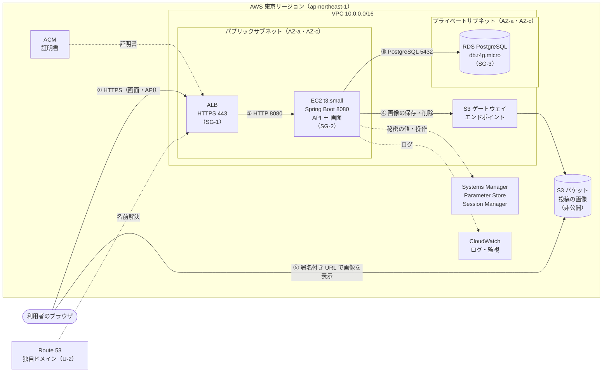
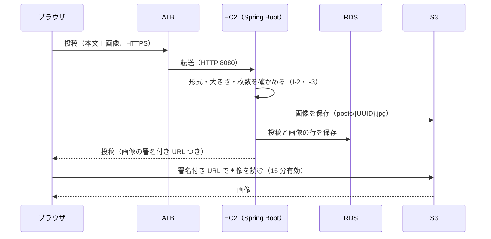

# インフラ設計書：タイムライン型 SNS アプリ（Raise timeline）

| 項目 | 内容 |
| --- | --- |
| 文書番号 | RT-BD-INFRA |
| 版数 | 0.1 |
| 作成日 | 2026-10-16 |
| 最終更新日 | 2026-10-16 |
| 作成者 | （氏名） |
| 上位文書 | [基本設計書](basic-design.md)（RT-BD） |
| 元にした文書 | [要件定義書](../requirements/requirements.md)（RT-REQ）版数 0.3 の P-2〜P-4・11 章 |
| 状態 | 承認待ち |

## 改訂履歴

| 版数 | 日付 | 内容 | 作成者 |
| --- | --- | --- | --- |
| 0.1 | 2026-10-16 | 初版。EC2・RDS・ALB・S3 を前提にした構成図を作成 | （氏名） |

本書は基本設計書の一部である。承認は[基本設計書](basic-design.md)で一括して行う。表記のルールは基本設計書 1.3 のとおり。

AWS に公開するかどうかは、まだ決めていない（要件定義書 U-2）。本書は、公開する場合の構成を先に決めておくものである。

---

## 1. 方針

| No | 方針 | 理由 |
| --- | --- | --- |
| 1 | ALB（ロードバランサー）→ EC2（サーバー）→ RDS（データベース）の基本の 3 層にし、画像は S3 に置く | 要件定義書 P-2・P-3。学習のため、Web アプリの基本の構成を一通り作る |
| 2 | EC2 は 1 台にする。画面（React をビルドしたファイル）も API と同じ Spring Boot から配る | 利用者は数十人で 1 台で足りる。同じ URL から配ればログインの Cookie と CSRF 対策が簡単になる |
| 3 | EC2 はパブリックサブネットに置くが、ALB からの通信しか受け付けない（SG-2）。SSH は開けず、操作は Session Manager で行う | プライベートサブネットに置くと、外へ出る通信のために NAT ゲートウェイ（月 7,000 円ほど）が要る。費用を抑えつつ、外から直接入れないようにする |
| 4 | RDS はプライベートサブネットに置き、EC2 からしか接続できないようにする。Multi-AZ にはしない | データベースは外から見えないのが基本。Multi-AZ は費用が 2 倍になり、学習用には要らない |
| 5 | S3 のバケットは非公開にし、画像は署名付き URL でブラウザに直接渡す | 要件定義書 N-14。画像を EC2 経由で送らないので、EC2 の負荷と通信量を抑えられる |
| 6 | パスワードなどの秘密の値は Systems Manager の Parameter Store に置き、EC2 には IAM ロールで権限を渡す | 要件定義書 N-16。アクセスキーをサーバーにもリポジトリにも置かない |
| 7 | 使わない間は EC2・RDS を止め、ALB を消せるようにする | 要件定義書 P-4。費用の大部分は動いている時間で決まる（7 章） |

## 2. 構成図

| 番号 | 通信 | 内容 |
| --- | --- | --- |
| ① | ブラウザ → ALB | 画面（HTML・JS）と API。HTTP（80）で来たら HTTPS（443）に移す |
| ② | ALB → EC2 | ALB で HTTPS を解いて、HTTP の 8080 で EC2 に送る |
| ③ | EC2 → RDS | PostgreSQL の 5432。VPC の中だけで通る |
| ④ | EC2 → S3 | 投稿された画像の保存と、投稿の削除に合わせた削除。S3 ゲートウェイエンドポイントを通るので、インターネットに出ない |
| ⑤ | ブラウザ → S3 | API が発行した署名付き URL（15 分）で、ブラウザが S3 から画像を直接読む |

## 3. リソース一覧

### 3.1 ネットワーク

| リソース | 名前 | 設定 |
| --- | --- | --- |
| VPC | rt-vpc | 10.0.0.0/16 |
| パブリックサブネット | rt-public-a / rt-public-c | 10.0.0.0/24（AZ-a）、10.0.1.0/24（AZ-c）。ALB は 2 つの AZ のサブネットが必要 |
| プライベートサブネット | rt-private-a / rt-private-c | 10.0.10.0/24（AZ-a）、10.0.11.0/24（AZ-c）。RDS のサブネットグループは 2 つの AZ が必要 |
| インターネットゲートウェイ | rt-igw | パブリックサブネットのルートに付ける |
| S3 ゲートウェイエンドポイント | rt-s3-endpoint | パブリック・プライベート両方のルートに付ける（無料） |

### 3.2 サーバー・データベース・ストレージ

| リソース | 名前 | 設定 |
| --- | --- | --- |
| ALB | rt-alb | インターネット向け。リスナー：443（ACM の証明書）→ ターゲットグループ、80 → 443 へ移す |
| ターゲットグループ | rt-tg | EC2 の 8080。ヘルスチェックは /actuator/health（200 を正常） |
| EC2 | rt-app | t3.small（2 vCPU・メモリ 2GB）、Amazon Linux 2023、EBS gp3 20GB。Java 21（Amazon Corretto）で Spring Boot の jar を systemd で動かす。パブリック IP あり（Session Manager と OS の更新のため） |
| RDS | rt-db | PostgreSQL（バージョンは技術スタック定義書）、db.t4g.micro、gp3 20GB、Single-AZ、パブリックアクセスなし、自動バックアップ 7 日（N-7）、保存時の暗号化あり |
| S3 バケット | rt-images-{アカウント ID} | パブリックアクセスをすべてブロック、保存時の暗号化（SSE-S3）、バージョニングなし。画像は posts/ の下に置く |
| ACM の証明書 | | 独自ドメインの証明書（U-2）。DNS で検証する |
| Route 53 | | 独自ドメインを ALB に向ける（エイリアスレコード）。U-2 で独自ドメインを取らない場合は 9 章の No.1 のとおり |

### 3.3 権限・秘密の値・監視

| リソース | 名前 | 設定 |
| --- | --- | --- |
| IAM ロール（EC2） | rt-app-role | S3：rt-images-{アカウント ID}/posts/* への PutObject・GetObject・DeleteObject のみ。Systems Manager：AmazonSSMManagedInstanceCore。Parameter Store：/rt/ の下の読み取り。CloudWatch：ログの書き込み |
| Parameter Store | /rt/db/password など | データベースのパスワード、セッションの秘密の値。SecureString（暗号化）で置く |
| CloudWatch Logs | /rt/app | Spring Boot のログ。30 日で消す |
| CloudWatch アラーム | | ALB のヘルスチェックの失敗、RDS の空き容量 2GB 未満で、メールを送る |
| AWS Budgets | rt-budget | 月の費用が予算（R-1）を超えそうなときにメールを送る |

## 4. セキュリティグループ（通信の許可）

受け付ける通信だけを書く。外へ出る通信はすべて許可する。

| ID | 付ける先 | 受け付ける通信 | 送り元 | 理由 |
| --- | --- | --- | --- | --- |
| SG-1 | ALB | TCP 443、TCP 80 | 0.0.0.0/0（どこからでも） | 利用者のブラウザから受ける。80 は 443 に移すためだけに開ける |
| SG-2 | EC2 | TCP 8080 | SG-1 のみ | ALB を通らない通信を受けない。SSH（22）は開けない（方針 3） |
| SG-3 | RDS | TCP 5432 | SG-2 のみ | EC2 からしか接続させない |

## 5. 処理の流れ

### 5.1 画像つきの投稿と表示

S3 への保存か、データベースへの保存のどちらかに失敗したときは、データ設計書の BR-4 のとおり全部やめる。

### 5.2 公開の手順（概要）

1. GitHub Actions で画面（Vite）をビルドし、Spring Boot の jar に含める
2. jar を S3 の配置用の場所に置く
3. Session Manager で EC2 に入り、jar を取ってきて systemd で起動し直す（Flyway が起動時にテーブルを更新する）
4. ALB のヘルスチェックが正常になったことを確かめる

詳しい手順は運用設計（基本設計書 2.2）で決める。

## 6. 開発環境との対応

開発中は AWS を使わず、手元の Docker Compose で同じ役割のものを動かす。ポートは CLAUDE.md の「サーバーのポート」のとおり。

| 役割 | 開発環境 | AWS |
| --- | --- | --- |
| 入口 | なし（ブラウザから直接） | ALB（443） |
| 画面 | Vite の開発サーバー（5173）。API への通信は 8080 に転送する | Spring Boot が配る（ビルドしたファイル） |
| API | Spring Boot（8080） | EC2 の Spring Boot（8080） |
| データベース | PostgreSQL のコンテナ（5432） | RDS（5432） |
| 画像の保存先 | MinIO のコンテナ（9000）。S3 と同じ使い方ができる | S3 |
| 秘密の値 | .env ファイル（リポジトリには入れない） | Parameter Store |

アプリは接続先（データベースの URL、S3 のエンドポイントとバケット名）を環境変数で受け取り、開発環境と AWS でコードを変えない（N-23）。

## 7. 費用の目安

東京リージョンで、1 か月（730 時間）動かし続けた場合の概算である。1 ドル 150 円で計算した。料金は変わることがあるため、構築の前に AWS Pricing Calculator で確かめ、結果を技術スタック定義書に記録する。

| サービス | 内容 | 月額（概算） |
| --- | --- | --- |
| ALB | 1 台 ＋ 少ない通信量 | 約 3,000 円 |
| EC2 | t3.small ＋ EBS 20GB ＋ パブリック IP | 約 3,900 円 |
| RDS | db.t4g.micro ＋ gp3 20GB ＋ バックアップ | 約 3,200 円 |
| S3 | 画像 12GB（データ設計書 10 章）＋ 読み出し | 約 300 円 |
| Route 53 | ホストゾーン 1 つ（ドメイン代は別） | 約 80 円 |
| CloudWatch・Parameter Store・ACM | 少ない量 | 約 100 円 |
| 合計 | | 約 10,600 円 |

止めている間の費用：EC2 は EBS とパブリック IP の分（約 900 円／月）、RDS はストレージの分（約 500 円／月）だけかかる。ALB は止められないため、使わない間は消して、使うときに作り直す。RDS は止めても 7 日たつと自動で起動するため、長く止めるときは、スナップショットを取ってから消す。

## 8. 構築の方法

AWS のリソースは、手作業ではなく Terraform（コードで AWS を作る道具）で作ることを第一の候補とする。消して作り直す（方針 7）ことが多いため、同じものを何度でも作れるようにする。events リポジトリの deploy/terraform と同じ書き方にそろえる。使うかどうかは、構築を始めるときに技術スタック定義書で決める。

## 9. 未決事項

| No | 内容 | 関係する要件 |
| --- | --- | --- |
| 1 | 独自ドメインを取るか。取らない場合、ALB の URL のままでは ACM の証明書を付けられず HTTPS にできないため、ALB の前に CloudFront を置いて CloudFront の URL（https://〜.cloudfront.net）で公開する | U-2、N-9 |
| 2 | EC2 をプライベートサブネットに移すか（NAT ゲートウェイの費用が月 7,000 円ほど増える） | 方針 3 |
| 3 | 公開する期間だけ動かすか、常に動かすか | P-4、R-1 |
