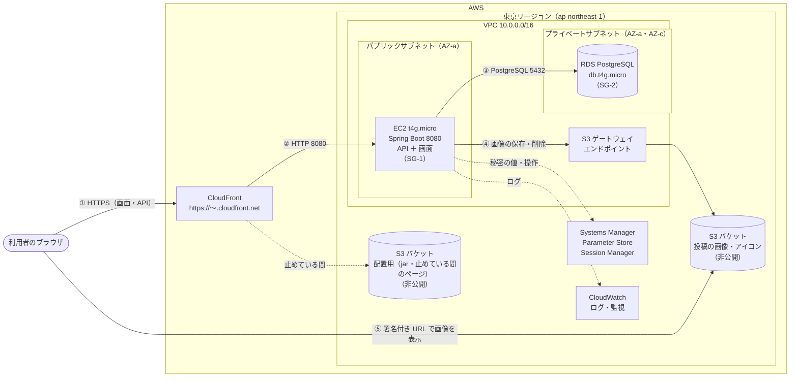

# インフラ設計書：タイムライン型 SNS アプリ（Raise timeline）

| 項目 | 内容 |
| --- | --- |
| 文書番号 | RT-BD-INFRA |
| 版数 | 0.6 |
| 作成日 | 2026-10-16 |
| 最終更新日 | 2026-10-23 |
| 作成者 | （氏名） |
| 上位文書 | [基本設計書](basic-design.md)（RT-BD） |
| 元にした文書 | [要件定義書](../requirements/requirements.md)（RT-REQ）版数 0.9 の P-2〜P-4・11 章、[技術スタック定義書](../tech-stack.md) 版数 0.6 |
| 状態 | 承認待ち |

## 改訂履歴

| 版数 | 日付 | 内容 | 作成者 |
| --- | --- | --- | --- |
| 0.1 | 2026-10-16 | 初版。EC2・RDS・ALB・S3 を前提にした構成図を作成 | （氏名） |
| 0.2 | 2026-10-16 | 技術スタックを kadai と同じにしたため、EC2 を t3.small から t4g.micro（ARM・Amazon Linux 2023 arm64）に変更し、費用の目安を直した（7 章）。AWS の構築を Terraform に決定（8 章） | （氏名） |
| 0.3 | 2026-10-17 | JWT 認証に合わせ、Parameter Store の秘密の値をセッションのものから JWT の署名のものに変更（3.3）。アイコン画像（FN-09）のために S3 の icons/ と IAM ロールの権限を追加（2 章・3.2・3.3・7 章） | （氏名） |
| 0.4 | 2026-10-19 | 開発中の画像の保存先を MinIO から S3 の開発用のバケットに変更し、自動のテストでは MinIO を使うことにした（6 章） | （氏名） |
| 0.5 | 2026-10-23 | ALB をなくし、CloudFront → EC2 の構成に変更した（1〜8 章）。EC2 は 1 台で振り分けが要らず、ALB は止められないのに月 約 3,000 円かかるため。独自ドメインは取らず、CloudFront の URL で公開することにした（9 章 No.1）。Route 53・ACM をなくし、セキュリティグループの番号を振り直した（SG-1 が EC2、SG-2 が RDS）。費用の目安を 約 8,700 円から 約 5,600 円に直した（7 章） | （氏名） |
| 0.6 | 2026-10-23 | 画面を jar に入れる方法（Maven のプロファイル with-frontend）、画面の URL の振り分け、キャッシュの決まりを書いた（5.2・5.3） | （氏名） |

本書は基本設計書の一部である。承認は[基本設計書](basic-design.md)で一括して行う。表記のルールは基本設計書 1.3 のとおり。

公開の時期は、まだ決めていない（要件定義書 U-2）。本書は、公開するときの構成を先に決めておくものである。

---

## 1. 方針

| No | 方針 | 理由 |
| --- | --- | --- |
| 1 | CloudFront（入口）→ EC2（サーバー）→ RDS（データベース）の構成にし、画像は S3 に置く | 要件定義書 P-2・P-3。学習のため、Web アプリの基本の構成を一通り作る |
| 2 | ロードバランサー（ALB）は置かない。HTTPS は CloudFront で受ける | EC2 は 1 台なので、アクセスを振り分ける必要がない。ALB は止められず、置いておくだけで月 約 3,000 円かかる（7 章）。CloudFront なら独自ドメインがなくても https://〜.cloudfront.net の URL で HTTPS になる（N-9） |
| 3 | EC2 は 1 台にする。画面（React をビルドしたファイル）も API と同じ Spring Boot から配る | 利用者は数十人で 1 台で足りる。同じ URL から配れば、JWT を入れる Cookie と CSRF 対策が簡単になる。JWT 認証でサーバーにログインの状態を持たないため、将来 2 台以上にして ALB を足しても、ログインはそのまま使える |
| 4 | EC2 はパブリックサブネットに置くが、CloudFront からの通信しか受け付けない（SG-1）。SSH は開けず、操作は Session Manager で行う | プライベートサブネットに置くと、外へ出る通信のために NAT ゲートウェイ（月 7,000 円ほど）が要る。費用を抑えつつ、CloudFront を通らない通信を受けないようにする |
| 5 | RDS はプライベートサブネットに置き、EC2 からしか接続できないようにする。Multi-AZ にはしない | データベースは外から見えないのが基本。Multi-AZ は費用が 2 倍になり、学習用には要らない |
| 6 | S3 のバケットは非公開にし、画像は署名付き URL でブラウザに直接渡す | 要件定義書 N-14。画像を EC2 経由で送らないので、EC2 の負荷と通信量を抑えられる |
| 7 | パスワードなどの秘密の値は Systems Manager の Parameter Store に置き、EC2 には IAM ロールで権限を渡す | 要件定義書 N-16。アクセスキーをサーバーにもリポジトリにも置かない |
| 8 | 使わない間は EC2・RDS を止める。CloudFront は消さずに、止めている間は「止めています」のページを出す | 要件定義書 P-4。費用の大部分は動いている時間で決まる（7 章）。CloudFront を消すと、作り直したときに URL が変わってしまう |

## 2. 構成図

| 番号 | 通信 | 内容 |
| --- | --- | --- |
| ① | ブラウザ → CloudFront | 画面（HTML・JS）と API。HTTP（80）で来たら HTTPS（443）に移す。証明書は CloudFront のもの（*.cloudfront.net）を使う |
| ② | CloudFront → EC2 | CloudFront で HTTPS を解いて、HTTP の 8080 で EC2 の公開の名前（ec2-〜.compute.amazonaws.com）に送る。EC2 に証明書を置けないため、ここは暗号化しない（kadai と同じ）。EC2 は CloudFront からの通信しか受けない（SG-1） |
| ③ | EC2 → RDS | PostgreSQL の 5432。VPC の中だけで通る |
| ④ | EC2 → S3 | 投稿された画像・アイコンの保存と、投稿の削除・アイコンの変更に合わせた削除。S3 ゲートウェイエンドポイントを通るので、インターネットに出ない |
| ⑤ | ブラウザ → S3 | API が発行した署名付き URL（15 分）で、ブラウザが S3 から画像を直接読む |

## 3. リソース一覧

### 3.1 ネットワーク

| リソース | 名前 | 設定 |
| --- | --- | --- |
| VPC | rt-vpc | 10.0.0.0/16 |
| パブリックサブネット | rt-public-a | 10.0.0.0/24（AZ-a）。EC2 は 1 台なので 1 つだけ作る |
| プライベートサブネット | rt-private-a / rt-private-c | 10.0.10.0/24（AZ-a）、10.0.11.0/24（AZ-c）。RDS のサブネットグループは 2 つの AZ が必要 |
| インターネットゲートウェイ | rt-igw | パブリックサブネットのルートに付ける |
| S3 ゲートウェイエンドポイント | rt-s3-endpoint | パブリック・プライベート両方のルートに付ける（無料） |

### 3.2 入口・サーバー・データベース・ストレージ

| リソース | 名前 | 設定 |
| --- | --- | --- |
| CloudFront | rt-cdn | 価格クラスは PriceClass_200（日本を含む）。ビューワーは HTTPS に移す（redirect-to-https）。オリジンは EC2 の公開の名前の HTTP 8080（http-only）。`/api/*`・`/actuator/*` はキャッシュしない（CachingDisabled）・すべてのメソッド・Cookie とクエリとヘッダーを渡す（AllViewerExceptHostHeader）。それ以外（画面）は CachingOptimized で、キャッシュの長さは Spring Boot が返す Cache-Control に従う。止めている間は、オリジンを配置用のバケットの「止めています」のページ（OAC で読む）に切り替える |
| EC2 | rt-app | t4g.micro（ARM・2 vCPU・メモリ 1GB）、Amazon Linux 2023（arm64）、EBS gp3 20GB。Java 21（java-21-amazon-corretto-headless）で Spring Boot の jar を systemd で動かし、落ちたら systemd が起動し直す。ヒープの上限は kadai と同じ -Xmx384m から始め、足りなければ t4g.small（メモリ 2GB）にする。パブリック IP あり（Session Manager と OS の更新のため）。Elastic IP は付けない（止めている間も費用がかかるため）。起動し直すと公開の名前が変わるので、起動のスクリプトで CloudFront のオリジンを付け直す（8 章） |
| RDS | rt-db | PostgreSQL（バージョンは技術スタック定義書）、db.t4g.micro、gp3 20GB、Single-AZ、パブリックアクセスなし、自動バックアップ 7 日（N-7）、保存時の暗号化あり |
| S3 バケット（画像） | rt-images-{アカウント ID} | パブリックアクセスをすべてブロック、保存時の暗号化（SSE-S3）、バージョニングなし。投稿の画像は posts/、アイコン画像は icons/ の下に置く |
| S3 バケット（配置用） | rt-deploy-{アカウント ID} | パブリックアクセスをすべてブロック、SSE-S3。反映する jar（app/）と、止めている間のページ（maintenance/）を置く。ページは CloudFront だけが読める（OAC） |

### 3.3 権限・秘密の値・監視

| リソース | 名前 | 設定 |
| --- | --- | --- |
| IAM ロール（EC2） | rt-app-role | S3：rt-images-{アカウント ID}/posts/*・icons/* への PutObject・GetObject・DeleteObject と、rt-deploy-{アカウント ID}/app/* の GetObject のみ。Systems Manager：AmazonSSMManagedInstanceCore。Parameter Store：/rt/ の下の読み取り。CloudWatch：ログの書き込み |
| Parameter Store | /rt/db/password、/rt/jwt/secret など | データベースのパスワード、JWT の署名に使う秘密の値（32 バイト以上の乱数。N-16・R-7）。SecureString（暗号化）で置く。JWT の秘密の値を変えると、全員のアクセストークンが使えなくなる |
| CloudWatch Logs | /rt/app | Spring Boot のログ。30 日で消す |
| CloudWatch アラーム | | EC2 のステータスチェックの失敗、RDS の空き容量 2GB 未満で、メールを送る |
| AWS Budgets | rt-budget | 月の費用が予算（R-1）を超えそうなときにメールを送る |

## 4. セキュリティグループ（通信の許可）

受け付ける通信だけを書く。外へ出る通信はすべて許可する。

| ID | 付ける先 | 受け付ける通信 | 送り元 | 理由 |
| --- | --- | --- | --- | --- |
| SG-1 | EC2 | TCP 8080 | CloudFront のみ（AWS が管理するプレフィックスリスト com.amazonaws.global.cloudfront.origin-facing。kadai と同じ） | CloudFront を通らない通信を受けない。SSH（22）は開けない（方針 4） |
| SG-2 | RDS | TCP 5432 | SG-1 のみ | EC2 からしか接続させない |

## 5. 処理の流れ

### 5.1 画像つきの投稿と表示

S3 への保存か、データベースへの保存のどちらかに失敗したときは、データ設計書の BR-4 のとおり全部やめる。

### 5.2 公開の手順（概要）

1. 手元のスクリプトで画面（Vite）をビルドし、Spring Boot の jar に含める（frontend で `npm run build` → backend で `mvnw package -Pwith-frontend`。画面をビルドしていなければ止まる）
2. jar を配置用のバケットに置く
3. Session Manager（コマンドの実行）で EC2 に jar を取ってこさせ、systemd で起動し直す（Flyway が起動時にテーブルを更新する）
4. CloudFront の URL の /actuator/health が正常（200）になったことを確かめる

詳しい手順は運用設計（基本設計書 2.2）で決める。

### 5.3 jar から配る画面

画面のファイルは jar の中（classpath:/static/）に入り、Spring Boot が API と同じ URL から配る（方針 3）。開発中は Vite（5173）が配るので、jar に画面が入っていなくても API は動く。

| パス | 返すもの | Cache-Control | 理由 |
| --- | --- | --- | --- |
| /assets/… | Vite がビルドした JS・CSS | max-age=31536000, public, immutable（1 年） | ファイル名に中身のハッシュが付き、中身が変われば URL も変わる |
| /users/taro などの画面の URL（拡張子なし） | index.html | no-cache | 直接開いたり読み直したりしても、画面（React Router）に任せる。反映した新しい画面をすぐ読ませる |
| /api/… | API（ないものは JSON の 404） | | index.html を返さない |
| /actuator/… | 稼働の確認 | | 同上 |
| 拡張子があってファイルがない | 404 | | 同上 |

CloudFront の画面のキャッシュ（3.2 の CachingOptimized）は、この Cache-Control に従う。

## 6. 開発環境との対応

開発中は、画像の保存先のほかは AWS を使わず、手元の Docker Compose で同じ役割のものを動かす。ポートは CLAUDE.md の「サーバーのポート」のとおり。

| 役割 | 開発環境 | AWS |
| --- | --- | --- |
| 入口 | なし（ブラウザから直接） | CloudFront（443） |
| 画面 | Vite の開発サーバー（5173）。API への通信は 8080 に転送する | Spring Boot が配る（ビルドしたファイル） |
| API | Spring Boot（8080） | EC2 の Spring Boot（8080） |
| データベース | PostgreSQL のコンテナ（5432） | RDS（5432） |
| 画像の保存先 | S3 の開発用のバケット（rt-images-dev-{アカウント ID}。パブリックアクセスをすべてブロック・SSE-S3）。鍵は手元の ~/.aws/credentials を使う。自動のテスト（mvnw verify・GitHub Actions）では、Testcontainers で MinIO のコンテナを起動して使う（AWS の鍵を GitHub に渡さないため） | S3（rt-images-{アカウント ID}） |
| 秘密の値 | .env ファイル（リポジトリには入れない） | Parameter Store |

アプリは接続先（データベースの URL、S3 のバケット名、テストのときだけ S3 のエンドポイント）を環境変数で受け取り、開発環境と AWS でコードを変えない（N-23）。

MinIO の公式の Docker イメージ（minio/minio）は 2026 年には配られなくなっていたため、開発中の画像の保存先を MinIO から S3 の開発用のバケットに変えた。テストでは Chainguard が作り直したイメージ（chainguard/minio）を使う（技術スタック定義書 3.3）。

## 7. 費用の目安

東京リージョンで、1 か月（730 時間）動かし続けた場合の概算である。1 ドル 150 円で計算した。料金は変わることがあるため、構築の前に AWS Pricing Calculator で確かめ、結果を技術スタック定義書に記録する。

| サービス | 内容 | 月額（概算） |
| --- | --- | --- |
| CloudFront | 少ない通信量（ずっと無料の枠：毎月 1TB・1,000 万リクエストまで） | 0 円 |
| EC2 | t4g.micro ＋ EBS 20GB ＋ パブリック IP | 約 2,000 円 |
| RDS | db.t4g.micro ＋ gp3 20GB ＋ バックアップ | 約 3,200 円 |
| S3 | 画像 14GB（投稿の画像とアイコン。データ設計書 10 章）＋ 読み出し、配置用の jar | 約 300 円 |
| CloudWatch・Parameter Store | 少ない量 | 約 100 円 |
| 合計 | | 約 5,600 円 |

ALB を置いた場合は、これに 約 3,000 円が加わる（版数 0.4 までの構成。約 8,700 円）。

止めている間の費用：EC2 は EBS の分（約 300 円／月）だけかかる。パブリック IP は止めると手放すため、かからない。RDS はストレージの分（約 500 円／月）だけかかる。CloudFront は通信がなければかからない。RDS は止めても 7 日たつと自動で起動するため、長く止めるときは、スナップショットを取ってから消す。

## 8. 構築の方法

AWS のリソースは、手作業ではなく Terraform（コードで AWS を作る道具）で作る。止めたり作り直したりすることが多いため、同じものを何度でも作れるようにする。バージョンと書き方は kadai の deploy/terraform と同じにする（Terraform 1.16.5、AWS プロバイダー 6.68.0、TFLint。[技術スタック定義書](../tech-stack.md) 3.4）。

| 項目 | 内容 |
| --- | --- |
| 置き場所 | deploy/terraform/ |
| 起動・停止 | kadai の deploy/start.sh・stop.sh と同じように、起動と停止をスクリプトにする。停止では、CloudFront のオリジンを止めている間のページに切り替えてから、EC2・RDS を止める。起動では、RDS・EC2 を起動し、CloudFront のオリジンを EC2 の新しい公開の名前に付け直す（7 章） |
| CI | GitHub Actions で terraform fmt -check・terraform validate・tflint を動かす。plan・apply は手元で行う |

## 9. 未決事項

| No | 内容 | 関係する要件 |
| --- | --- | --- |
| 1 | （決定）独自ドメインは取らず、CloudFront の URL（https://〜.cloudfront.net）で公開する。2026-10-23 に決めた | U-2、N-9 |
| 2 | EC2 をプライベートサブネットに移すか（NAT ゲートウェイの費用が月 7,000 円ほど増える） | 方針 4 |
| 3 | 公開する期間だけ動かすか、常に動かすか | P-4、R-1 |
