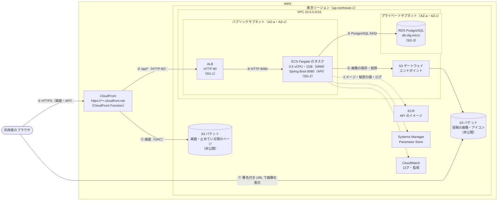
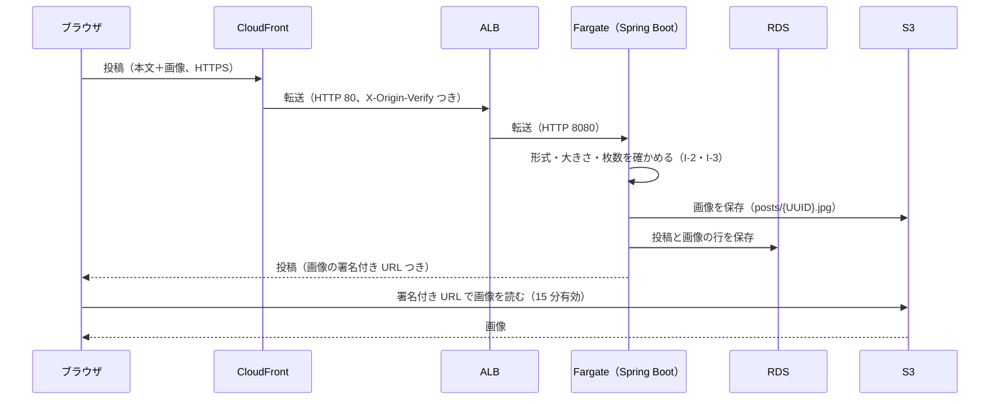

# インフラ設計書：タイムライン型 SNS アプリ（Raise timeline）

| 項目 | 内容 |
| --- | --- |
| 文書番号 | RT-BD-INFRA |
| 版数 | 0.10 |
| 作成日 | 2026-10-16 |
| 最終更新日 | 2026-10-31 |
| 作成者 | （氏名） |
| 上位文書 | [基本設計書](basic-design.md)（RT-BD） |
| 元にした文書 | [要件定義書](../requirements/requirements.md)（RT-REQ）版数 0.13 の P-2〜P-4・11 章、[技術スタック定義書](../tech-stack.md) 版数 0.13 |
| 状態 | 承認待ち |

## 改訂履歴

| 版数 | 日付 | 内容 | 作成者 |
| --- | --- | --- | --- |
| 0.1 | 2026-10-16 | 初版。EC2・RDS・ALB・S3 を前提にした構成図を作成 | （氏名） |
| 0.2 | 2026-10-16 | 技術スタックを kadai と同じにしたため、EC2 を t3.small から t4g.micro（ARM・Amazon Linux 2023 arm64）に変更し、費用の目安を直した（7 章）。AWS の構築を Terraform に決定（8 章） | （氏名） |
| 0.3 | 2026-10-17 | JWT 認証に合わせ、Parameter Store の秘密の値をセッションのものから JWT の署名のものに変更（3.3）。アイコン画像（FN-09）のために S3 の icons/ と IAM ロールの権限を追加（2 章・3.2・3.3・7 章） | （氏名） |
| 0.4 | 2026-10-19 | 開発中の画像の保存先を MinIO から S3 の開発用のバケットに変更し、自動のテストでは MinIO を使うことにした（6 章） | （氏名） |
| 0.5 | 2026-10-23 | ALB をなくし、CloudFront → EC2 の構成に変更した（1〜8 章）。EC2 は 1 台で振り分けが要らず、ALB は止められないのに月 約 3,000 円かかるため。独自ドメインは取らず、CloudFront の URL で公開することにした（9 章 No.1）。Route 53・ACM をなくし、セキュリティグループの番号を振り直した（SG-1 が EC2、SG-2 が RDS）。費用の目安を 約 8,700 円から 約 5,600 円に直した（7 章） | （氏名） |
| 0.6 | 2026-10-23 | 画面を jar に入れる方法（Maven のプロファイル with-frontend）、画面の URL の振り分け、キャッシュの決まりを書いた（5.2・5.3） | （氏名） |
| 0.7 | 2026-10-24 | CloudWatch Logs に送る API のログを、1 行 1 つの JSON（ECS 形式）にしたことを書いた（3.3。基本設計書 2.3） | （氏名） |
| 0.8 | 2026-10-30 | 利用者の決定で構成を変えた（1〜9 章）。画面は S3 に置いて CloudFront で配り、API は EC2 ではなく ECS Fargate（コンテナ）で動かし、CloudFront と Fargate の間に ALB を置く。ALB は止めている間は Terraform で消す。セキュリティグループを SG-1 ALB・SG-2 Fargate・SG-3 RDS に振り直した。Session Manager・配置用のバケットをなくし、ECR を足した。費用の目安を直した（動かし続けると 約 11,000 円。7 章）。9 章 No.2 を解決した | （氏名） |
| 0.9 | 2026-10-30 | 公開に使う AWS アカウントが無料プランであることと、その上限に合わせて RDS の自動バックアップを 7 日から 1 日にしたことを書いた（3.2・7 章）。利用者の決定で、無料プランのクレジットの中で公開する | （氏名） |
| 0.10 | 2026-10-31 | 公開の時期が決まった（検収のときだけ公開し、終わったら消す。要件定義書 U-2）ことを冒頭に書いた | （氏名） |

本書は基本設計書の一部である。承認は[基本設計書](basic-design.md)で一括して行う。表記のルールは基本設計書 1.3 のとおり。

公開は検収のときだけ環境を作り直して行い、使わない間は止め、検収が終わったら環境を消す（要件定義書 U-2）。本書は、公開するときの構成を決めておくものである。

---

## 1. 方針

| No | 方針 | 理由 |
| --- | --- | --- |
| 1 | CloudFront（入口）→ ALB（ロードバランサー）→ ECS Fargate（API のコンテナ）→ RDS（データベース）の構成にし、画面と画像は S3 に置く | 要件定義書 P-2・P-3。学習のため、コンテナで動かす Web アプリの基本の構成を一通り作る |
| 2 | 画面（React をビルドしたファイル）は S3 に置き、CloudFront から配る。API と同じ CloudFront の URL にし、/api/* だけを ALB に送る | 画面の配信に API のサーバーを使わない。同じ URL なので、JWT を入れる Cookie と CSRF 対策は開発中と同じに動く |
| 3 | API は ECS Fargate で動かす。サーバー（EC2）は自分で持たない | OS の更新やログインの管理が要らない。イメージ（ECR）を替えるだけで反映でき、失敗したら前のものに戻る（3.2） |
| 4 | Fargate の前に ALB を置く。HTTPS は CloudFront で受け、CloudFront → ALB は HTTP にする | タスクは作り直すたびに IP が変わるので、ALB で受け止めてヘルスチェックに通ったタスクにだけ送る。独自ドメインがないため ALB に証明書を付けられず、HTTPS は CloudFront の https://〜.cloudfront.net で受ける（N-9） |
| 5 | ALB は CloudFront からの通信だけを受け、さらに CloudFront が付ける秘密のヘッダー（X-Origin-Verify）がなければ 403 を返す | セキュリティグループ（CloudFront のプレフィックスリスト）だけでは、ほかの人の CloudFront を通した通信も届いてしまうため |
| 6 | Fargate のタスクはパブリックサブネットに置き、パブリック IP を付けるが、ALB からの通信しか受け付けない（SG-2） | プライベートサブネットに置くと、イメージの取得やログの送信のために NAT ゲートウェイ（月 7,000 円ほど）か VPC エンドポイント（1 つ月 1,500 円ほど）が要る。費用を抑えつつ、ALB を通らない通信を受けないようにする |
| 7 | RDS はプライベートサブネットに置き、Fargate のタスクからしか接続できないようにする。Multi-AZ にはしない | データベースは外から見えないのが基本。Multi-AZ は費用が 2 倍になり、学習用には要らない |
| 8 | 画像の S3 のバケットは非公開にし、画像は署名付き URL でブラウザに直接渡す | 要件定義書 N-14。画像を API 経由で送らないので、タスクの負荷と通信量を抑えられる |
| 9 | パスワードなどの秘密の値は Systems Manager の Parameter Store に置き、タスクの起動時に環境変数で渡す。権限は IAM ロールで渡す | 要件定義書 N-16。アクセスキーをサーバーにもリポジトリにも置かない |
| 10 | 使わない間は、ECS のサービスと ALB を消し、RDS を止める。CloudFront は消さずに、止めている間は「止めています」のページを出す | 要件定義書 P-4。ALB は止められず、置いておくだけで月 約 3,500 円かかる（7 章）。Terraform で何度でも作り直せる。CloudFront を消すと、作り直したときに URL が変わってしまう |

## 2. 構成図

| 番号 | 通信 | 内容 |
| --- | --- | --- |
| ① | ブラウザ → CloudFront | 画面（HTML・JS）と API。HTTP（80）で来たら HTTPS（443）に移す。証明書は CloudFront のもの（*.cloudfront.net）を使う |
| ② | CloudFront → S3（画面） | /api/*・/actuator/* 以外。S3 は CloudFront からだけ読める（OAC）。画面の URL（/users/taro など）は CloudFront Function が index.html に書き換える（5.3） |
| ③ | CloudFront → ALB | /api/*・/actuator/*。HTTPS を解いて、HTTP の 80 で ALB の名前に送る。ALB に証明書を置けないため、ここは暗号化しない（kadai と同じ）。秘密のヘッダー X-Origin-Verify を付ける |
| ④ | ALB → Fargate | HTTP の 8080。ALB はヘルスチェック（/actuator/health）に通ったタスクにだけ送る |
| ⑤ | Fargate → RDS | PostgreSQL の 5432。VPC の中だけで通る |
| ⑥ | Fargate → S3（画像） | 投稿された画像・アイコンの保存と、投稿の削除・アイコンの変更に合わせた削除。S3 ゲートウェイエンドポイントを通るので、インターネットに出ない |
| ⑦ | ブラウザ → S3（画像） | API が発行した署名付き URL（15 分）で、ブラウザが S3 から画像を直接読む |

タスクは、起動するときに ECR からイメージを、Parameter Store から秘密の値を取り、動いている間は CloudWatch Logs にログを送る。どれもパブリック IP を使ってインターネット経由で通る（方針 6）。

## 3. リソース一覧

Terraform（deploy/terraform/）で作る。名前は Terraform で付けるもの。

### 3.1 ネットワーク

| リソース | 名前 | 設定 |
| --- | --- | --- |
| VPC | rt-vpc | 10.0.0.0/16 |
| パブリックサブネット | rt-public-a / rt-public-c | 10.0.0.0/24（AZ-a）、10.0.1.0/24（AZ-c）。ALB は 2 つの AZ が必要。Fargate のタスクもここに置く |
| プライベートサブネット | rt-private-a / rt-private-c | 10.0.10.0/24（AZ-a）、10.0.11.0/24（AZ-c）。RDS のサブネットグループは 2 つの AZ が必要。インターネットには出ない |
| インターネットゲートウェイ | rt-igw | パブリックサブネットのルートに付ける |
| S3 ゲートウェイエンドポイント | rt-s3-endpoint | パブリック・プライベート両方のルートに付ける（無料） |

### 3.2 入口・API・データベース・ストレージ

| リソース | 名前 | 設定 |
| --- | --- | --- |
| CloudFront | raise-timeline | 価格クラスは PriceClass_200（日本を含む）。ビューワーは HTTPS に移す（redirect-to-https）。既定は画面のバケット（OAC、CachingOptimized。キャッシュの長さはファイルの Cache-Control に従う）。`/api/*`・`/actuator/*` は ALB の HTTP 80（http-only）へ、キャッシュしない（CachingDisabled）・すべてのメソッド・Cookie とクエリとヘッダーを渡す（AllViewerExceptHostHeader）。止めている間は ALB へのビヘイビアをなくし、すべてのパスで止めている間のページを返す |
| CloudFront Function | rt-router | 画面のビヘイビアのビューワーリクエストで動く。動いている間は画面の URL を index.html に、止めている間はすべてを maintenance/index.html に書き換える（5.3） |
| ALB | rt-alb | インターネット向け、パブリックサブネット a・c、HTTP 80。X-Origin-Verify が合うときだけターゲットグループ rt-app（IP、8080、ヘルスチェック /actuator/health、登録解除の待ち 30 秒）に送り、ほかは 403。止めている間は消す |
| ECR | rt-app | API のイメージ。タグはコミット ID で上書きさせない（IMMUTABLE）。push したときに脆弱性を検査する。新しいものから 10 個だけ残す |
| ECS クラスター | rt-cluster | Fargate。Container Insights は使わない（費用がかかるため） |
| ECS タスク定義 | rt-app | Fargate、ARM64（Graviton）、0.5 vCPU・メモリ 1GB。イメージは ECR に最後に push したもの。ヒープの上限はメモリの 75%（Dockerfile）。環境変数で DB の接続先・Cookie の Secure・バケット名を、Parameter Store から DB のパスワードと JWT の秘密の値を渡す。ログは CloudWatch Logs の /rt/app へ。止めている間は消す |
| ECS サービス | rt-app | タスクは 1 つ（毎日 4:30 の画像の消し直しが重ならないように）。パブリック IP あり。起動から 180 秒はヘルスチェックの失敗で止めない（0.5 vCPU では Spring Boot の起動に時間がかかるため）。新しいタスクが起動しなければ前のタスク定義に戻す（デプロイのサーキットブレーカー）。止めている間は消す |
| RDS | rt-db | PostgreSQL（バージョンは技術スタック定義書）、db.t4g.micro、gp3 20GB、Single-AZ、パブリックアクセスなし、自動バックアップ 1 日（N-7。無料プランの上限。有料プランにしたら 7 日にする）、保存時の暗号化あり、削除保護あり、消すときは最後のスナップショットを取る。止めるのはスクリプト（8 章）で行う |
| S3 バケット（画面） | rt-web-{アカウント ID} | パブリックアクセスをすべてブロック、SSE-S3。Vite でビルドした画面のファイルと、止めている間のページ（maintenance/）を置く。CloudFront だけが読める（OAC） |
| S3 バケット（画像） | rt-images-{アカウント ID} | パブリックアクセスをすべてブロック、保存時の暗号化（SSE-S3）、バージョニングなし。投稿の画像は posts/、アイコン画像は icons/ の下に置く |

### 3.3 権限・秘密の値・監視

| リソース | 名前 | 設定 |
| --- | --- | --- |
| IAM ロール（タスクの実行） | rt-task-execution | ECS がタスクを起動するときに使う。AmazonECSTaskExecutionRolePolicy（ECR からイメージを取る・ログを送る）と、Parameter Store の /rt/db/password・/rt/jwt/secret の読み取り |
| IAM ロール（タスク） | rt-app | アプリ（AWS SDK）が使う。S3：rt-images-{アカウント ID}/posts/*・icons/* への PutObject・GetObject・DeleteObject のみ |
| Parameter Store | /rt/db/password、/rt/jwt/secret | データベースのパスワード、JWT の署名に使う秘密の値（48 文字の乱数。N-16・R-7）。Terraform が作り、SecureString（暗号化）で置く。JWT の秘密の値を変えると、全員のアクセストークンが使えなくなる |
| CloudWatch Logs | /rt/app | Spring Boot のログ。標準出力に 1 行 1 つの JSON（ECS 形式）で出したものを送り、Logs Insights で項目（ステータス・リクエスト ID・ユーザー ID など）ごとに探す（基本設計書 2.3）。30 日で消す |
| CloudWatch アラーム | rt-no-healthy-task、rt-api-5xx、rt-db-free-storage | ALB のヘルスチェックに通るタスクが 3 分続けてない、API の 5xx が 5 分で 10 回以上（この 2 つは動いている間だけ作る）、RDS の空き容量 2GB 未満で、SNS（rt-alerts）からメールを送る |
| AWS Budgets | rt-budget | 月の費用が予算（R-1。67 ドル ≒ 10,000 円）の 80% を超えたとき、月末の予測が予算を超えそうなときにメールを送る |

Terraform の状態ファイル（DB のパスワードなどの秘密の値も入る）は手元に置き、リポジトリには入れない（kadai と同じ）。

## 4. セキュリティグループ（通信の許可）

受け付ける通信だけを書く。

| ID | 付ける先 | 受け付ける通信 | 送り元 | 理由 |
| --- | --- | --- | --- | --- |
| SG-1 | ALB | TCP 80 | CloudFront のみ（AWS が管理するプレフィックスリスト com.amazonaws.global.cloudfront.origin-facing。kadai と同じ） | CloudFront を通らない通信を受けない。さらに秘密のヘッダーで確かめる（方針 5）。外へ出る通信は SG-2 の 8080 だけ |
| SG-2 | Fargate のタスク | TCP 8080 | SG-1 のみ | ALB を通らない通信を受けない（方針 6）。外へ出る通信はすべて許可する（ECR・Parameter Store・CloudWatch Logs・S3・RDS） |
| SG-3 | RDS | TCP 5432 | SG-2 のみ | Fargate のタスクからしか接続させない |

## 5. 処理の流れ

### 5.1 画像つきの投稿と表示

S3 への保存か、データベースへの保存のどちらかに失敗したときは、データ設計書の BR-4 のとおり全部やめる。

署名付き URL はタスクロールの一時的な鍵で作るため、鍵の期限が近いと 15 分より早く読めなくなることがある。画面は、画像が読めないときに URL を取り直す（FN-04）。

### 5.2 公開の手順（概要）

1. API：手元で `mvnw package` で jar を作り、`docker buildx build --platform linux/arm64` でイメージ（backend/Dockerfile）を作って、コミット ID をタグにして ECR に push する
2. `terraform apply -var running=true` で、そのイメージを使う新しいタスク定義を作る。ECS が新しいタスクを起動し、ALB のヘルスチェックに通ったら古いタスクを止める（Flyway が起動時にテーブルを更新する）。通らなければ前のタスク定義に戻る
3. 画面：frontend で `npm run build` して、できたファイルを画面のバケットに置く（5.3 の Cache-Control を付ける）。index.html の CloudFront のキャッシュを消す
4. CloudFront の URL の /actuator/health が正常（200）になったことを確かめる

詳しい手順は運用設計（基本設計書 2.2）で決める。

### 5.3 画面の配り方

公開先では、画面のファイルは S3 に置き、CloudFront が配る（方針 2）。開発中は Vite（5173）が配る。

| パス | 返すもの | Cache-Control | 理由 |
| --- | --- | --- | --- |
| /assets/… | Vite がビルドした JS・CSS | max-age=31536000, public, immutable（1 年） | ファイル名に中身のハッシュが付き、中身が変われば URL も変わる |
| /users/taro などの画面の URL（最後の部分に拡張子がない） | index.html（CloudFront Function が書き換える） | no-cache | 直接開いたり読み直したりしても、画面（React Router）に任せる。反映した新しい画面をすぐ読ませる |
| /api/… | API（ないものは JSON の 404） | | ALB へ送るので index.html を返さない |
| /actuator/… | 稼働の確認 | | 同上 |
| 拡張子があってファイルがない | 403（S3 が返す） | | 同上 |

CloudFront のエラーページの設定（403・404 のときに index.html を返す）は使わない。API の 403・404 まで index.html になってしまうため。

Spring Boot の jar に画面を入れる方法（Maven のプロファイル with-frontend。jar が上の表と同じ振り分けをする）は、公開先では使わない。GitHub Actions の E2E・性能テストで、ランナーの中で画面と API を 1 つの jar で動かすのに使う。

## 6. 開発環境との対応

開発中は、画像の保存先のほかは AWS を使わず、手元の Docker Compose で同じ役割のものを動かす。ポートは CLAUDE.md の「サーバーのポート」のとおり。

| 役割 | 開発環境 | AWS |
| --- | --- | --- |
| 入口 | なし（ブラウザから直接） | CloudFront（443）→ ALB（80） |
| 画面 | Vite の開発サーバー（5173）。API への通信は 8080 に転送する | S3（rt-web-{アカウント ID}）のビルドしたファイルを CloudFront が配る |
| API | Spring Boot（8080。mvnw spring-boot:run） | ECS Fargate のタスクの Spring Boot（8080。backend/Dockerfile のイメージ） |
| データベース | PostgreSQL のコンテナ（5432） | RDS（5432） |
| 画像の保存先 | S3 の開発用のバケット（rt-images-dev-{アカウント ID}。パブリックアクセスをすべてブロック・SSE-S3）。鍵は手元の ~/.aws/credentials を使う。自動のテスト（mvnw verify・GitHub Actions）では、Testcontainers で MinIO のコンテナを起動して使う（AWS の鍵を GitHub に渡さないため） | S3（rt-images-{アカウント ID}）。鍵はタスクロール |
| 秘密の値 | .env ファイル（リポジトリには入れない） | Parameter Store |

アプリは接続先（データベースの URL、S3 のバケット名、テストのときだけ S3 のエンドポイント）を環境変数で受け取り、開発環境と AWS でコードを変えない（N-23）。

MinIO の公式の Docker イメージ（minio/minio）は 2026 年には配られなくなっていたため、開発中の画像の保存先を MinIO から S3 の開発用のバケットに変えた。テストでは Chainguard が作り直したイメージ（chainguard/minio）を使う（技術スタック定義書 3.3）。

## 7. 費用の目安

公開に使う AWS アカウントは無料プラン（2026-10-30 の時点でクレジットの残り 154.64 ドル、期限 2027-04-11）で、費用はクレジットから引かれる。無料プランではクレジットを使い切っても請求されないが、アカウントが止まり、作ったものが消える。無料プランの上限のため、RDS の自動バックアップは 1 日分にする（3.2）。

東京リージョンで、1 か月（730 時間）動かし続けた場合の概算である。1 ドル 150 円で計算した。料金は変わることがあるため、構築の前に AWS Pricing Calculator で確かめ、結果を技術スタック定義書に記録する。

| サービス | 内容 | 月額（概算） |
| --- | --- | --- |
| CloudFront | 少ない通信量（ずっと無料の枠：毎月 1TB・1,000 万リクエストまで）、CloudFront Function（毎月 200 万回まで無料） | 0 円 |
| ALB | 時間あたりの料金 ＋ 少ない LCU | 約 3,500 円 |
| ECS Fargate | ARM・0.5 vCPU・1GB を 1 つ | 約 2,200 円 |
| パブリック IPv4 | ALB の 2 つ ＋ タスクの 1 つ（1 つ 1 時間 0.005 ドル） | 約 1,600 円 |
| RDS | db.t4g.micro ＋ gp3 20GB ＋ バックアップ | 約 3,200 円 |
| S3・ECR | 画像 14GB（投稿の画像とアイコン。データ設計書 10 章）＋ 読み出し、画面のファイル、イメージ 10 個 | 約 400 円 |
| CloudWatch・Parameter Store | 少ない量 | 約 100 円 |
| 合計 | | 約 11,000 円 |

動かし続けると、R-1 の予算（月 10,000 円）を超える。そのため、使う時間だけ動かし、使わない間は止める（方針 10、9 章 No.3）。たとえば 1 日 8 時間だけ動かすと、ALB・Fargate・パブリック IP・RDS の時間の分が 3 分の 1 になり、月 約 4,000 円になる。

止めている間の費用：ECS のサービスと ALB は消すので、かからない（タスクのパブリック IP も手放す）。RDS はストレージの分（約 500 円／月）だけかかる。S3・ECR は置いている量の分（約 300 円／月）かかる。CloudFront は通信がなければかからない。RDS は止めても 7 日たつと自動で起動するため、長く止めるときは、スナップショットを取ってから消す。

EC2 1 台の構成（版数 0.5〜0.7）は 約 5,600 円だった。ALB・Fargate にしたことで、動かし続けた場合は 約 5,400 円増える。

## 8. 構築の方法

AWS のリソースは、手作業ではなく Terraform（コードで AWS を作る道具）で作る。止めたり作り直したりすることが多いため、同じものを何度でも作れるようにする。バージョンと書き方は kadai の deploy/terraform と同じにする（Terraform 1.16.5、AWS プロバイダー 6.68.0、TFLint。[技術スタック定義書](../tech-stack.md) 3.4）。

| 項目 | 内容 |
| --- | --- |
| 置き場所 | deploy/terraform/（止めている間のページは deploy/maintenance/） |
| 起動・停止 | 変数 running で切り替える。running = false にすると、CloudFront をすべて止めている間のページにしてから、ECS のサービス・タスク定義・ALB・ALB のアラームを消す。running = true にすると作り直す（ECR にイメージがないうちは true にできない）。RDS の停止・起動は Terraform ではなく、スクリプト（kadai の deploy/start.sh・stop.sh と同じように作る）で AWS CLI から行う |
| CI | GitHub Actions で terraform fmt -check・terraform validate・tflint を動かし、jar からイメージが作れることを確かめる。plan・apply は手元で行う |

## 9. 未決事項

| No | 内容 | 関係する要件 |
| --- | --- | --- |
| 1 | （決定）独自ドメインは取らず、CloudFront の URL（https://〜.cloudfront.net）で公開する。2026-10-23 に決めた | U-2、N-9 |
| 2 | （決定）API のサーバーはプライベートサブネットに移さず、Fargate のタスクをパブリックサブネットに置いてセキュリティグループで守る（NAT ゲートウェイの費用を避ける）。2026-10-30 に決めた | 方針 6 |
| 3 | 公開する期間だけ動かすか、常に動かすか。常に動かすと R-1 の予算を超える（7 章） | P-4、R-1 |
