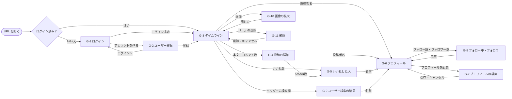

# 画面設計書：タイムライン型 SNS アプリ（Raise timeline）

| 項目 | 内容 |
| --- | --- |
| 文書番号 | RT-BD-SCR |
| 版数 | 0.1 |
| 作成日 | 2026-10-16 |
| 最終更新日 | 2026-10-16 |
| 作成者 | （氏名） |
| 上位文書 | [基本設計書](basic-design.md)（RT-BD） |
| 元にした文書 | [画面一覧](../requirements/screens.md)、[機能定義書](../functions/function-definition.md)（要件定義書 版数 0.4） |
| 状態 | 承認待ち |

## 改訂履歴

| 版数 | 日付 | 内容 | 作成者 |
| --- | --- | --- | --- |
| 0.1 | 2026-10-16 | 初版。要件定義書 版数 0.2 の 7 章（画面設計）をもとに作成し、ユーザー検索の結果画面（G-9）とダイアログ（G-10・G-11）を追加 | （氏名） |

本書は基本設計書の一部である。承認は[基本設計書](basic-design.md)で一括して行う。表記のルールは基本設計書 1.3 のとおり。

---

## 1. 画面一覧

| 画面 ID | 名称 | 種類 | 版 | 関連要件 |
| --- | --- | --- | --- | --- |
| G-1 | ログイン画面 | 画面 | 第 1 版 | A-5〜A-8 |
| G-2 | ユーザー登録画面 | 画面 | 第 1 版 | A-1〜A-4 |
| G-3 | タイムライン画面 | 画面 | 第 1 版 | T、W-1〜W-7、I-1〜I-7、L-1〜L-5 |
| G-4 | 投稿の詳細画面 | 画面 | 第 1 版 | W-6〜W-8、C、L |
| G-5 | いいねした人の一覧画面 | 画面 | 第 1 版 | L-5、F-1・F-2 |
| G-6 | プロフィール画面 | 画面 | 第 1 版 | PF-1〜PF-4、F-1〜F-5 |
| G-7 | プロフィールの編集画面 | 画面 | 第 2 版 | PF-5〜PF-7 |
| G-8 | フォロー中・フォロワーの一覧画面 | 画面 | 第 1 版 | F-5〜F-6 |
| G-9 | ユーザー検索の結果画面 | 画面 | 第 1 版 | S-1〜S-9 |
| G-10 | 画像の拡大ダイアログ | ダイアログ | 第 1 版 | I-7 |
| G-11 | 確認ダイアログ | ダイアログ | 第 1 版 | W-7、C-5 |

## 2. 画面遷移図



図を見やすくするため、次の線は省いた。

- ヘッダーのアプリ名・検索欄・自分のプロフィール・ログアウトは、G-3〜G-9 のどこからでも使える（行き先は G-3・G-9・G-6・G-1）
- G-10 は G-4・G-6 からも、G-11 は G-4（投稿とコメントの削除）・G-6 からも開く。閉じると開いた画面に戻る

## 3. 共通仕様

### 3.1 色

| 名前 | 用途 | 色 |
| --- | --- | --- |
| 画面背景 | すべての画面の背景 | #FFFFFF |
| 区切り線 | 投稿カードの間、ヘッダーの下 | #E5E7EB |
| 文字 | 通常の文字 | #0F1419 |
| 補足文字 | @ユーザー ID・日時・件数・残りの文字数 | #536471 |
| 主色 | 主ボタンの背景、選んでいるタブの下線、リンク | #1A5FB4 |
| いいね色 | いいねした「♥」と、その数 | #C0245C |
| 危険色 | 削除ボタンの背景、エラーの文字、280 文字を超えた残りの文字数 | #B42318 |
| 頭文字の丸 | 表示名の頭文字を出す丸の背景 | #E8EEF7 |
| お知らせ（警告） | 通信切れ（M-20）の背景 | #FFEBE6 |
| 背景の覆い | ダイアログを開いたときに後ろの画面を覆う色 | 黒・透明度 50%（G-10 は 85%） |

文字と背景の組み合わせは、実装時にコントラストを確認するツールで 4.5:1 以上（N-18）であることを確かめる。

### 3.2 文字

| 対象 | 大きさ | 太さ |
| --- | --- | --- |
| アプリ名（ヘッダー） | 20px | 太字 |
| 画面の見出し・ダイアログの見出し | 18px | 太字 |
| 表示名 | 15px | 太字 |
| 本文・コメント | 15px | 標準 |
| その他すべて | 14px | 標準 |

書体は、Windows では「メイリオ」または「Yu Gothic UI」、macOS・iOS では「ヒラギノ角ゴシック」、Android では「Noto Sans JP」を使う（OS に入っているものを使い、書体ファイルは配布しない）。

### 3.3 ボタン

| 種類 | 見た目 | 使う場所 |
| --- | --- | --- |
| 主ボタン | 主色の背景・白い文字 | 投稿する、コメントする、ログイン、登録する、保存する、フォローする |
| 通常ボタン | 枠線のみ・文字色 | キャンセル、画像を選ぶ、フォロー中、さらに表示、再読み込み |
| 危険ボタン | 危険色の背景・白い文字 | 削除 |

- 高さ 36px、角の丸み 18px（両端が丸い形）、左右の余白 16px
- マウスを乗せるとカーソルを指の形にし、背景を 10% 暗くする
- 押せない状態のときは、透明度 50% で表示し、カーソルを禁止マークにする
- 「フォロー中」ボタンは、マウスを乗せている間だけ文字を「フォロー解除」、枠線と文字を危険色にする（F-2）

### 3.4 メッセージの表示方法

| 方法 | 位置 | 消えるとき | 使うメッセージ |
| --- | --- | --- | --- |
| 入力欄の下 | 入力欄のすぐ下に危険色の文字 | その入力欄に文字を入力したとき | M-1〜M-5 |
| フォームの上 | G-1 の「ログイン」ボタンの上 | 次に「ログイン」を押したとき | M-6、M-7、M-19 |
| 一覧の代わり | 一覧を出す場所の中央に補足文字で出す | 一覧に出すものができたとき | M-8、M-11、M-16、M-17 |
| 一覧の下 | 読み込みに失敗した場所に「再読み込み」ボタンと一緒に出す | 「再読み込み」で成功したとき | M-9 |
| トースト | 画面の下中央、幅 360px（画面が狭いときは左右 16px を空けた幅）。右端に「×」 | 「×」を押したとき、または 5 秒たったとき。同時に出すのは 1 つで、新しいものが出たら古いものは消す | M-12、M-13、M-14、M-18 |
| お知らせ欄 | ヘッダーのすぐ下、画面の横幅いっぱい | 接続が戻ったとき | M-20 |
| ダイアログ | G-11 | ボタンを押したとき | M-10、M-15 |

### 3.5 ダイアログ共通

- 画面の中央に表示し、後ろの画面を「背景の覆い」で覆う。開いている間は後ろの画面を操作できない
- Esc キー、または覆いの部分のクリックで、「キャンセル」「閉じる」と同じ動きをする
- G-11 を開いたときは「キャンセル」ボタンにカーソルを置く（Enter キーで誤って削除しないため）

### 3.6 ヘッダー（G-3〜G-9 で共通）

```
┌────────────────────────────────────────────────────────────┐
│ Raise timeline   [🔍 ユーザーを検索        ]  (た) ログアウト │
└────────────────────────────────────────────────────────────┘
```

| 項目 | 内容 | 操作 |
| --- | --- | --- |
| アプリ名 | 「Raise timeline」 | 押すと G-3 |
| 検索欄 | 幅 280px。薄い文字で「ユーザーを検索」。30 文字まで（S-5） | Enter キーまたは虫めがねで G-9（S-2）。0 文字のときは何もしない |
| 自分の頭文字 | 自分の表示名の頭文字を丸の中に出す | 押すと自分の G-6 |
| ログアウト | 通常ボタン | 押すと確認なしでログアウトし G-1（A-9） |

画面の横幅が 600px 未満のときは、アプリ名を「RT」に縮め、検索欄は虫めがねのボタンだけにする。押すとヘッダーの全体が検索欄に変わる。

### 3.7 投稿カード（G-3・G-4・G-6 で共通）

```
┌──────────────────────────────────────────────────┐
│ (た) たろう  @taro_y · 3 分前                  … │
│      今日は晴れ。川沿いを散歩してきた             │
│      ┌──────────┐ ┌──────────┐                   │
│      │ 画像 1   │ │ 画像 2   │                   │
│      └──────────┘ └──────────┘                   │
│      ♡ 12   💬 3                                 │
└──────────────────────────────────────────────────┘
```

| 項目 | 内容 | 操作 |
| --- | --- | --- |
| 頭文字の丸 | 直径 40px。表示名の 1 文字目 | 押すと投稿者の G-6 |
| 表示名・@ユーザー ID | 表示名は太字、@ユーザー ID は補足文字。長いときは末尾を「…」で省く | 押すと投稿者の G-6 |
| 投稿日時 | 3.9 のとおり | — |
| 「…」 | 自分の投稿にだけ出す。押すと「削除」だけのメニューを出す | 「削除」で G-11（W-7） |
| 本文 | 改行をそのまま出す（W-5） | 押すと G-4（G-4 の上では何もしない） |
| 画像 | 1 枚：横幅いっぱい・高さ最大 400px。2 枚：横に 2 つ。3 枚：左に 1 つ、右に 2 つ。4 枚：2 行 2 列。どれも角の丸み 12px、余白 2px | 押すと G-10（I-7） |
| ♡ / ♥ | いいねしていなければ「♡」（補足文字の色）、していれば「♥」（いいね色） | 押すといいね・取り消し（L-1・L-2） |
| いいね数 | 「♡」の右 | 押すと G-5（L-5） |
| 💬 とコメント数 | 「♡」の右に 48px 空けて出す | 押すと G-4（W-6） |

インプレッション数・リツイート・共有のボタンは置かない。

### 3.8 入力の共通ルール

- 前後の空白（半角スペース・全角スペース・タブ・改行）を取り除いてから、文字数の確認と保存を行う
- 文字数は要件定義書の用語「文字数」のとおり、Unicode の文字（コードポイント）単位で数える
- 投稿・コメントの本文は、280 文字を超えても入力はできる（あとで削れるように）。超えている間は送信できない（W-2）。それ以外の入力欄は、上限を超える文字を入力できないようにする
- 1 行の入力欄で Enter キーを押すと、その画面の主ボタンと同じ動きをする。日本語入力の変換を確定するための Enter キーでは送信しない
- 投稿・コメントの本文の入力欄では、Enter キーで改行し、Ctrl＋Enter（macOS では ⌘＋Enter）で送信する

### 3.9 日付・日時の表示

| 経過した時間 | 表示 |
| --- | --- |
| 1 分未満 | 「たった今」 |
| 1 時間未満 | 「3 分前」 |
| 24 時間未満 | 「5 時間前」 |
| 同じ年 | 「10月16日」 |
| 前の年以前 | 「2025年10月16日」 |

日時の上にマウスを乗せると、「2026/10/16 15:30」（日本時間、24 時間表記）を出す。

### 3.10 画面の幅

- 中身は横幅 600px の 1 列にして、画面の中央に置く
- 画面の横幅が 600px 未満のときは、横幅いっぱいに広げる（左右の余白 16px）。375px でも横にスクロールしない（N-20）

---

## 4. G-1 ログイン画面

```
┌──────────────────────────────────────────┐
│              Raise timeline               │
│                                          │
│   ユーザー ID かパスワードが違います。      │ ← メッセージ（ある場合のみ）
│   ユーザー ID  [                    ]     │
│   パスワード   [                    ]     │
│              [      ログイン      ]       │
│      アカウントを作る                      │
└──────────────────────────────────────────┘
```

| 項目 | 内容 | 操作 |
| --- | --- | --- |
| ユーザー ID | 1 行の入力欄。15 文字まで | |
| パスワード | 1 行の入力欄。入力した文字は「●」で隠す。64 文字まで | |
| 「ログイン」 | 主ボタン。どちらかが空のときは押せない | A-5〜A-7 |
| 「アカウントを作る」 | リンク | G-2 |
| メッセージ | M-6・M-7・M-19（3.4） | |

## 5. G-2 ユーザー登録画面

```
┌──────────────────────────────────────────┐
│           アカウントを作る                 │
│   ユーザー ID         [               ]   │
│     3〜15 文字の半角英数字と「_」            │
│   表示名             [               ]   │
│   パスワード          [               ]   │
│     英字と数字を含む 8〜64 文字              │
│   パスワード（確認）   [               ]   │
│              [      登録する      ]       │
│      ログインはこちら                      │
└──────────────────────────────────────────┘
```

| 項目 | 内容 | 操作 |
| --- | --- | --- |
| ユーザー ID | 入力欄の下に条件を補足文字で出す。入力欄から離れたときに使われていないかを確かめ、使われていれば M-1 を出す | A-2 |
| 表示名 | 30 文字まで | A-4 |
| パスワード・パスワード（確認） | 「●」で隠す | A-3 |
| 「登録する」 | 主ボタン。押したときに全項目を確かめ、条件に合わない項目の下にメッセージを出す | A-1 |
| 「ログインはこちら」 | リンク | G-1 |

## 6. G-3 タイムライン画面

レイアウトは[画面一覧](../requirements/screens.md) 3 章のとおり。上から、ヘッダー（3.6）・投稿フォーム・タブ・投稿カード（3.7）の一覧の順に並べる。

### 投稿フォーム

| 項目 | 内容 | 操作 |
| --- | --- | --- |
| 本文 | 複数行の入力欄。薄い文字で「いまどうしてる？」。入力に合わせて最大 10 行まで高くする | W-1・W-2 |
| 画像のプレビュー | 選んだ画像を 80px 四方で横に並べる。右上に「×」 | 「×」で外す（I-4） |
| 「画像を選ぶ」 | 通常ボタン。4 枚選んでいるときは押せない | I-1〜I-3 |
| 残りの文字数 | 「残り 248」。280 文字を超えたら危険色で「-12」 | W-2 |
| 「投稿する」 | 主ボタン。送信中は「投稿中…」にして押せなくする | W-1・W-3・I-5 |

### タブ

| 項目 | 内容 | 操作 |
| --- | --- | --- |
| 「フォロー中」「すべて」 | 選んでいるタブを太字にし、主色の下線を引く。URL の ?tab=following / ?tab=all と合わせる | 押すとそのタブの最新 20 件から出し直す（T-1・T-3・T-6） |

### 投稿の一覧

| 状態 | 表示 |
| --- | --- |
| 読み込み中 | 一覧の下に「読み込み中…」（T-2） |
| 0 件（「フォロー中」） | M-8 と、「すべて」タブを開くボタン（T-4） |
| 0 件（「すべて」） | 「まだ投稿がありません。」 |
| 最後まで読んだ | 一覧の下に「これ以上の投稿はありません」 |
| 失敗 | M-9 と「再読み込み」（T-8） |

## 7. G-4 投稿の詳細画面

```
┌──────────────────────────────────────────┐
│ ← 投稿                                    │
├──────────────────────────────────────────┤
│ （投稿カード。画像は横幅いっぱい）          │
├──────────────────────────────────────────┤
│ [ コメントを書く                       ]  │
│                       残り 280 [コメントする] │
├──────────────────────────────────────────┤
│ (は) はなこ @hana · 1 分前          削除   │
│      いい天気ですね                       │
│ (じ) じろう @jiro · たった今               │
│      散歩いいな                           │
│              [ さらに表示 ]               │
└──────────────────────────────────────────┘
```

| 項目 | 内容 | 操作 |
| --- | --- | --- |
| 「←」 | 前の画面に戻る。直接開いたときは G-3 | |
| 投稿カード | 3.7 のとおり。本文を押しても何もしない | |
| コメントフォーム | 本文・残りの文字数・「コメントする」 | C-1・C-2 |
| コメントの一覧 | 古い順に 50 件。自分のコメントにだけ「削除」（危険色の文字） | C-3〜C-5 |
| 「さらに表示」 | 通常ボタン。51 件以上あるときだけ出す | C-3 |
| 削除された投稿 | 投稿カードとコメントの代わりに M-11 | W-8 |

## 8. G-5 いいねした人の一覧画面

```
┌──────────────────────────────────────────┐
│ ← いいね 12 件                            │
├──────────────────────────────────────────┤
│ (た) たろう  @taro_y            [フォロー中] │
│ (は) はなこ  @hana              [フォローする] │
│ (じ) じろう  @jiro                         │ ← 自分にはボタンを出さない
└──────────────────────────────────────────┘
```

ユーザーの行は G-5・G-8・G-9 で同じ形にする。

| 項目 | 内容 | 操作 |
| --- | --- | --- |
| ユーザーの行 | 頭文字の丸・表示名・@ユーザー ID。G-8・G-9 では下に自己紹介の 1 行目（長いときは「…」で省く） | 行を押すとその人の G-6 |
| フォローボタン | 自分以外の行の右に出す | F-1・F-2 |
| 並び順 | 新しくいいねした順に 20 件ずつ | L-5 |

## 9. G-6 プロフィール画面

```
┌──────────────────────────────────────────┐
│ (た)  たろう                 [フォローする] │ ← 自分のときは [プロフィールを編集]
│       @taro_y                             │
│       川沿いを散歩するのが好きです          │
│       2026年10月から利用                   │
│       フォロー 12   フォロワー 8   投稿 30  │
├──────────────────────────────────────────┤
│ （その人の投稿カードの一覧）                │
└──────────────────────────────────────────┘
```

| 項目 | 内容 | 操作 |
| --- | --- | --- |
| 頭文字の丸 | 直径 80px | |
| 表示名・@ユーザー ID・自己紹介 | 自己紹介は改行をそのまま出す | PF-1 |
| 登録した年月 | 「2026年10月から利用」 | PF-1 |
| フォロー数・フォロワー数 | 数を太字にする | 押すと G-8 の該当タブ（F-5） |
| 投稿数 | | PF-1 |
| フォローボタン／「プロフィールを編集」 | ほかの人には前者、自分には後者（第 2 版） | F-1・F-2・PF-5 |
| 投稿の一覧 | G-3 と同じ。0 件のときは「まだ投稿がありません。」 | PF-2 |
| 存在しないユーザー | 全体の代わりに M-17 | PF-4 |

## 10. G-7 プロフィールの編集画面（第 2 版）

| 項目 | 内容 | 操作 |
| --- | --- | --- |
| 表示名 | 1 行の入力欄。今の値を入れておく。30 文字まで | PF-6 |
| 自己紹介 | 複数行の入力欄。今の値を入れておく。入力欄の右下に「残り 120」 | PF-6 |
| 「保存する」 | 主ボタン | PF-5。失敗したときは M-18 |
| 「キャンセル」 | 通常ボタン | PF-5 |

## 11. G-8 フォロー中・フォロワーの一覧画面

```
┌──────────────────────────────────────────┐
│ ← たろう                                  │
│   [ フォロー中 ]   フォロワー               │
├──────────────────────────────────────────┤
│ （ユーザーの行。G-5 と同じ形）              │
└──────────────────────────────────────────┘
```

| 項目 | 内容 | 操作 |
| --- | --- | --- |
| 見出し | 一覧を見ているユーザーの表示名 | 「←」で G-6 |
| タブ | 「フォロー中」「フォロワー」。URL の /following・/followers と合わせる | F-6 |
| ユーザーの行 | 8 章のとおり。新しくフォローした順に 20 件ずつ | F-6 |
| 0 件 | 「まだ誰もフォローしていません。」／「まだフォロワーはいません。」 | |

## 12. G-9 ユーザー検索の結果画面

```
┌──────────────────────────────────────────┐
│ Raise timeline  [🔍 taro          ]  ...  │ ← 検索した文字を入れておく
├──────────────────────────────────────────┤
│ 「taro」の検索結果                         │
│ (た) たろう    @taro          [フォローする] │ ← ユーザー ID が完全に一致
│ (た) たろう    @taro_y          [フォロー中] │ ← ユーザー ID が「taro」で始まる
│ (山) 山田taro  @yamada         [フォローする] │ ← 表示名に含む
└──────────────────────────────────────────┘
```

| 項目 | 内容 | 操作 |
| --- | --- | --- |
| ヘッダーの検索欄 | 検索した文字を入れておく。変えて Enter キーで検索し直す | S-2 |
| 見出し | 「「（検索した文字）」の検索結果」 | |
| ユーザーの行 | 8 章のとおり。並び順は S-6、20 件ずつ（S-7） | S-8 |
| 0 件 | M-16 | S-9 |
| 検索した文字 | URL の ?q= に入れる。URL を開き直しても同じ結果を出す | |

## 13. G-10 画像の拡大ダイアログ

| 項目 | 内容 | 操作 |
| --- | --- | --- |
| 画像 | 画面に収まる最大の大きさで、縦横の比を保って出す | 画像の外側のクリックで閉じる |
| 「×」 | 右上。白い文字 | 閉じる |
| 「‹」「›」 | 左右の中央。2 枚以上のときだけ出す。左右の矢印キーでも切り替える | I-7 |
| 枚数 | 下の中央に「2 / 4」 | |

## 14. G-11 確認ダイアログ

```
┌──────────────────────────────────────┐
│ 投稿を削除                             │
│ この投稿を削除しますか？画像・コメント・  │
│ いいねも削除され、元に戻せません。       │
│                  [キャンセル] [ 削除 ]  │
└──────────────────────────────────────┘
```

| 使う場面 | 見出し | メッセージ | ボタン |
| --- | --- | --- | --- |
| 投稿の削除 | 投稿を削除 | M-10 | 「キャンセル」（通常）・「削除」（危険） |
| コメントの削除 | コメントを削除 | M-15 | 同上 |

「削除」を押したら、削除が終わるまでボタンを押せなくする。失敗したときはダイアログを閉じて M-18 を出す。
