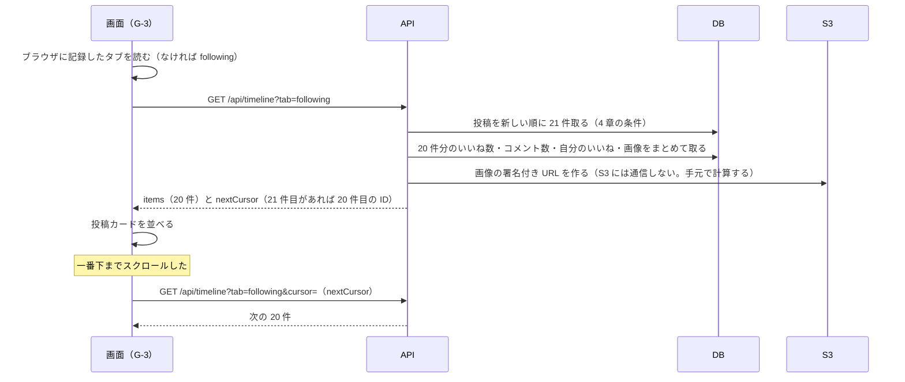

# 機能定義書 FN-02 タイムライン：タイムライン型 SNS アプリ（Raise timeline）

| 項目 | 内容 |
| --- | --- |
| 文書番号 | RT-FD-02 |
| 版数 | 0.1 |
| 作成日 | 2026-10-16 |
| 最終更新日 | 2026-10-16 |
| 作成者 | （氏名） |
| 上位文書 | [機能定義書](function-definition.md)（RT-FD） |
| 状態 | 承認待ち |

## 改訂履歴

| 版数 | 日付 | 内容 | 作成者 |
| --- | --- | --- | --- |
| 0.1 | 2026-10-16 | 初版。機能要件定義書 2.2（T-1〜T-8）を移し、3 章以降を追加 | （氏名） |

本書は機能定義書の一部である。承認は[機能定義書](function-definition.md)で一括して行う。API とメッセージの共通の決まりは機能定義書 3 章・4 章のとおり。

---

## 1. 概要

| 項目 | 内容 |
| --- | --- |
| 目的 | フォローした人の投稿と、全員の投稿を、新しい順に読めるようにする |
| 版 | 第 1 版 |
| 使う画面 | G-3 タイムライン画面 |
| 関係する機能 | FN-03 投稿（投稿カード・投稿フォーム）、FN-04 画像、FN-06 いいね、FN-07 フォロー（「フォロー中」の対象） |
| 前提 | 投稿カードの中身と操作は FN-03・FN-04・FN-06 で定める。本書は一覧の出し方だけを定める |

## 2. 機能要件

| ID | 内容 |
| --- | --- |
| T-1 | タイムライン画面（G-3）に「フォロー中」「すべて」の 2 つのタブを出す。「フォロー中」には自分とフォローしている人の投稿を、「すべて」には全ユーザーの投稿を出す |
| T-2 | 投稿は新しい順に 20 件ずつ出す。一番下までスクロールすると、次の 20 件を読み込んで続けて出す。読み込んでいる間は一覧の下に「読み込み中…」と表示する |
| T-3 | G-3 を開いたときは、前回最後に選んでいたタブを出す。初めて開いたときは「フォロー中」を出す。どのタブを選んだかはブラウザに記録する |
| T-4 | 「フォロー中」タブで、誰もフォローしておらず自分の投稿もないときは、一覧の代わりに M-8 を表示する |
| T-5 | 自分が投稿したときは、表示中のタブの一番上にその投稿を足す |
| T-6 | ほかの人の新しい投稿を自動では足さない。タブを押し直すか、画面を読み込み直すと、最新の 20 件から出し直す |
| T-7 | 読み込んでいる途中にほかの人が投稿しても、同じ投稿を 2 回出したり、抜かしたりしない |
| T-8 | 読み込みに失敗したときは M-9 と「再読み込み」ボタンを表示する。「再読み込み」で同じ読み込みをやり直す |

## 3. 処理の流れ

21 件取るのは、次の 1 件があるかどうか（nextCursor を null にするか）を知るためである。

## 4. 入力の確認

| 項目 | 型 | 必須 | 条件 | 守られないとき |
| --- | --- | --- | --- | --- |
| tab | 文字列 | ○ | following か all | 400 TAB_INVALID |
| cursor | 文字列 | | 前回の nextCursor。数字だけ | 400 CURSOR_INVALID |

## 5. 業務ルール

### 5.1 どの投稿を出すか

| タブ | 条件（SQL のイメージ） |
| --- | --- |
| フォロー中 | `posts.user_id = 自分の ID` または `posts.user_id IN (SELECT followee_id FROM follows WHERE follower_id = 自分の ID)` |
| すべて | 条件なし |

どちらも `posts.id < cursor`（cursor があるとき）を足し、`ORDER BY posts.id DESC LIMIT 21` で取る。ID は新しい投稿ほど大きいので（データ設計書 方針 2）、ID だけで「新しい順」と「続きの位置」を決められる。途中で投稿が増えても、増えた投稿は cursor より大きい ID になるため、同じ投稿を 2 回出さない（T-7）。

### 5.2 件数をまとめて取る

20 件の投稿のいいね数・コメント数・「自分がいいねしたか」・画像は、投稿ごとに SQL を出さず、20 件の ID を使って 1 回ずつ（合わせて 4 回）でまとめて取る（N+1 を作らない。N-2）。

### 5.3 画面の動き

| 場面 | 動き |
| --- | --- |
| タブを押した | 選んだタブをブラウザ（localStorage）に記録し、URL を ?tab= に合わせて、最新の 20 件から出し直す |
| 自分が投稿した | API から返った投稿を、表示中の一覧の先頭に足す（読み込み直さない。T-5） |
| 投稿を削除した | 一覧からその投稿を消す |
| フォローを外した | 次に読み込んだときから出さない（F-7）。表示中の一覧からは消さない |
| 削除された投稿が一覧に残っていた | 押して G-4 を開くと M-11（FN-03） |

## 6. API（案）

| メソッド | URL | 入力 | 出力（成功） | 主なエラー |
| --- | --- | --- | --- | --- |
| GET | /api/timeline?tab=&cursor= | 4 章のとおり | 200 `{"items":[PostView…],"nextCursor":"1234"}` | 400 TAB_INVALID・CURSOR_INVALID |

PostView の形は機能定義書 3.5 のとおり。tab=following で cursor がないときだけ、出力に自分のフォロー数 `"followingCount": 0` を足す（M-8 を出すかどうかを画面で決めるため）。

## 7. 使うデータ

| テーブル | 操作 | 内容 |
| --- | --- | --- |
| posts | R | 投稿 |
| follows | R | 「フォロー中」の対象 |
| users | R | 投稿者の表示名・ユーザー ID |
| post_images | R | 画像の置き場所 |
| likes | R | いいね数・自分がいいねしたか |
| comments | R | コメント数 |

## 8. 権限

ログインしている人なら誰でも、どちらのタブも見られる。

## 9. エラーとメッセージ

| 場面 | HTTP | code | メッセージ |
| --- | --- | --- | --- |
| tab・cursor が正しくない | 400 | TAB_INVALID・CURSOR_INVALID | M-9（画面で直すことはできないため） |
| 読み込みに失敗 | 500 | INTERNAL_ERROR | M-9 と「再読み込み」 |
| 「フォロー中」に出す投稿がなく、誰もフォローしていない | 200（items が空） | | M-8 |
| 「フォロー中」に出す投稿がないが、フォローしている人はいる | 200（items が空） | | 「まだ投稿がありません。」 |

## 10. テストの観点

- 「フォロー中」に、自分の投稿とフォローしている人の投稿だけが出て、フォローしていない人の投稿が出ない
- 「すべて」に全員の投稿が出る
- 投稿 41 件で、20 件 → 20 件 → 1 件と読めて、最後の nextCursor が null になる
- 1 ページ目を読んだ後にほかの人が 3 件投稿しても、2 ページ目に重複も抜けもない
- タブを切り替えて画面を開き直すと、最後に選んだタブが出る。localStorage が使えないブラウザでも「フォロー中」で動く
- 誰もフォローしていない新しいユーザーで M-8 が出る
- 投稿 1 万件・フォロー 1,000 人で、API が 1 秒以内に返る（N-2）
