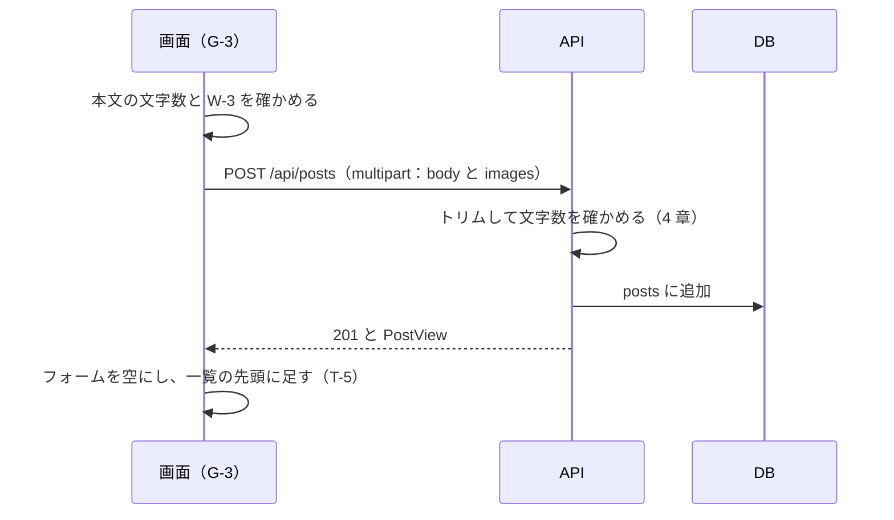
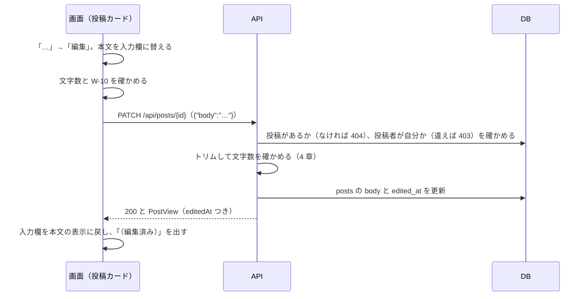
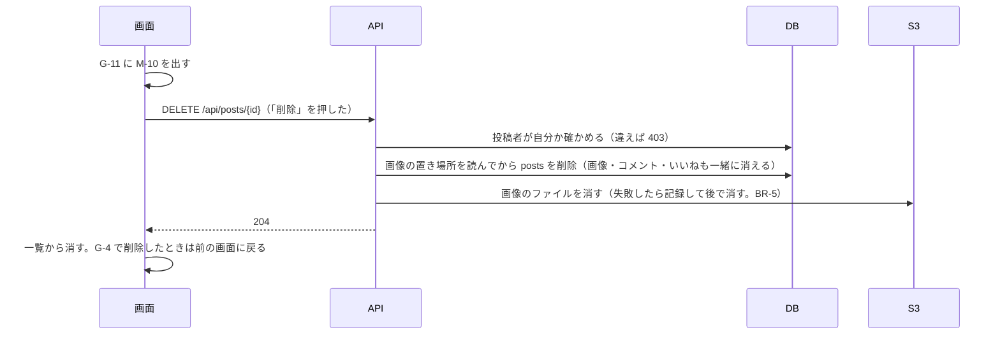

# 機能定義書 FN-03 投稿：タイムライン型 SNS アプリ（Raise timeline）

| 項目 | 内容 |
| --- | --- |
| 文書番号 | RT-FD-03 |
| 版数 | 0.2 |
| 作成日 | 2026-10-16 |
| 最終更新日 | 2026-10-17 |
| 作成者 | （氏名） |
| 上位文書 | [機能定義書](function-definition.md)（RT-FD） |
| 状態 | 承認待ち |

## 改訂履歴

| 版数 | 日付 | 内容 | 作成者 |
| --- | --- | --- | --- |
| 0.1 | 2026-10-16 | 初版。機能要件定義書 2.3（W-1〜W-8）を移し、3 章以降を追加 | （氏名） |
| 0.2 | 2026-10-17 | 投稿の編集（本文だけ）を追加（W-9〜W-11、3.2、4〜10 章） | （氏名） |

本書は機能定義書の一部である。承認は[機能定義書](function-definition.md)で一括して行う。API とメッセージの共通の決まりは機能定義書 3 章・4 章のとおり。

---

## 1. 概要

| 項目 | 内容 |
| --- | --- |
| 目的 | 280 文字までの文章を投稿・編集・削除し、1 つの投稿を詳しく見られるようにする |
| 版 | 第 1 版 |
| 使う画面 | G-3 タイムライン画面（投稿フォーム・投稿カード）、G-4 投稿の詳細画面、G-11 確認ダイアログ |
| 関係する機能 | FN-04 画像（投稿と一緒に保存する）、FN-05 コメント・FN-06 いいね（投稿の削除で一緒に消える）、FN-02 タイムライン・FN-09 プロフィール（投稿カードを並べる） |
| 前提 | 編集できるのは本文だけで、画像は変えられない（画像を変えたいときは削除して投稿し直す）。編集の履歴（前の本文）は残さない |

## 2. 機能要件

| ID | 内容 |
| --- | --- |
| W-1 | G-3 の上の投稿フォームに本文を入力して「投稿する」を押すと投稿する。投稿した後はフォームを空にする |
| W-2 | 本文はトリムした後で 0〜280 文字とする。入力欄の右下に残りの文字数を出し、280 文字を超えたら残りの文字数を赤字の負の数で出して「投稿する」を押せないようにする |
| W-3 | 本文が 0 文字で画像もないときは「投稿する」を押せないようにする。画像が 1 枚以上あれば本文は 0 文字でもよい |
| W-4 | 投稿は「投稿カード」で出す。表示名・@ユーザー ID・投稿日時・本文・画像・いいね数・コメント数を出す。インプレッション数とリツイートのボタンは出さない |
| W-5 | 本文の改行はそのまま出す。URL はリンクにしない。HTML の記号はそのまま文字として出す（N-15） |
| W-6 | 投稿カードの本文またはコメント数を押すと、投稿の詳細画面（G-4）を開く |
| W-7 | 自分の投稿カードにだけ「…」メニュー（「編集」「削除」）を出す。「削除」を押すと確認ダイアログ（G-11）に M-10 を表示し、「削除」でその投稿と画像・コメント・いいねを削除する。「キャンセル」では何もしない |
| W-8 | 削除された投稿の詳細画面を開いたときは、投稿の代わりに M-11 を表示する |
| W-9 | 「…」メニューの「編集」を押すと、その投稿カードの本文を入力欄に替え、今の本文を入れておく（画面は移らない）。「保存する」で本文を変え、「キャンセル」では変えずに元の表示に戻す。画像は表示したままで、変えられない |
| W-10 | 編集した本文の条件は W-2・W-3 と同じとする（280 文字まで。画像がない投稿は 1 文字以上）。本文を変えていないときは「保存する」を押せない |
| W-11 | 一度でも編集した投稿は、投稿日時の後ろに「（編集済み）」と出す。「（編集済み）」にマウスを乗せると、最後に編集した日時を出す。編集しても投稿日時と並び順（タイムラインでの位置）は変わらず、いいね・コメントもそのまま残す |

## 3. 処理の流れ

### 3.1 投稿

画像があるときの流れは FN-04 の 3 章のとおり。画像がないときは S3 を使わない。

送信中は「投稿する」を「投稿中…」にして押せなくする（2 回押して 2 つ投稿されないようにする）。

### 3.2 編集

送信中は「保存する」を「保存中…」にして押せなくする。失敗したときは入力欄と入力した本文を残して M-18 を出す（投稿が削除されていたときは M-11）。

### 3.3 削除

## 4. 入力の確認

| 項目 | 型 | 必須 | 条件 | 守られないとき |
| --- | --- | --- | --- | --- |
| body（本文） | 文字列 | | トリム後 0〜280 文字（コードポイント） | 400 BODY_TOO_LONG。画面では押せないので出ない |
| body と images | | | どちらか一方は必要（BR-2） | 400 POST_EMPTY |

編集（PATCH）のときは body だけを受け取り、同じ条件で確かめる。画像は元の投稿の枚数で BR-2 を確かめる（画像がある投稿なら、本文を 0 文字にしてもよい）。

## 5. 業務ルール

| No | ルール |
| --- | --- |
| 1 | 本文は前後の空白を取り除いて保存する。途中の改行・空白はそのまま残す |
| 2 | 本文に入っている HTML の記号（<、> など）は、保存するときも出すときも変えない。画面では React の通常の表示で文字として出す（N-15） |
| 3 | 削除は取り消せない。画像・コメント・いいねは外部キーの ON DELETE CASCADE で一緒に消える（データ設計書 5 章） |
| 4 | 削除した投稿の ID は使い回さない（連番のため） |
| 5 | 編集したときは body と edited_at（編集した時刻）だけを変える。created_at と ID は変えないので、タイムラインの並び順も変わらない |
| 6 | 編集の前の本文は残さない。編集の回数の上限と、編集できる期間の制限は設けない |
| 7 | 同じ投稿を 2 つの画面で同時に編集したときは、後から保存したほうの本文になる |

## 6. API（案）

| メソッド | URL | 入力 | 出力（成功） | 主なエラー |
| --- | --- | --- | --- | --- |
| POST | /api/posts | multipart：body（文字列）、images（ファイル 0〜4 個） | 201 PostView | 400 POST_EMPTY・BODY_TOO_LONG、画像のエラーは FN-04 |
| GET | /api/posts/{id} | なし | 200 PostView | 404 POST_NOT_FOUND |
| PATCH | /api/posts/{id} | `{"body":"…"}` | 200 PostView | 400 POST_EMPTY・BODY_TOO_LONG、403 FORBIDDEN、404 POST_NOT_FOUND |
| DELETE | /api/posts/{id} | なし | 204 | 403 FORBIDDEN、404 POST_NOT_FOUND |

## 7. 使うデータ

| テーブル | 操作 | 内容 |
| --- | --- | --- |
| posts | C R U D | 投稿の追加・読み取り・本文の編集・削除 |
| post_images | C R D | FN-04。投稿の削除で一緒に消える |
| comments・likes | R D | 件数を数える。投稿の削除で一緒に消える |
| users | R | 投稿者 |

## 8. 権限

| 操作 | 投稿者 | 第三者 |
| --- | --- | --- |
| 投稿する | できる | できる |
| 投稿・詳細を見る | できる | できる |
| 本文を編集する | できる | できない（「…」を出さない。API は 403） |
| 削除する | できる | できない（「…」を出さない。API は 403） |

## 9. エラーとメッセージ

| 場面 | HTTP | code | メッセージ |
| --- | --- | --- | --- |
| 本文が 280 文字を超える | 400 | BODY_TOO_LONG | M-14（画面で防ぐため、ふつうは出ない） |
| 本文も画像もない | 400 | POST_EMPTY | M-14（同上） |
| 投稿に失敗 | 500 | INTERNAL_ERROR | M-14。フォームの中身は残す |
| 他人の投稿を編集・削除しようとした | 403 | FORBIDDEN | M-18 |
| 削除された投稿を開いた・編集・削除しようとした | 404 | POST_NOT_FOUND | M-11 |
| 編集の保存に失敗 | 500 | INTERNAL_ERROR | M-18。入力欄と入力した本文は残す |
| 削除に失敗 | 500 | INTERNAL_ERROR | M-18 |

## 10. テストの観点

- 本文 280 文字は投稿でき、281 文字は押せない。前後に空白を足した 280 文字も投稿できる
- 絵文字（肌の色つき・国旗）を含む本文の文字数が、画面と API で同じに数えられる
- 本文 0 文字・画像なしで押せない。画像 1 枚だけなら投稿できる
- 「」を投稿しても、そのままの文字で表示されて動かない
- 「投稿する」を素早く 2 回押しても投稿が 1 つだけできる
- 他人の投稿に「…」が出ない。他人の投稿の ID で DELETE を送ると 403
- 削除すると画像・コメント・いいねも消え、S3 のファイルも消える
- 削除された投稿の URL を開くと M-11
- 編集：本文を 280 文字に直すと保存でき、281 文字では押せない。本文を変えていないときは押せない
- 編集：画像のない投稿の本文を空にできない。画像のある投稿は本文を空にできる
- 編集した投稿に「（編集済み）」が出て、タイムラインでの位置・投稿日時・いいね数・コメント数が変わらない。編集していない投稿には出ない
- 編集の「キャンセル」で、入力した内容が捨てられて元の本文に戻る
- 他人の投稿の ID で PATCH を送ると 403、削除された投稿の ID で送ると 404（M-11）
- 編集した本文に「」を入れても、そのままの文字で表示されて動かない
