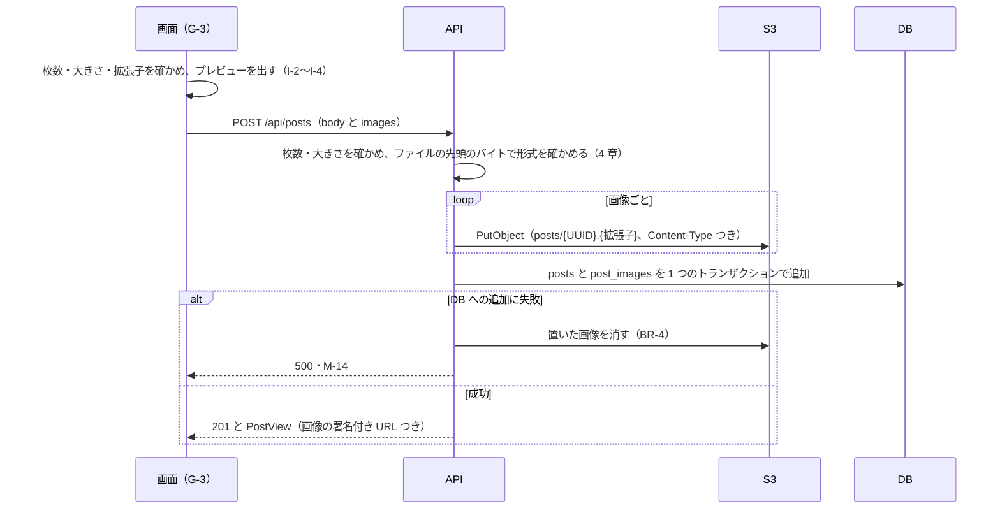
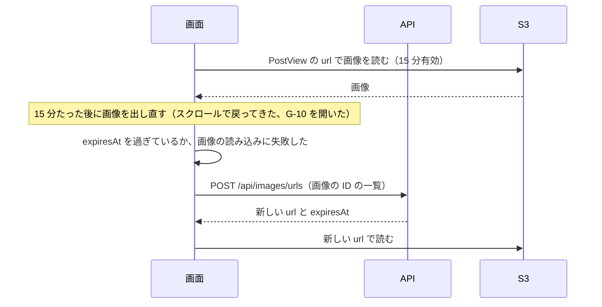

# 機能定義書 FN-04 画像：タイムライン型 SNS アプリ（Raise timeline）

| 項目 | 内容 |
| --- | --- |
| 文書番号 | RT-FD-04 |
| 版数 | 0.6 |
| 作成日 | 2026-10-16 |
| 最終更新日 | 2026-10-31 |
| 作成者 | （氏名） |
| 上位文書 | [機能定義書](function-definition.md)（RT-FD） |
| 状態 | 承認待ち |

## 改訂履歴

| 版数 | 日付 | 内容 | 作成者 |
| --- | --- | --- | --- |
| 0.1 | 2026-10-16 | 初版。機能要件定義書 2.4（I-1〜I-8）を移し、3 章以降を追加 | （氏名） |
| 0.2 | 2026-10-17 | 投稿の編集（FN-03 W-9）では画像を変えられないことと、アイコン画像（FN-09）との関係を 1 章・8 章に書いた | （氏名） |
| 0.3 | 2026-10-19 | 開発中の画像の保存先を S3 の開発用のバケットに変更（1 章）。URL の取り直しのエラーの code を書いた（6 章）。テストの観点に、データベースへの保存の失敗と S3 から消せなかったときを足した（10 章） | （氏名） |
| 0.4 | 2026-10-20 | URL を取り直しても画像を出せないときの動き（取り直しを繰り返さない）と、同じ投稿の取り直しを 1 回にまとめることを 3.2 に書いた。テストの観点を足した（10 章） | （氏名） |
| 0.5 | 2026-10-30 | 公開の構成の変更（インフラ設計書 0.8）に合わせ、S3 を読み書きする IAM ロールを EC2 のものから API のタスク（ECS Fargate）のものに直した（8 章） | （氏名） |
| 0.6 | 2026-10-31 | テストの観点に ID（TC-04-1〜）を付けた（10 章）。テスト仕様書で、観点ごとに確かめるテストを決めるため | （氏名） |

本書は機能定義書の一部である。承認は[機能定義書](function-definition.md)で一括して行う。API とメッセージの共通の決まりは機能定義書 3 章・4 章のとおり。

---

## 1. 概要

| 項目 | 内容 |
| --- | --- |
| 目的 | 投稿に画像を 4 枚まで添え、S3 に保存して、誰でも見られるようにする |
| 版 | 第 1 版 |
| 使う画面 | G-3 の投稿フォーム（選択・プレビュー）、投稿カード（G-3・G-4・G-6）、G-10 画像の拡大ダイアログ |
| 関係する機能 | FN-03 投稿（画像は投稿と一緒に保存・削除する。投稿を編集しても画像は変えられない）、FN-09 プロフィール（アイコン画像も、本書の形式の確かめ方と署名付き URL の決まりを使う） |
| 前提 | 画像は AWS S3（開発中は開発用のバケット、自動のテストでは MinIO）に置き、データベースには置き場所だけを持つ（要件定義書 P-2）。S3 は外から読めず、署名付き URL で見せる（N-14） |

## 2. 機能要件

| ID | 内容 |
| --- | --- |
| I-1 | 投稿フォームの「画像を選ぶ」を押すと、ファイルを選ぶ画面を開く。選べるのは JPEG・PNG・GIF・WebP で、一度に複数選べる |
| I-2 | 画像は 1 つの投稿に 4 枚までとする。合わせて 5 枚以上を選んだときは、先に選んだ 4 枚だけを添え、M-12 を表示する |
| I-3 | 1 枚 5MB を超える画像、または I-1 以外の形式の画像は添えず、M-13 を表示する。形式は拡張子だけでなく、ファイルの中身でも確かめる |
| I-4 | 選んだ画像は投稿フォームの中に小さく並べて表示し、それぞれの「×」で外せる |
| I-5 | 「投稿する」を押すと、画像を S3 に保存してから投稿する。保存に失敗したときは投稿せず、M-14 を表示する。フォームの本文と画像はそのまま残す |
| I-6 | 投稿カードには、画像を選んだ順にタイル状に並べて出す（1 枚は大きく 1 枚、2〜4 枚は 2 列） |
| I-7 | 画像を押すと、画像の拡大ダイアログ（G-10）で大きく出す。複数あるときは左右の矢印で切り替える。Esc キー・「×」・画像の外側のクリックで閉じる |
| I-8 | 画像の URL は 15 分で使えなくなる（N-14）。画面を開いたまま期限が切れて画像を出せなくなったときは、自動で新しい URL を取り直して出す |

## 3. 処理の流れ

### 3.1 画像つきの投稿

S3 への保存の途中で失敗したときは、それまでに置いた画像を消して 500・M-14 を返す。

### 3.2 表示と URL の取り直し

- 取り直しは投稿ごとにまとめて行う。同じ投稿の画像がいくつ同時に読み込めなくても、`POST /api/images/urls` は 1 回だけ送り、取り直し中ならその結果を待つ
- 取り直した url がまだ期限内なのに読み込めないときは、取り直しても直らないとみなし、もう取り直さずに画像の場所に「画像を読み込めませんでした」と出す。取り直した url も期限を過ぎていれば、また取り直す
- 取り直しの結果に入っていない画像（削除された画像。6 章）があるときも、「画像を読み込めませんでした」と出す

## 4. 入力の確認

| 項目 | 条件 | 画面で確かめる | API で確かめる | 守られないとき |
| --- | --- | --- | --- | --- |
| 枚数 | 1 投稿 0〜4 枚 | ○ | ○ | M-12（API は 400 TOO_MANY_IMAGES） |
| 大きさ | 1 枚 5,242,880 バイト以下 | ○ | ○ | M-13（API は 413 IMAGE_TOO_LARGE） |
| 形式 | JPEG・PNG・GIF・WebP | 拡張子と File.type | ファイルの先頭のバイト（マジックナンバー） | M-13（API は 400 IMAGE_TYPE_INVALID） |

| 形式 | ファイルの先頭のバイト |
| --- | --- |
| JPEG | FF D8 FF |
| PNG | 89 50 4E 47 0D 0A 1A 0A |
| GIF | 47 49 46 38（"GIF8"） |
| WebP | 52 49 46 46（"RIFF"）＋ 8〜11 バイト目が 57 45 42 50（"WEBP"） |

Spring Boot の 1 回の送信の上限は 21MB（画像 4 枚 × 5MB ＋ 本文）にする。超えたら 413。

## 5. 業務ルール

| No | ルール |
| --- | --- |
| 1 | S3 のキーは「posts/{UUID}.{形式から決めた拡張子}」とする。元のファイル名は使わず、保存もしない |
| 2 | S3 には Content-Type（image/jpeg など）を付けて置く。ブラウザが画像として表示するため |
| 3 | 画像の大きさの縮小・変換はしない（第 1 版）。写真の位置情報（Exif）は消さないため、操作マニュアルで注意する |
| 4 | 署名付き URL の有効期限は 15 分。URL を作るのに S3 との通信はいらない（手元で計算する）ため、一覧を出すたびに作ってよい |
| 5 | 並び順は、利用者が選んだ順に 0〜3（sort_order） |
| 6 | 投稿を削除したときの画像の消し方は、データ設計書 BR-5 のとおり |

## 6. API（案）

| メソッド | URL | 入力 | 出力（成功） | 主なエラー |
| --- | --- | --- | --- | --- |
| POST | /api/posts | FN-03 のとおり。images にファイルを 0〜4 個 | 201 PostView | 400 TOO_MANY_IMAGES・IMAGE_TYPE_INVALID、413 IMAGE_TOO_LARGE、500 |
| POST | /api/images/urls | `{"imageIds":[55,56]}`（50 個まで） | 200 `{"items":[{"id":55,"url":"…","expiresAt":"…"}]}` | 400 BAD_REQUEST（51 個以上・imageIds がない） |

POST /api/images/urls は、削除された画像の ID を受け取ったときは、その ID を結果に含めない（エラーにしない）。

## 7. 使うデータ

| 対象 | 操作 | 内容 |
| --- | --- | --- |
| post_images | C R | 画像の置き場所・形式・大きさ・並び順 |
| S3 | C R D | 画像のファイル。R は署名付き URL の発行 |

## 8. 権限

| 操作 | 投稿者 | 第三者 |
| --- | --- | --- |
| 画像を添える | できる（自分の投稿だけ） | — |
| 画像を見る | できる | できる |
| 画像を消す | 投稿の削除と一緒にだけ（画像だけを消す機能はない） | できない |

API のタスク（ECS Fargate）の IAM ロールは S3 の posts/（投稿の画像）と icons/（アイコン画像。FN-09）の下だけを読み書きできる（インフラ設計書 3.3）。

## 9. エラーとメッセージ

| 場面 | HTTP | code | メッセージ |
| --- | --- | --- | --- |
| 5 枚以上 | 400 | TOO_MANY_IMAGES | M-12 |
| 5MB を超える | 413 | IMAGE_TOO_LARGE | M-13 |
| 形式が違う（拡張子を変えたファイルを含む） | 400 | IMAGE_TYPE_INVALID | M-13 |
| S3 への保存に失敗 | 500 | IMAGE_UPLOAD_FAILED | M-14。フォームの中身は残す |
| URL の取り直しに失敗 | 500 | INTERNAL_ERROR | 画像の場所に「画像を読み込めませんでした」と出す |

## 10. テストの観点

- TC-04-1：4 枚は添えられ、5 枚目で M-12。一度に 6 枚選ぶと先の 4 枚だけが残る
- TC-04-2：5MB ちょうどは添えられ、5MB＋1 バイトは M-13
- TC-04-3：拡張子を .jpg に変えたテキストファイル・PDF を、画面の確認を外して API に直接送っても 400 になる
- TC-04-4：画像だけの投稿（本文 0 文字）ができる
- TC-04-5：S3 に画像を置けない状態で投稿すると M-14 で、投稿も画像の行もできておらず、途中まで置いた画像も残っていない。データベースへの保存に失敗したときも、置いた画像を消す（BR-4）
- TC-04-6：投稿を削除すると S3 の画像も消える。S3 から消せなかったときは記録し（storage_deletions）、1 日 1 回消し直す（BR-5）
- TC-04-7：S3 のバケットの URL を直接開いても画像が見られない（403）
- TC-04-8：画面を 16 分開いたままにしてから G-10 を開くと、画像が出る（URL を取り直す）
- TC-04-9：4 枚の画像が同時に読み込めなくても、取り直しは 1 回だけ送る
- TC-04-10：取り直した URL でも読み込めないときは、取り直しを繰り返さずに「画像を読み込めませんでした」と出す
- TC-04-11：1〜4 枚それぞれで、カードの並べ方が画面設計書 3.7 のとおりになる
