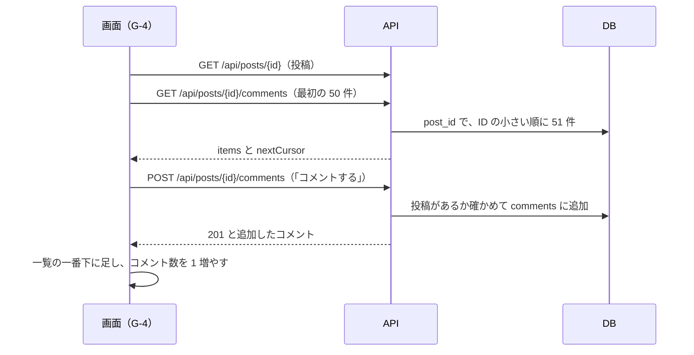

# 機能定義書 FN-05 コメント：タイムライン型 SNS アプリ（Raise timeline）

| 項目 | 内容 |
| --- | --- |
| 文書番号 | RT-FD-05 |
| 版数 | 0.2 |
| 作成日 | 2026-10-16 |
| 最終更新日 | 2026-10-17 |
| 作成者 | （氏名） |
| 上位文書 | [機能定義書](function-definition.md)（RT-FD） |
| 状態 | 承認待ち |

## 改訂履歴

| 版数 | 日付 | 内容 | 作成者 |
| --- | --- | --- | --- |
| 0.1 | 2026-10-16 | 初版。機能要件定義書 2.5（C-1〜C-6）を移し、3 章以降を追加 | （氏名） |
| 0.2 | 2026-10-17 | Comment の author にアイコンの URL（iconUrl）を追加（FN-09 PF-10） | （氏名） |

本書は機能定義書の一部である。承認は[機能定義書](function-definition.md)で一括して行う。API とメッセージの共通の決まりは機能定義書 3 章・4 章のとおり。

---

## 1. 概要

| 項目 | 内容 |
| --- | --- |
| 目的 | 投稿に文章で返事をし、その中身を誰でも読めるようにする |
| 版 | 第 1 版 |
| 使う画面 | G-4 投稿の詳細画面（コメントフォーム・一覧）、G-11 確認ダイアログ、投稿カードのコメント数 |
| 関係する機能 | FN-03 投稿（投稿を削除するとコメントも消える） |
| 前提 | コメントへのコメント（返信の返信）はできない。コメントは編集できない |

## 2. 機能要件

| ID | 内容 |
| --- | --- |
| C-1 | G-4 のコメントフォームに本文を入力して「コメントする」を押すと、その投稿にコメントする。コメントの一覧の一番下に足し、フォームを空にする |
| C-2 | 本文はトリムした後で 1〜280 文字とする。残りの文字数の出し方と、押せないときの扱いは W-2・W-3 と同じ |
| C-3 | コメントは古い順に 50 件ずつ出す。51 件以上あるときは一覧の下に「さらに表示」を出し、押すと次の 50 件を出す |
| C-4 | 各コメントには、表示名・@ユーザー ID・コメント日時・本文を出す。表示名を押すとその人のプロフィール画面（G-6）を開く |
| C-5 | 自分のコメントにだけ「削除」を出す。押すと G-11 に M-15 を表示し、「削除」でコメントを削除する。投稿者も、ほかの人が付けたコメントは削除できない |
| C-6 | コメントの中身と件数は誰でも見られる |

## 3. 処理の流れ

まだ「さらに表示」で読んでいないコメントがあるときに自分がコメントした場合も、一覧の一番下に足す。続きを読み込んだときに、自分のコメントは重ねて出さない（ID で重複を除く）。

## 4. 入力の確認

| 項目 | 型 | 必須 | 条件 | 守られないとき |
| --- | --- | --- | --- | --- |
| body（本文） | 文字列 | ○ | トリム後 1〜280 文字（コードポイント） | 400 COMMENT_INVALID。画面では押せないので出ない |

## 5. 業務ルール

| No | ルール |
| --- | --- |
| 1 | コメントの並び順は ID の小さい順（古い順）。続きは「最後に出したコメントの ID より大きいもの」で読む |
| 2 | 本文の扱い（改行・HTML の記号）は投稿と同じ（FN-03 の 5 章 No.1・No.2） |
| 3 | 投稿が削除されたら、その投稿のコメントも消える（ON DELETE CASCADE） |
| 4 | 投稿カードのコメント数は、表示した時点の件数。自分のコメント・削除はすぐに ±1 する（L-6 と同じ考え方） |

## 6. API（案）

| メソッド | URL | 入力 | 出力（成功） | 主なエラー |
| --- | --- | --- | --- | --- |
| GET | /api/posts/{id}/comments?cursor= | cursor（前回の nextCursor） | 200 `{"items":[Comment…],"nextCursor":…}` | 404 POST_NOT_FOUND |
| POST | /api/posts/{id}/comments | `{"body":"…"}` | 201 Comment | 400 COMMENT_INVALID、404 POST_NOT_FOUND |
| DELETE | /api/comments/{commentId} | なし | 204 | 403 FORBIDDEN、404 COMMENT_NOT_FOUND |

Comment の形：`{"id":9,"author":{"username":"hana","displayName":"はなこ","iconUrl":null},"body":"…","mine":false,"createdAt":"…"}`

## 7. 使うデータ

| テーブル | 操作 | 内容 |
| --- | --- | --- |
| comments | C R D | コメントの追加・一覧・削除 |
| posts | R | 投稿があるか |
| users | R | コメントした人 |

## 8. 権限

| 操作 | 投稿者 | コメントした本人 | 第三者 |
| --- | --- | --- | --- |
| コメントする | できる | できる | できる |
| コメントを読む | できる | できる | できる |
| コメントを削除する | 自分のコメントだけ | できる | できない |

## 9. エラーとメッセージ

| 場面 | HTTP | code | メッセージ |
| --- | --- | --- | --- |
| 本文が空・280 文字を超える | 400 | COMMENT_INVALID | M-18（画面で防ぐため、ふつうは出ない） |
| コメント先の投稿が削除された | 404 | POST_NOT_FOUND | M-11 |
| 他人のコメントを削除しようとした | 403 | FORBIDDEN | M-18 |
| すでに削除されたコメントを削除しようとした | 404 | COMMENT_NOT_FOUND | 一覧から消すだけで、メッセージは出さない |
| コメント・削除に失敗 | 500 | INTERNAL_ERROR | M-18。フォームの中身は残す |

## 10. テストの観点

- 280 文字はコメントでき、281 文字・空白だけは押せない
- 51 件あるとき、最初は 50 件と「さらに表示」が出て、押すと 51 件目が出て「さらに表示」が消える
- 投稿者が、ほかの人のコメントに「削除」が出ず、API で消そうとすると 403
- 投稿を削除すると、そのコメントもすべて消える
- 投稿者でもコメントした本人でもない人（第三者）が、コメントの中身と件数を見られる
- コメントを書いている間に投稿が削除されたら、M-11 が出る
