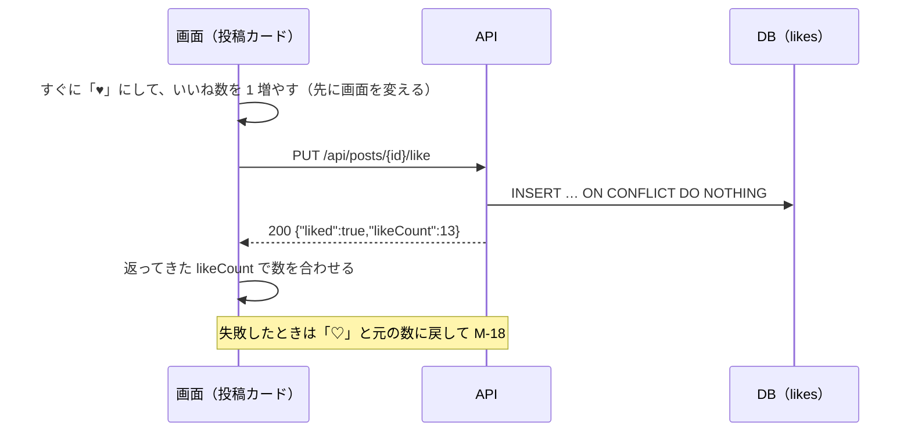

# 機能定義書 FN-06 いいね：タイムライン型 SNS アプリ（Raise timeline）

| 項目 | 内容 |
| --- | --- |
| 文書番号 | RT-FD-06 |
| 版数 | 0.1 |
| 作成日 | 2026-10-16 |
| 最終更新日 | 2026-10-16 |
| 作成者 | （氏名） |
| 上位文書 | [機能定義書](function-definition.md)（RT-FD） |
| 状態 | 承認待ち |

## 改訂履歴

| 版数 | 日付 | 内容 | 作成者 |
| --- | --- | --- | --- |
| 0.1 | 2026-10-16 | 初版。機能要件定義書 2.6（L-1〜L-6）を移し、3 章以降を追加 | （氏名） |

本書は機能定義書の一部である。承認は[機能定義書](function-definition.md)で一括して行う。API とメッセージの共通の決まりは機能定義書 3 章・4 章のとおり。

---

## 1. 概要

| 項目 | 内容 |
| --- | --- |
| 目的 | 投稿に好意の印を付け、その件数と、誰が付けたかを誰でも見られるようにする |
| 版 | 第 1 版 |
| 使う画面 | 投稿カード（G-3・G-4・G-6）の「♡」といいね数、G-5 いいねした人の一覧画面 |
| 関係する機能 | FN-03 投稿（投稿を削除するといいねも消える）、FN-07 フォロー（G-5 のフォローボタン） |
| 前提 | いいねした人の一覧を誰でも見られることが、本アプリの特徴の 1 つである（要件定義書 1.2 の 2） |

## 2. 機能要件

| ID | 内容 |
| --- | --- |
| L-1 | 投稿カードの「♡」を押すといいねする。「♥」（色付き）に変え、いいね数を 1 増やす |
| L-2 | いいねした投稿の「♥」を押すと、いいねを取り消す。「♡」に戻し、いいね数を 1 減らす |
| L-3 | いいねは 1 人 1 投稿に 1 つまでとする。続けて何回押しても 2 つ以上にはならない |
| L-4 | 自分の投稿にもいいねできる |
| L-5 | いいね数を押すと、いいねした人の一覧画面（G-5）を開く。新しくいいねした順に 20 件ずつ出し、一番下までスクロールすると次の 20 件を出す |
| L-6 | いいね数・コメント数は、画面を表示した時点の値を出す。自分の操作はすぐに反映し、ほかの人の操作は画面を開き直したときに反映する。0 件のときも「0」と出す |

## 3. 処理の流れ

画面を先に変えるのは、押してから反映までを 0.5 秒以内（N-3）にするためである。返ってきた likeCount で、ほかの人の操作も含めた最新の数に合わせる。

押している間に続けて押されたときは、最後に押した状態（いいねする／しない）だけを API に送る。

## 4. 入力の確認

なし（入力する項目がない）。

## 5. 業務ルール

| No | ルール |
| --- | --- |
| 1 | いいねは likes の主キー（user_id, post_id）で 1 つに保つ。すでにあるときの PUT、ないときの DELETE はエラーにしない（データ設計書 BR-6） |
| 2 | PUT と DELETE は何回送っても同じ結果になる（冪等）。そのため、画面は失敗したときにそのまま送り直してよい |
| 3 | いいねした人の一覧は created_at の新しい順。同じ日時のときは user_id の大きい順。続きは「最後に出した行の日時と user_id」で読む |
| 4 | 投稿を削除したら、その投稿のいいねも消える（ON DELETE CASCADE） |

## 6. API（案）

| メソッド | URL | 入力 | 出力（成功） | 主なエラー |
| --- | --- | --- | --- | --- |
| PUT | /api/posts/{id}/like | なし | 200 `{"liked":true,"likeCount":13}` | 404 POST_NOT_FOUND |
| DELETE | /api/posts/{id}/like | なし | 200 `{"liked":false,"likeCount":12}` | 404 POST_NOT_FOUND |
| GET | /api/posts/{id}/likes?cursor= | cursor | 200 `{"items":[UserSummary…],"nextCursor":…,"totalCount":12}` | 404 POST_NOT_FOUND |

UserSummary の形は機能定義書 3.5 のとおり。totalCount は G-5 の見出し「いいね 12 件」に使う。

## 7. 使うデータ

| テーブル | 操作 | 内容 |
| --- | --- | --- |
| likes | C R D | いいね・取り消し・一覧・件数 |
| posts | R | 投稿があるか |
| users | R | いいねした人 |
| follows | R | G-5 のフォローボタンの状態（自分がフォローしているか） |

## 8. 権限

| 操作 | 投稿者 | 第三者 |
| --- | --- | --- |
| いいねする・取り消す | できる（自分の投稿にも） | できる |
| いいね数・いいねした人の一覧を見る | できる | できる |
| ほかの人のいいねを消す | できない | できない |

## 9. エラーとメッセージ

| 場面 | HTTP | code | メッセージ |
| --- | --- | --- | --- |
| 投稿が削除されていた | 404 | POST_NOT_FOUND | M-11。カードを一覧から消す |
| いいね・取り消しに失敗 | 500 | INTERNAL_ERROR | M-18。「♡」と数を元に戻す |
| 一覧の読み込みに失敗 | 500 | INTERNAL_ERROR | M-9 と「再読み込み」 |

## 10. テストの観点

- 「♡」を 10 回素早く押しても、likes の行は 0 か 1 で、最後に押した状態と合っている
- 2 つのブラウザで同じ人が同じ投稿にいいねしても、行は 1 つ
- 自分の投稿にいいねできる
- 第三者が G-5 で、いいねした人の一覧と件数を見られる。21 人いるとき 20 人 → 1 人と読める
- API を止めた状態で押すと、「♡」と数が元に戻り M-18 が出る
- いいねしてから投稿を削除すると、likes の行も消える
