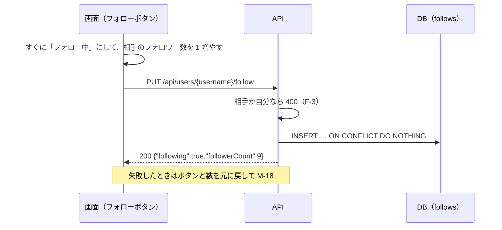

# 機能定義書 FN-07 フォロー：タイムライン型 SNS アプリ（Raise timeline）

| 項目 | 内容 |
| --- | --- |
| 文書番号 | RT-FD-07 |
| 版数 | 0.1 |
| 作成日 | 2026-10-16 |
| 最終更新日 | 2026-10-16 |
| 作成者 | （氏名） |
| 上位文書 | [機能定義書](function-definition.md)（RT-FD） |
| 状態 | 承認待ち |

## 改訂履歴

| 版数 | 日付 | 内容 | 作成者 |
| --- | --- | --- | --- |
| 0.1 | 2026-10-16 | 初版。機能要件定義書 2.7（F-1〜F-7）を移し、3 章以降を追加 | （氏名） |

本書は機能定義書の一部である。承認は[機能定義書](function-definition.md)で一括して行う。API とメッセージの共通の決まりは機能定義書 3 章・4 章のとおり。

---

## 1. 概要

| 項目 | 内容 |
| --- | --- |
| 目的 | 読みたい人をフォローして「フォロー中」タブに投稿を出し、誰が誰をフォローしているかを誰でも見られるようにする |
| 版 | 第 1 版 |
| 使う画面 | G-6 プロフィール画面（フォローボタン・件数）、G-8 フォロー中・フォロワーの一覧画面、ユーザーの行（G-5・G-8・G-9）のフォローボタン |
| 関係する機能 | FN-02 タイムライン（「フォロー中」の対象）、FN-08 ユーザー検索（フォローする人を探す）、FN-09 プロフィール |
| 前提 | 相手の承認はいらない（鍵アカウントはない。要件定義書 2.2） |

## 2. 機能要件

| ID | 内容 |
| --- | --- |
| F-1 | ほかの人のプロフィール画面（G-6）と、ユーザーの一覧（G-5・G-8・G-9）の「フォローする」を押すと、その人をフォローする。ボタンを「フォロー中」に変え、相手のフォロワー数を 1 増やす |
| F-2 | 「フォロー中」ボタンを押すと、確認なしでフォローを外す。マウスを乗せている間は、ボタンの文字を「フォロー解除」に変える |
| F-3 | 相手の承認はいらない。自分自身には「フォローする」ボタンを出さない |
| F-4 | 同じ人を 2 回以上フォローすることはできない |
| F-5 | G-6 にフォロー数とフォロワー数を出す。押すと、フォロー中・フォロワーの一覧画面（G-8）を開く |
| F-6 | G-8 には「フォロー中」「フォロワー」の 2 つのタブを出し、新しくフォローした順に 20 件ずつ出す。フォロー中・フォロワーの一覧と件数は誰でも見られる |
| F-7 | フォローを外しても、その人の投稿に付けたいいね・コメントは残す。外した人の投稿は、次に読み込んだときから「フォロー中」タブに出さない |

## 3. 処理の流れ

いいね（FN-06 の 3 章）と同じく、先に画面を変え、返ってきた件数で合わせる。同じ画面に同じ人のボタンが複数あるとき（G-5 と G-6 を行き来したときなど）は、画面の中で状態を 1 つにまとめて、どこでも同じ表示にする。

## 4. 入力の確認

| 項目 | 条件 | 守られないとき |
| --- | --- | --- |
| フォローする相手（URL の username） | 存在するユーザー。自分ではない | 404 USER_NOT_FOUND、400 CANNOT_FOLLOW_SELF |

## 5. 業務ルール

| No | ルール |
| --- | --- |
| 1 | フォローは follows の主キー（follower_id, followee_id）で 1 つに保つ。自分自身のフォローは CHECK 制約でも止める（データ設計書 4.6） |
| 2 | PUT・DELETE は何回送っても同じ結果になる（冪等。データ設計書 BR-6） |
| 3 | 一覧の並び順は created_at の新しい順。同じ日時のときは相手の ID の大きい順 |
| 4 | フォロー数・フォロワー数はその都度数える（データ設計書 方針 1） |
| 5 | フォローを外しても、いいね・コメントはそのまま残す（F-7） |

## 6. API（案）

| メソッド | URL | 入力 | 出力（成功） | 主なエラー |
| --- | --- | --- | --- | --- |
| PUT | /api/users/{username}/follow | なし | 200 `{"following":true,"followerCount":9}` | 400 CANNOT_FOLLOW_SELF、404 USER_NOT_FOUND |
| DELETE | /api/users/{username}/follow | なし | 200 `{"following":false,"followerCount":8}` | 404 USER_NOT_FOUND |
| GET | /api/users/{username}/following?cursor= | cursor | 200 `{"items":[UserSummary…],"nextCursor":…}` | 404 USER_NOT_FOUND |
| GET | /api/users/{username}/followers?cursor= | cursor | 200 `{"items":[UserSummary…],"nextCursor":…}` | 404 USER_NOT_FOUND |

フォロー数・フォロワー数は、プロフィールの API（FN-09）で返す。

## 7. 使うデータ

| テーブル | 操作 | 内容 |
| --- | --- | --- |
| follows | C R D | フォロー・解除・一覧・件数 |
| users | R | 相手がいるか、一覧のユーザー |

## 8. 権限

| 操作 | 本人 | 第三者 |
| --- | --- | --- |
| フォローする・外す | 自分のフォローだけ | — |
| フォロー中・フォロワーの一覧と件数を見る | できる | できる |
| 自分のフォロワーを外す | できない（相手のフォローを消すことはできない） | できない |

## 9. エラーとメッセージ

| 場面 | HTTP | code | メッセージ |
| --- | --- | --- | --- |
| 自分をフォローしようとした | 400 | CANNOT_FOLLOW_SELF | M-18（ボタンを出さないため、ふつうは出ない） |
| 相手のユーザーがいない | 404 | USER_NOT_FOUND | M-17 |
| フォロー・解除に失敗 | 500 | INTERNAL_ERROR | M-18。ボタンと数を元に戻す |

## 10. テストの観点

- フォローすると、相手の投稿が「フォロー中」タブに出る。外すと、次に読み込んだときに出なくなる
- 自分のプロフィールにはフォローボタンが出ず、API で自分をフォローすると 400
- ボタンを素早く何回押しても、follows の行は 0 か 1 で、最後に押した状態と合っている
- 第三者が、ほかの人のフォロー中・フォロワーの一覧と件数を見られる
- フォローを外しても、その人の投稿へのいいね・コメントが残る
- G-5 でフォローしてから G-6 を開くと「フォロー中」になっている
