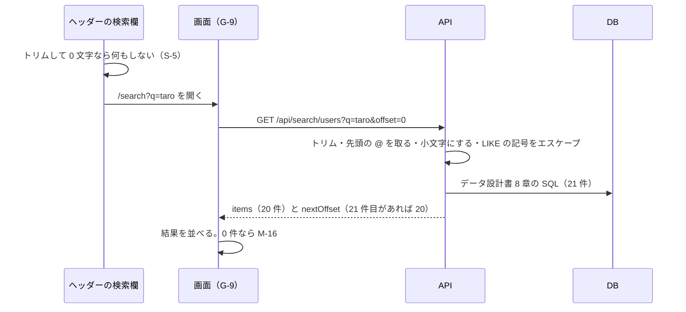

# 機能定義書 FN-08 ユーザー検索：タイムライン型 SNS アプリ（Raise timeline）

| 項目 | 内容 |
| --- | --- |
| 文書番号 | RT-FD-08 |
| 版数 | 0.3 |
| 作成日 | 2026-10-16 |
| 最終更新日 | 2026-10-31 |
| 作成者 | （氏名） |
| 上位文書 | [機能定義書](function-definition.md)（RT-FD） |
| 状態 | 承認待ち |

## 改訂履歴

| 版数 | 日付 | 内容 | 作成者 |
| --- | --- | --- | --- |
| 0.1 | 2026-10-16 | 初版。機能要件定義書 2.8（S-1〜S-9）を移し、3 章以降を追加 | （氏名） |
| 0.2 | 2026-10-23 | API の URL を /api/users/search から /api/search/users に変えた（3 章・6 章）。/api/users/{username}（プロフィール）とぶつかり、「search」というユーザー ID の人のプロフィールが開けなくなるため。offset が 1,000 のときは空の一覧を返すことを書いた（4 章） | （氏名） |
| 0.3 | 2026-10-31 | テストの観点に ID（TC-08-1〜）を付けた（10 章）。テスト仕様書で、観点ごとに確かめるテストを決めるため | （氏名） |

本書は機能定義書の一部である。承認は[機能定義書](function-definition.md)で一括して行う。API とメッセージの共通の決まりは機能定義書 3 章・4 章のとおり。

---

## 1. 概要

| 項目 | 内容 |
| --- | --- |
| 目的 | フォローしたい人を、ユーザー ID か表示名で探せるようにする |
| 版 | 第 1 版 |
| 使う画面 | 全画面のヘッダーの検索欄、G-9 ユーザー検索の結果画面 |
| 関係する機能 | FN-07 フォロー（結果の行からフォローする）、FN-09 プロフィール（結果の行から開く） |
| 前提 | 検索するのはユーザーだけ。投稿・ハッシュタグは検索しない（要件定義書 2.2）。入力中の候補は出さない |

## 2. 機能要件

| ID | 内容 |
| --- | --- |
| S-1 | ログインした後のすべての画面のヘッダーに、ユーザーの検索欄を出す。入力欄には薄い文字で「ユーザーを検索」と出す |
| S-2 | 検索欄に文字を入力して Enter キーまたは虫めがねのボタンを押すと、ユーザー検索の結果画面（G-9）を開く。G-9 でも同じ検索欄で検索し直せる |
| S-3 | 検索の対象は、ユーザー ID と表示名とする。自己紹介と投稿は対象にしない |
| S-4 | 入力した文字を、ユーザー ID か表示名のどこかに含むユーザーを探す（部分一致）。英字の大文字・小文字は区別しない。先頭の「@」は取り除いてから探す |
| S-5 | 検索する文字はトリムした後で 1〜30 文字とする。31 文字目以降は入力できない。0 文字のときは検索しない |
| S-6 | 結果は次の順に並べる。(1) ユーザー ID が完全に一致する人、(2) ユーザー ID が入力した文字で始まる人、(3) 表示名が入力した文字で始まる人、(4) それ以外で含む人。同じ順位の中はフォロワーの多い順、それも同じならユーザー ID の順とする |
| S-7 | 結果は 20 件ずつ出し、一番下までスクロールすると次の 20 件を出す |
| S-8 | 結果の各行には、表示名・@ユーザー ID・自己紹介の 1 行目と、自分以外には「フォローする／フォロー中」ボタンを出す。行を押すとその人の G-6 を開く。自分も結果に出る |
| S-9 | 一致するユーザーがいないときは M-16 を表示する |

## 3. 処理の流れ

URL に検索語（?q=）を入れるので、結果の画面を開き直したり、戻るボタンで戻ってきたりしても同じ結果を出せる。

## 4. 入力の確認

| 項目 | 型 | 必須 | 条件 | 守られないとき |
| --- | --- | --- | --- | --- |
| q（検索語） | 文字列 | ○ | トリムして先頭の「@」を取った後で 1〜30 文字 | 400 QUERY_INVALID |
| offset | 数値 | | 0 以上の 20 の倍数、1,000 以下 | 400 OFFSET_INVALID |

offset の上限は、深く読み進めて重い検索を続けられないようにするためである（1,000 件より後は出さない）。offset が 1,000 のときは空の一覧を返し、980 から読んだときの nextOffset は null にする。

## 5. 業務ルール

### 5.1 一致の判定と並び順

検索語を「taro」としたときの例：

| 順位 | 条件 | 一致する例 |
| --- | --- | --- |
| 1 | ユーザー ID が「taro」と同じ（大文字・小文字は区別しない） | @taro、@TARO |
| 2 | ユーザー ID が「taro」で始まる | @taro_y、@tarou |
| 3 | 表示名が「taro」で始まる | 表示名「Taro Yamada」 |
| 4 | ユーザー ID か表示名のどこかに「taro」を含む | @yamada_taro、表示名「山田taro」 |

同じ順位の中は、フォロワーの多い順 → ユーザー ID の順。実装はデータ設計書 8 章のとおり。

### 5.2 そのほか

| No | ルール |
| --- | --- |
| 1 | 検索語の「%」「_」「\」は文字として探す（LIKE の特別な記号として扱わない） |
| 2 | ひらがな・カタカナ、全角・半角の英数字は別の文字として扱う（「タロウ」で「たろう」は出ない） |
| 3 | 読み込みの位置は件数（offset）で指定する（機能定義書 3.4 の例外）。読んでいる途中にユーザーが増えて 1 件ずれることは許す |
| 4 | 検索した文字は保存しない（検索の履歴は作らない） |

## 6. API（案）

| メソッド | URL | 入力 | 出力（成功） | 主なエラー |
| --- | --- | --- | --- | --- |
| GET | /api/search/users?q=&offset= | 4 章のとおり | 200 `{"items":[UserSummary…],"nextOffset":20}` | 400 QUERY_INVALID・OFFSET_INVALID |

最後まで読んだら nextOffset は null。UserSummary の形は機能定義書 3.5 のとおり。

URL を /api/users の下に置かないのは、/api/users/{username}（FN-09 のプロフィール）とぶつからないようにするためである（「search」も登録できるユーザー ID のため）。

## 7. 使うデータ

| テーブル | 操作 | 内容 |
| --- | --- | --- |
| users | R | ユーザー ID・表示名で探す（pg_trgm の索引。データ設計書 6 章） |
| follows | R | フォロワー数（並び順）と、自分がフォローしているか（ボタン） |

## 8. 権限

ログインしている人なら誰でも検索できる。結果には全ユーザー（自分を含む）が出る。

## 9. エラーとメッセージ

| 場面 | HTTP | code | メッセージ |
| --- | --- | --- | --- |
| 検索語が空・31 文字以上 | 400 | QUERY_INVALID | 画面で防ぐため、ふつうは出ない。出たら M-9 |
| 一致するユーザーがいない | 200（items が空） | | M-16 |
| 検索に失敗 | 500 | INTERNAL_ERROR | M-9 と「再読み込み」 |

## 10. テストの観点

- TC-08-1：5.1 の表の例がすべて、表の順位どおりに並ぶ
- TC-08-2：同じ順位で、フォロワーの多い人が先に出る
- TC-08-3：「@taro」で「taro」と同じ結果になる。「TARO」でも同じ
- TC-08-4：「%」「_」だけで検索しても全員は出ない（文字として探す）
- TC-08-5：1 文字・2 文字の検索語でも結果が出る（索引が効かない場合も N-5 の 1 秒以内）
- TC-08-6：一致しないときに M-16 が出る。自分も結果に出て、自分の行にはフォローボタンがない
- TC-08-7：結果から G-6 を開いて戻ると、同じ結果が出る
- TC-08-8：ユーザー 1,000 人で 1 秒以内に結果が出る（N-5）
