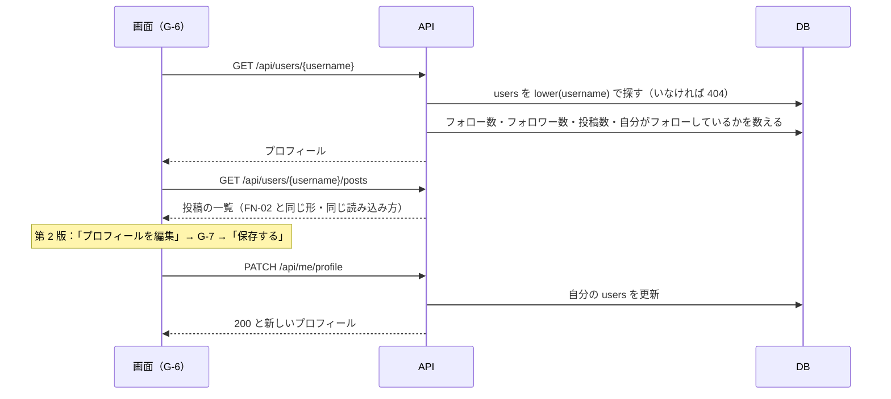
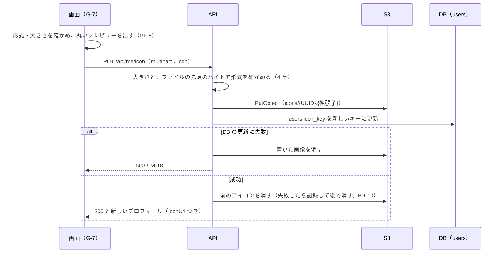

# 機能定義書 FN-09 プロフィール：タイムライン型 SNS アプリ（Raise timeline）

| 項目 | 内容 |
| --- | --- |
| 文書番号 | RT-FD-09 |
| 版数 | 0.2 |
| 作成日 | 2026-10-16 |
| 最終更新日 | 2026-10-17 |
| 作成者 | （氏名） |
| 上位文書 | [機能定義書](function-definition.md)（RT-FD） |
| 状態 | 承認待ち |

## 改訂履歴

| 版数 | 日付 | 内容 | 作成者 |
| --- | --- | --- | --- |
| 0.1 | 2026-10-16 | 初版。機能要件定義書 2.9（PF-1〜PF-7）を移し、3 章以降を追加 | （氏名） |
| 0.2 | 2026-10-17 | アイコン画像の設定・表示（第 2 版。PF-8〜PF-10）を追加し、3〜10 章を直した | （氏名） |

本書は機能定義書の一部である。承認は[機能定義書](function-definition.md)で一括して行う。API とメッセージの共通の決まりは機能定義書 3 章・4 章のとおり。

---

## 1. 概要

| 項目 | 内容 |
| --- | --- |
| 目的 | ユーザーがどんな人で、どんな投稿をしているかを見られるようにし、自分のアイコン画像・表示名・自己紹介を変えられるようにする |
| 版 | 第 1 版（表示）、第 2 版（編集） |
| 使う画面 | G-6 プロフィール画面、G-7 プロフィールの編集画面（第 2 版） |
| 関係する機能 | FN-07 フォロー（フォローボタン・件数）、FN-03 投稿（投稿の一覧）、FN-01 ユーザー登録（表示名の条件）、FN-04 画像（形式の確かめ方・署名付き URL） |
| 前提 | アイコン画像は第 2 版で作る。第 1 版と、アイコンを設定していない人は、表示名の頭文字を丸の中に出す。アイコン画像は投稿の画像と同じく S3 に置き、署名付き URL で見せる（N-14） |

## 2. 機能要件

### 第 1 版

| ID | 内容 |
| --- | --- |
| PF-1 | プロフィール画面（G-6）に、表示名・@ユーザー ID・自己紹介・登録した年月・フォロー数・フォロワー数・投稿数を出す |
| PF-2 | G-6 の下に、その人の投稿を新しい順に 20 件ずつ出す。読み込み方は T-2 と同じ |
| PF-3 | ほかの人の G-6 には「フォローする／フォロー中」ボタンを出す（F-1・F-2）。自分の G-6 には「プロフィールを編集」ボタンを出す（第 2 版） |
| PF-4 | 存在しないユーザー ID の G-6 を開いたときは M-17 を表示する |

### 第 2 版

| ID | 内容 |
| --- | --- |
| PF-5 | 「プロフィールを編集」を押すと、プロフィールの編集画面（G-7）を開く。表示名と自己紹介を変えて「保存する」を押すと反映し、G-6 に戻る。「キャンセル」では反映せずに G-6 に戻る |
| PF-6 | 表示名の条件は A-4 と同じとする。自己紹介は 0〜160 文字で、改行を入れられる。161 文字目以降は入力できない |
| PF-7 | ユーザー ID とパスワードは G-7 では変えられない |
| PF-8 | G-7 の「画像を選ぶ」でアイコン画像を選ぶと、丸く切り抜いたプレビューを出す。選べるのは 5MB までの JPEG・PNG・WebP で、それ以外は選ばずに M-21 を表示する。形式はファイルの中身でも確かめる。「保存する」で表示名・自己紹介と一緒に反映する |
| PF-9 | アイコンを設定している人の G-7 には「アイコンを外す」を出す。押して「保存する」と、アイコンをなくして頭文字の丸に戻す |
| PF-10 | アイコンを設定した人は、頭文字の丸を出していたすべての場所（ヘッダー・投稿カード・コメント・ユーザーの行・G-6）に、その画像を丸く切り抜いて出す。画像の縦横の比は保ち、はみ出した部分は切る（中央に合わせる）。画像を読めないとき（URL の期限切れなど）は頭文字の丸を出す |

## 3. 処理の流れ



### 3.1 アイコン画像の設定（第 2 版）

G-7 の「保存する」で、アイコンを変えたときだけ先にアイコンの API を呼び、成功したら PATCH /api/me/profile を呼ぶ。どちらかが失敗したら G-7 に残り、M-18 を出す（先に成功した分は反映されたままになる）。



「アイコンを外す」のときは DELETE /api/me/icon を呼ぶ。users.icon_key を空にしてから、S3 の前のアイコンを消す（BR-10）。

## 4. 入力の確認（第 2 版）

| 項目 | 型 | 必須 | 条件 | 守られないとき |
| --- | --- | --- | --- | --- |
| displayName（表示名） | 文字列 | ○ | トリム後 1〜30 文字 | M-5（400 DISPLAY_NAME_REQUIRED） |
| bio（自己紹介） | 文字列 | | トリム後 0〜160 文字。途中の改行はそのまま残す | 400 BIO_TOO_LONG（画面では 161 文字目を入力できないので出ない） |
| icon（アイコン画像） | ファイル | ○（PUT /api/me/icon のとき） | 5,242,880 バイト以下。JPEG・PNG・WebP（先頭のバイトの確かめ方は FN-04 の 4 章と同じ。GIF は使えない） | M-21（API は 413 ICON_TOO_LARGE・400 ICON_TYPE_INVALID） |

## 5. 業務ルール

| No | ルール |
| --- | --- |
| 1 | URL の {username} は大文字・小文字を区別しない。画面には登録したときの書き方で出す |
| 2 | 件数（フォロー数・フォロワー数・投稿数）は、表示した時点の値。自分のフォロー操作は、そのボタンがある画面ではすぐに ±1 する |
| 3 | 表示名を変えたら、過去の投稿・コメントにも新しい表示名を出す（投稿には表示名を保存せず、ユーザーからたどるため） |
| 4 | 「登録した年月」は users.created_at を日本時間にした年月（例：2026年10月から利用） |
| 5 | アイコンの S3 のキーは「icons/{UUID}.{形式から決めた拡張子}」とする。元のファイル名は使わない。変えるたびに新しいキーにする（同じキーに上書きしない。ブラウザに古い画像が残らないようにするため） |
| 6 | アイコン画像の縮小・切り抜き・変換は、サーバーではしない（第 2 版）。丸く切り抜くのは画面の表示だけ。写真の位置情報（Exif）は消さないため、操作マニュアルで注意する |
| 7 | アイコンの URL は、投稿の画像と同じく有効期限 15 分の署名付き URL とし、プロフィール・PostView・UserSummary・コメントを返すたびに作る。期限が切れたら PF-10 のとおり頭文字の丸を出し、次にその画面を読み込んだときに新しい URL で出す |

## 6. API（案）

| メソッド | URL | 入力 | 出力（成功） | 主なエラー |
| --- | --- | --- | --- | --- |
| GET | /api/users/{username} | なし | 200 プロフィール | 404 USER_NOT_FOUND |
| GET | /api/users/{username}/posts?cursor= | cursor | 200 `{"items":[PostView…],"nextCursor":…}` | 404 USER_NOT_FOUND |
| PATCH | /api/me/profile（第 2 版） | `{"displayName":"…","bio":"…"}` | 200 プロフィール | 400 DISPLAY_NAME_REQUIRED・BIO_TOO_LONG |
| PUT | /api/me/icon（第 2 版） | multipart：icon（ファイル 1 個） | 200 プロフィール | 400 ICON_TYPE_INVALID、413 ICON_TOO_LARGE、500 ICON_UPLOAD_FAILED |
| DELETE | /api/me/icon（第 2 版） | なし | 204 | |

プロフィールの形：

```json
{
  "username": "taro_y",
  "displayName": "たろう",
  "bio": "川沿いを散歩するのが好きです",
  "iconUrl": null,
  "joinedAt": "2026-10-01T00:00:00Z",
  "followingCount": 12,
  "followerCount": 8,
  "postCount": 30,
  "followedByMe": false,
  "me": false
}
```

自分のプロフィールを変える API は URL にユーザー ID を入れない（/api/me）。ほかの人のユーザー ID を入れて変えられないようにするため。

## 7. 使うデータ

| テーブル | 操作 | 内容 |
| --- | --- | --- |
| users | R U | プロフィールの表示・編集（U は第 2 版。アイコンの置き場所 icon_key を含む） |
| S3（icons/） | C R D | アイコン画像の保存・署名付き URL の発行・前のアイコンの削除（第 2 版） |
| follows | R | フォロー数・フォロワー数・自分がフォローしているか |
| posts（と画像・いいね・コメント） | R | 投稿数と投稿の一覧 |

## 8. 権限

| 操作 | 本人 | 第三者 |
| --- | --- | --- |
| プロフィールと投稿の一覧を見る | できる | できる |
| 表示名・自己紹介・アイコンを変える（第 2 版） | できる | できない（API は自分のものしか変えない） |
| アイコンを見る | できる | できる |

## 9. エラーとメッセージ

| 場面 | HTTP | code | メッセージ |
| --- | --- | --- | --- |
| ユーザーがいない | 404 | USER_NOT_FOUND | M-17 |
| 表示名が空 | 400 | DISPLAY_NAME_REQUIRED | M-5 |
| アイコンが 5MB を超える | 413 | ICON_TOO_LARGE | M-21 |
| アイコンの形式が違う（GIF・拡張子を変えたファイルを含む） | 400 | ICON_TYPE_INVALID | M-21 |
| アイコンの S3 への保存に失敗 | 500 | ICON_UPLOAD_FAILED | M-18。入力した内容は残す |
| 保存に失敗 | 500 | INTERNAL_ERROR | M-18。入力した内容は残す |
| 読み込みに失敗 | 500 | INTERNAL_ERROR | M-9 と「再読み込み」 |

## 10. テストの観点

- /users/TARO_Y と /users/taro_y で同じ人のプロフィールが出る
- 自分のプロフィールにはフォローボタンが出ず、ほかの人のプロフィールには出る
- 件数が、フォロー・フォロワー・投稿の実際の数と合っている
- 存在しないユーザー ID で M-17 が出る
- （第 2 版）表示名を変えると、過去の投稿カードの表示名も変わる。自己紹介 160 文字は保存でき、161 文字目は入力できない
- （第 2 版）ほかの人の表示名を変える方法がない（API に他人を指定する入力がない）
- （第 2 版）5MB ちょうどの JPEG・PNG・WebP はアイコンにでき、5MB＋1 バイト・GIF・拡張子を .png に変えたテキストファイルは M-21（API に直接送っても 400・413）
- （第 2 版）アイコンを設定すると、ヘッダー・自分の過去の投稿カード・コメント・ユーザーの行・G-6 のすべてで頭文字の丸が画像に替わる。縦長・横長の画像も、つぶれずに丸く出る
- （第 2 版）アイコンを変えると、S3 の前のアイコンが消える。「アイコンを外す」で頭文字の丸に戻り、S3 のファイルも消える
- （第 2 版）MinIO を止めた状態でアイコンを保存すると M-18 で、users.icon_key は変わっていない
- （第 2 版）S3 のバケットの icons/ の URL を直接開いても画像が見られない（403）
