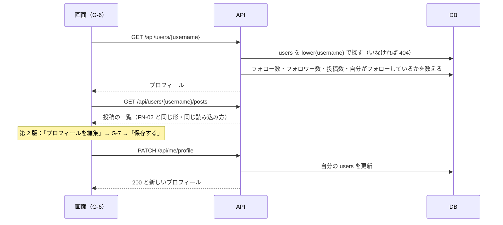

# 機能定義書 FN-09 プロフィール：タイムライン型 SNS アプリ（Raise timeline）

| 項目 | 内容 |
| --- | --- |
| 文書番号 | RT-FD-09 |
| 版数 | 0.1 |
| 作成日 | 2026-10-16 |
| 最終更新日 | 2026-10-16 |
| 作成者 | （氏名） |
| 上位文書 | [機能定義書](function-definition.md)（RT-FD） |
| 状態 | 承認待ち |

## 改訂履歴

| 版数 | 日付 | 内容 | 作成者 |
| --- | --- | --- | --- |
| 0.1 | 2026-10-16 | 初版。機能要件定義書 2.9（PF-1〜PF-7）を移し、3 章以降を追加 | （氏名） |

本書は機能定義書の一部である。承認は[機能定義書](function-definition.md)で一括して行う。API とメッセージの共通の決まりは機能定義書 3 章・4 章のとおり。

---

## 1. 概要

| 項目 | 内容 |
| --- | --- |
| 目的 | ユーザーがどんな人で、どんな投稿をしているかを見られるようにし、自分の表示名と自己紹介を変えられるようにする |
| 版 | 第 1 版（表示）、第 2 版（編集） |
| 使う画面 | G-6 プロフィール画面、G-7 プロフィールの編集画面（第 2 版） |
| 関係する機能 | FN-07 フォロー（フォローボタン・件数）、FN-03 投稿（投稿の一覧）、FN-01 ユーザー登録（表示名の条件） |
| 前提 | アイコン画像はない。表示名の頭文字を丸の中に出す（要件定義書 2.2） |

## 2. 機能要件

### 第 1 版

| ID | 内容 |
| --- | --- |
| PF-1 | プロフィール画面（G-6）に、表示名・@ユーザー ID・自己紹介・登録した年月・フォロー数・フォロワー数・投稿数を出す |
| PF-2 | G-6 の下に、その人の投稿を新しい順に 20 件ずつ出す。読み込み方は T-2 と同じ |
| PF-3 | ほかの人の G-6 には「フォローする／フォロー中」ボタンを出す（F-1・F-2）。自分の G-6 には「プロフィールを編集」ボタンを出す（第 2 版） |
| PF-4 | 存在しないユーザー ID の G-6 を開いたときは M-17 を表示する |

### 第 2 版

| ID | 内容 |
| --- | --- |
| PF-5 | 「プロフィールを編集」を押すと、プロフィールの編集画面（G-7）を開く。表示名と自己紹介を変えて「保存する」を押すと反映し、G-6 に戻る。「キャンセル」では反映せずに G-6 に戻る |
| PF-6 | 表示名の条件は A-4 と同じとする。自己紹介は 0〜160 文字で、改行を入れられる。161 文字目以降は入力できない |
| PF-7 | ユーザー ID とパスワードは G-7 では変えられない |

## 3. 処理の流れ



## 4. 入力の確認（第 2 版）

| 項目 | 型 | 必須 | 条件 | 守られないとき |
| --- | --- | --- | --- | --- |
| displayName（表示名） | 文字列 | ○ | トリム後 1〜30 文字 | M-5（400 DISPLAY_NAME_REQUIRED） |
| bio（自己紹介） | 文字列 | | トリム後 0〜160 文字。途中の改行はそのまま残す | 400 BIO_TOO_LONG（画面では 161 文字目を入力できないので出ない） |

## 5. 業務ルール

| No | ルール |
| --- | --- |
| 1 | URL の {username} は大文字・小文字を区別しない。画面には登録したときの書き方で出す |
| 2 | 件数（フォロー数・フォロワー数・投稿数）は、表示した時点の値。自分のフォロー操作は、そのボタンがある画面ではすぐに ±1 する |
| 3 | 表示名を変えたら、過去の投稿・コメントにも新しい表示名を出す（投稿には表示名を保存せず、ユーザーからたどるため） |
| 4 | 「登録した年月」は users.created_at を日本時間にした年月（例：2026年10月から利用） |

## 6. API（案）

| メソッド | URL | 入力 | 出力（成功） | 主なエラー |
| --- | --- | --- | --- | --- |
| GET | /api/users/{username} | なし | 200 プロフィール | 404 USER_NOT_FOUND |
| GET | /api/users/{username}/posts?cursor= | cursor | 200 `{"items":[PostView…],"nextCursor":…}` | 404 USER_NOT_FOUND |
| PATCH | /api/me/profile（第 2 版） | `{"displayName":"…","bio":"…"}` | 200 プロフィール | 400 DISPLAY_NAME_REQUIRED・BIO_TOO_LONG |

プロフィールの形：

```json
{
  "username": "taro_y",
  "displayName": "たろう",
  "bio": "川沿いを散歩するのが好きです",
  "joinedAt": "2026-10-01T00:00:00Z",
  "followingCount": 12,
  "followerCount": 8,
  "postCount": 30,
  "followedByMe": false,
  "me": false
}
```

自分のプロフィールを変える API は URL にユーザー ID を入れない（/api/me）。ほかの人のユーザー ID を入れて変えられないようにするため。

## 7. 使うデータ

| テーブル | 操作 | 内容 |
| --- | --- | --- |
| users | R U | プロフィールの表示・編集（U は第 2 版） |
| follows | R | フォロー数・フォロワー数・自分がフォローしているか |
| posts（と画像・いいね・コメント） | R | 投稿数と投稿の一覧 |

## 8. 権限

| 操作 | 本人 | 第三者 |
| --- | --- | --- |
| プロフィールと投稿の一覧を見る | できる | できる |
| 表示名・自己紹介を変える（第 2 版） | できる | できない（API は自分のものしか変えない） |

## 9. エラーとメッセージ

| 場面 | HTTP | code | メッセージ |
| --- | --- | --- | --- |
| ユーザーがいない | 404 | USER_NOT_FOUND | M-17 |
| 表示名が空 | 400 | DISPLAY_NAME_REQUIRED | M-5 |
| 保存に失敗 | 500 | INTERNAL_ERROR | M-18。入力した内容は残す |
| 読み込みに失敗 | 500 | INTERNAL_ERROR | M-9 と「再読み込み」 |

## 10. テストの観点

- /users/TARO_Y と /users/taro_y で同じ人のプロフィールが出る
- 自分のプロフィールにはフォローボタンが出ず、ほかの人のプロフィールには出る
- 件数が、フォロー・フォロワー・投稿の実際の数と合っている
- 存在しないユーザー ID で M-17 が出る
- （第 2 版）表示名を変えると、過去の投稿カードの表示名も変わる。自己紹介 160 文字は保存でき、161 文字目は入力できない
- （第 2 版）ほかの人の表示名を変える方法がない（API に他人を指定する入力がない）
