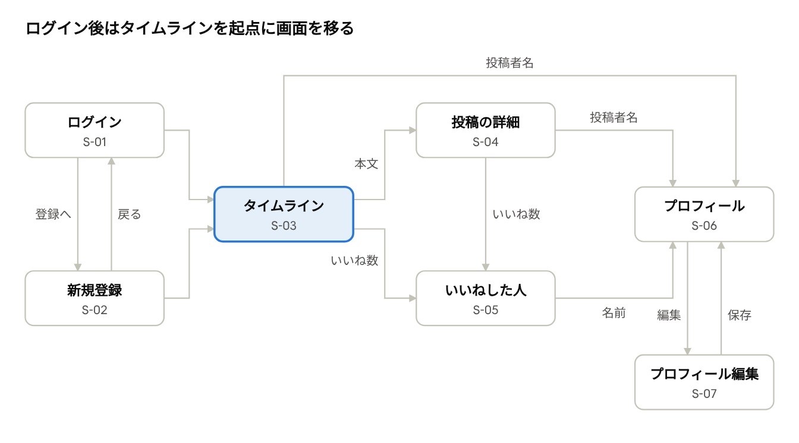
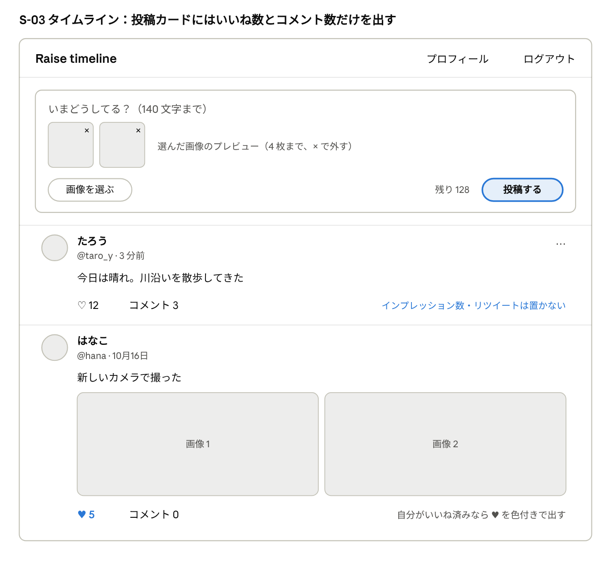
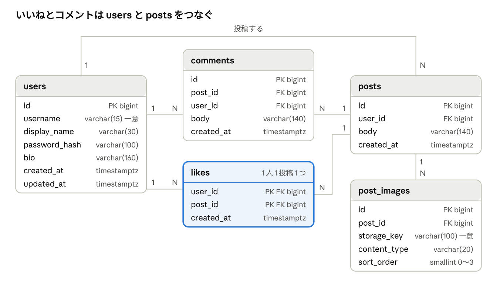

# Raise timeline 要件定義書

更新日: 2026-10-16 · 作成: @神崎 · 元の文書: Claude Docs「Raise timeline 要件定義書」

## 1. 概要

Spring Boot・React・PostgreSQL で、X（Twitter）のようなタイムライン形式のテキスト SNS を作る。複数のユーザーが投稿し、互いの投稿にいいね・コメントできる。インプレッション数を出さないこと、リツイートがないことが他の SNS との違い。

| 項目 | 内容 |
| --- | --- |
| アプリ名 | Raise timeline |
| 目的 | 学習。複数ユーザー・認証・画像アップロード・多対多の関係を持つ Web アプリの設計と実装を学ぶ |
| 想定利用者 | 登録した複数のユーザー（受託開発ではないが、不特定の人が使う前提で設計する） |
| 利用場面 | 短い文章や画像を投稿し、ほかのユーザーの投稿を新しい順に読み、いいね・コメントで反応する |
| 技術 | Spring Boot（API）・React（画面）・PostgreSQL（DB）。kadai と同じ構成 |
| 作る機能 | ログイン、タイムライン、コメント、いいね、画像投稿（3. 機能一覧） |
| リポジトリ | https://github.com/y0408e0301-star/raise-timeline |

### 他の SNS との違い

| 違い | 内容 | ねらい |
| --- | --- | --- |
| インプレッションを出さない | 投稿が何回表示されたかは記録も表示もしない | 数字を気にせず投稿できるようにする |
| リツイートがない | 他人の投稿を自分のタイムラインに再投稿する機能を作らない | 投稿が本人の言葉だけで広がり、拡散を目的にしない |
| 反応は誰でも見える | いいね・コメントの件数と、誰がいいね・コメントしたかは投稿者以外にも見える | 第三者にもその投稿への反応が分かるようにする |

### 今回は作らないもの

フォロー、リツイート（引用を含む）、インプレッション、ダイレクトメッセージ、通知、検索、ハッシュタグ、投稿の編集、ブロック・ミュート、管理者画面。

## 2. 用語

| 用語 | 意味 | 例 |
| --- | --- | --- |
| ユーザー | アカウントを登録してログインした人 | 山田太郎 |
| ユーザー ID | ログインとプロフィールの URL に使う、他と重ならない英数字の名前。画面では @ を付けて出す | @taro\_y |
| 表示名 | 投稿やコメントに表示する名前。他の人と同じでもよい | たろう |
| 投稿 | ユーザーがタイムラインに出す文章。画像を添えられる | 「今日は晴れ」＋写真 1 枚 |
| タイムライン | 全ユーザーの投稿を新しい順に並べた一覧 | ホーム画面 |
| コメント | 投稿に付ける文章の返信。コメントへのコメントはできない | 「いい写真ですね」 |
| いいね | 投稿への好意の印。1 人 1 投稿に 1 つ。取り消せる | ♥ 12 |
| 第三者 | その投稿の投稿者でも、いいね・コメントした本人でもないユーザー | タイムラインを読んでいる別の人 |

## 3. 機能一覧

必須は F-01〜F-12。必須を作り終えたら F-13・F-14 を足す。

| ID | 分類 | 機能 | 内容 | 優先度 |
| --- | --- | --- | --- | --- |
| F-01 | ログイン | ユーザー登録 | ユーザー ID・表示名・パスワードを入力してアカウントを作る。作ったらそのままログインする | 必須 |
| F-02 | ログイン | ログイン | ユーザー ID とパスワードでログインする。ログインしていないと他の画面は使えない | 必須 |
| F-03 | ログイン | ログアウト | ログアウトしてログイン画面に戻る | 必須 |
| F-04 | タイムライン | タイムライン表示 | 全ユーザーの投稿を新しい順に 20 件ずつ出す。下まで読むと次の 20 件を読み込む | 必須 |
| F-05 | タイムライン | テキスト投稿 | 140 文字までの文章を投稿する | 必須 |
| F-06 | タイムライン | 投稿の削除 | 自分の投稿を削除する。削除の前に確認する | 必須 |
| F-07 | タイムライン | 投稿の詳細 | 1 つの投稿と、そのコメント一覧を出す | 必須 |
| F-08 | 画像投稿 | 画像の添付 | 投稿に画像を 4 枚まで添える。添える前にプレビューを出し、外せる | 必須 |
| F-09 | 画像投稿 | 画像の表示 | タイムラインと詳細に画像を並べて出し、押すと大きく表示する | 必須 |
| F-10 | コメント | コメントする・削除する | 投稿に 140 文字までのコメントを付ける。自分のコメントは削除できる | 必須 |
| F-11 | いいね | いいねする・取り消す | 投稿の ♥ を押すといいね、もう一度押すと取り消す。自分の投稿にもできる | 必須 |
| F-12 | いいね・コメント | 件数と一覧の公開 | どの投稿にもいいね数とコメント数を出す。件数を押すと、いいねした人の一覧を出す。誰でも見られる | 必須 |
| F-13 | ユーザー | プロフィール | ユーザーの表示名・自己紹介・投稿一覧を出す。投稿の名前を押すと開く | 推奨 |
| F-14 | ユーザー | プロフィールの編集 | 自分の表示名と自己紹介（160 文字まで）を変える | 推奨 |

## 4. 機能要件の詳細

いいね・コメントは誰でも見られるが、消せるのは付けた本人だけ。画面でボタンを隠すだけでなく、API でも本人かどうかを確かめる。

### 4.1 入力の決まり

| 項目 | 決まり | 守られないとき |
| --- | --- | --- |
| ユーザー ID | 3〜15 文字。半角英数字と \_ だけ。大文字・小文字を区別せず、他の人と重ならない。登録後は変えられない | 「このユーザー ID は使われています」などを入力欄の下に出す |
| 表示名 | 1〜30 文字 | 同上 |
| パスワード | 8〜64 文字。英字と数字を両方含む | 同上 |
| 投稿の本文 | 1〜140 文字。画像が 1 枚以上あれば空でもよい。前後の空白は数えない | 投稿ボタンを押せなくし、残り文字数を赤で出す |
| 画像 | 1 投稿 4 枚まで。JPEG・PNG・GIF・WebP。1 枚 5 MB まで | 添えようとした画像の横に理由を出す |
| コメント | 1〜140 文字 | 投稿と同じ |
| 自己紹介 | 0〜160 文字 | 入力欄の下に出す |

文字数は見た目の 1 文字を 1 と数える（絵文字も 1 文字）。画面と API の両方で確かめ、両方の数え方をそろえる。

### 4.2 公開範囲と権限

| できること | 投稿者 | 第三者 | ログインしていない人 |
| --- | --- | --- | --- |
| 投稿・画像を見る | できる | できる | できない |
| いいね数・コメント数を見る | できる | できる | できない |
| いいねした人の一覧・コメントの中身を見る | できる | できる | できない |
| いいね・コメントする | できる | できる | できない |
| 投稿を削除する | できる | できない | できない |
| コメントを削除する | 自分のコメントだけ | 自分のコメントだけ | できない |
| いいねを取り消す | 自分のいいねだけ | 自分のいいねだけ | できない |

投稿者も、自分の投稿に他人が付けたコメントは消せない。権限のない操作を API に送ったら 403、ログインしていなければ 401 を返す。

### 4.3 いいねと件数の決まり

- いいねは 1 人 1 投稿に 1 つ。続けて押しても 2 つにはならない（DB の一意制約で守る）
- いいねした投稿は ♥ を色付きで出し、自分がいいねしたかどうか分かるようにする
- いいね数・コメント数は、画面を開いたときの値を出す。自分が押したときはすぐに ±1 する。他人の操作を自動で反映はしない
- 0 件のときも「0」と出す
- いいねした人の一覧は新しくいいねした順、コメント一覧は古い順に並べる

### 4.4 削除の決まり

- 投稿を削除すると、その画像・コメント・いいねも一緒に消す。削除は取り消せない
- 削除された投稿の詳細を開いたら「この投稿は削除されました」と出す（API は 404）

## 5. 非機能要件

不特定の人が使う前提なので、パスワードと画像アップロードの守りを最初から入れる。

| 分類 | 要件 |
| --- | --- |
| 認証 | Spring Security のセッション認証（Cookie）。Cookie は HttpOnly・SameSite=Lax。公開環境では Secure も付ける |
| パスワード | BCrypt でハッシュ化して保存する。平文では保存もログ出力もしない |
| セキュリティ | CSRF 対策を有効にする。投稿・コメントは React の通常の表示でエスケープし、HTML としては出さない。SQL は JPA のパラメーターで組み立てる |
| 画像 | 拡張子だけでなくファイルの中身で形式を確かめる。保存名は UUID にして元の名前を使わない。最初はサーバーのフォルダーに置き、公開するときに S3 などへ移せるように保存先を 1 か所にまとめる |
| 性能 | タイムライン 20 件の API は 1 秒以内に返す（投稿 1 万件のとき）。いいね数・コメント数は投稿ごとに数え直さず、まとめて取る（N+1 を作らない） |
| ページング | 最後に読んだ投稿の ID より古いものを 20 件取る（カーソル方式）。読んでいる途中で新しい投稿が増えても重ならない |
| 時刻 | DB には UTC で保存し、画面では日本時間で「3 分前」「10月16日」のように出す |
| 対応環境 | Chrome・Edge・Safari・Firefox の最新版。スマートフォンの幅（375 px）でも崩れない |
| 品質 | API は JUnit＋MockMvc、画面は Vitest＋Testing Library でテストを書く。lint・書式・テストを GitHub Actions で PR ごとに動かす |
| 開発環境 | PostgreSQL は Docker Compose で 5432、Spring Boot は 8080、Vite は 5173 で起動する。テーブルは Flyway で作る |

## 6. 画面一覧と画面遷移

画面は 7 つ。ログイン後はタイムラインが起点になり、どの画面からも上のヘッダーでタイムライン・自分のプロフィール・ログアウトに移れる。

| ID | 画面 | URL | 主な機能 | ログイン |
| --- | --- | --- | --- | --- |
| S-01 | ログイン | /login | F-02 | 不要 |
| S-02 | 新規登録 | /signup | F-01 | 不要 |
| S-03 | タイムライン | / | F-04, F-05, F-06, F-08, F-09, F-11, F-12 | 必要 |
| S-04 | 投稿の詳細 | /posts/{投稿 ID} | F-06, F-07, F-09, F-10, F-11, F-12 | 必要 |
| S-05 | いいねした人 | /posts/{投稿 ID}/likes | F-12 | 必要 |
| S-06 | プロフィール | /users/{ユーザー ID} | F-13 | 必要 |
| S-07 | プロフィールの編集 | /settings/profile | F-14 | 必要 |

ログインか登録をするとタイムラインに入る。そこから投稿カードの押した場所で行き先が変わる。図にない線として、どの画面からもヘッダーで S-03・S-06（自分）へ移れ、ログアウトで S-01 に戻る。

画像の拡大表示と削除の確認は、別の画面にしないでその場に重ねて出す（ダイアログ）。ログインしていない人が S-03〜S-07 を開くと S-01 に移し、ログイン後に元の画面へ戻す。

## 7. 画面設計

どの画面も投稿は同じ「投稿カード」で出し、カードにはいいね数とコメント数だけを並べる。インプレッション数とリツイートのボタンは置かない。

上が投稿フォーム、下が新しい順の投稿カード。S-04・S-06 も同じカードを使い、画面の幅は中央の 1 列（最大 600 px 程度）にする。

### 7.1 投稿カード（S-03・S-04・S-06 で共通）

| 要素 | 内容 | 押したとき |
| --- | --- | --- |
| 表示名・@ユーザー ID | 投稿者 | S-06 へ |
| 投稿日時 | 「3 分前」「10月16日」 | — |
| 本文 | 改行をそのまま出す。URL はリンクにしない | S-04 へ（S-04 では何もしない） |
| 画像 | 1〜4 枚をタイル状に並べる | 拡大表示のダイアログ |
| ♡ いいねボタン | 自分がいいね済みなら ♥（色付き） | いいね・取り消し |
| いいね数 | 0 以上の数 | S-05 へ |
| コメント数 | 吹き出しの絵と数 | S-04 へ |
| … メニュー | 自分の投稿にだけ出す | 「削除」→ 確認ダイアログ |

### 7.2 画面ごとの要素

| 画面 | 要素 |
| --- | --- |
| S-01 ログイン | ユーザー ID、パスワード、「ログイン」ボタン、「アカウントを作る」リンク（S-02 へ）。間違えたときは「ユーザー ID かパスワードが違います」とだけ出し、どちらが違うかは言わない |
| S-02 新規登録 | ユーザー ID、表示名、パスワード、パスワード（確認）、「登録する」ボタン、「ログイン」リンク（S-01 へ） |
| S-03 タイムライン | ヘッダー（アプリ名、自分のプロフィール、ログアウト）、投稿フォーム（本文、残り文字数、画像を選ぶボタン、選んだ画像のプレビューと ×、「投稿する」ボタン）、投稿カードの一覧。一番下まで読むと次の 20 件を読み込む |
| S-04 投稿の詳細 | 「← 戻る」、投稿カード（画像は大きめ）、コメントフォーム（本文、残り文字数、「コメントする」）、コメントの一覧（表示名、@ユーザー ID、日時、本文、自分のコメントにだけ「削除」） |
| S-05 いいねした人 | 「← 戻る」、「いいね 12 件」のような見出し、ユーザーの一覧（表示名、@ユーザー ID。押すと S-06 へ） |
| S-06 プロフィール | 表示名、@ユーザー ID、自己紹介、登録した月、投稿数、自分のときだけ「編集」ボタン（S-07 へ）、その人の投稿カードの一覧 |
| S-07 プロフィールの編集 | 表示名、自己紹介、「保存する」（S-06 へ戻る）、「キャンセル」 |

## 8. ER 図とテーブル定義

テーブルは 5 つ。いいねは users と posts をつなぐ多対多の中間テーブルで、主キー（user\_id, post\_id）で 1 人 1 投稿 1 つを守る。インプレッションとリツイートのテーブルは作らない。いいね数・コメント数は列に持たず、その都度 COUNT で数える。

1 の側が親、N の側が子。posts を消すと post\_images・comments・likes が一緒に消える（ON DELETE CASCADE）。

### users（ユーザー）

| カラム | 型 | 制約 | 説明 |
| --- | --- | --- | --- |
| id | bigint | PK、自動採番 |  |
| username | varchar(15) | NOT NULL、lower(username) で一意 | ユーザー ID |
| display\_name | varchar(30) | NOT NULL | 表示名 |
| password\_hash | varchar(100) | NOT NULL | BCrypt のハッシュ |
| bio | varchar(160) | NOT NULL、既定 '' | 自己紹介 |
| created\_at | timestamptz | NOT NULL、既定 now() | 登録日時 |
| updated\_at | timestamptz | NOT NULL、既定 now() |  |

### posts（投稿）

| カラム | 型 | 制約 | 説明 |
| --- | --- | --- | --- |
| id | bigint | PK、自動採番 | タイムラインの並び順とカーソルに使う |
| user\_id | bigint | NOT NULL、FK users.id | 投稿者 |
| body | varchar(140) | NOT NULL、既定 '' | 本文。画像なしのとき空にしないのは API で確かめる |
| created\_at | timestamptz | NOT NULL、既定 now() | 投稿日時 |

索引：(user\_id, id DESC)（プロフィールの投稿一覧）

### post\_images（投稿の画像）

| カラム | 型 | 制約 | 説明 |
| --- | --- | --- | --- |
| id | bigint | PK、自動採番 |  |
| post\_id | bigint | NOT NULL、FK posts.id ON DELETE CASCADE |  |
| storage\_key | varchar(100) | NOT NULL、一意 | 保存先での名前（UUID＋拡張子） |
| content\_type | varchar(20) | NOT NULL | image/jpeg など |
| sort\_order | smallint | NOT NULL、0〜3、(post\_id, sort\_order) で一意 | 並べ順 |

### comments（コメント）

| カラム | 型 | 制約 | 説明 |
| --- | --- | --- | --- |
| id | bigint | PK、自動採番 |  |
| post\_id | bigint | NOT NULL、FK posts.id ON DELETE CASCADE | コメント先の投稿 |
| user\_id | bigint | NOT NULL、FK users.id | コメントした人 |
| body | varchar(140) | NOT NULL | 本文 |
| created\_at | timestamptz | NOT NULL、既定 now() |  |

索引：(post\_id, id)（投稿ごとの一覧と件数）

### likes（いいね）

| カラム | 型 | 制約 | 説明 |
| --- | --- | --- | --- |
| user\_id | bigint | PK（第 1 列）、FK users.id | いいねした人 |
| post\_id | bigint | PK（第 2 列）、FK posts.id ON DELETE CASCADE | いいねした投稿 |
| created\_at | timestamptz | NOT NULL、既定 now() | S-05 の並び順に使う |

索引：(post\_id, created\_at DESC)（投稿ごとの一覧と件数）

## 9. 未決事項

文字数や枚数などの値は仮のもの。実装を始める前に決める。

- [ ] 投稿・コメント 140 文字、画像 4 枚・5 MB、自己紹介 160 文字でよいか
- [ ] 公開先（AWS など）と、公開するときの画像の保存先（S3 など）
- [ ] ユーザーの退会を作るか。作るなら、その人の投稿・コメント・いいねをどうするか
- [ ] アイコン画像を設定できるようにするか（今は表示名の頭文字を出す）
- [ ] 同じ人が短い間に大量に投稿したときの制限を入れるか
